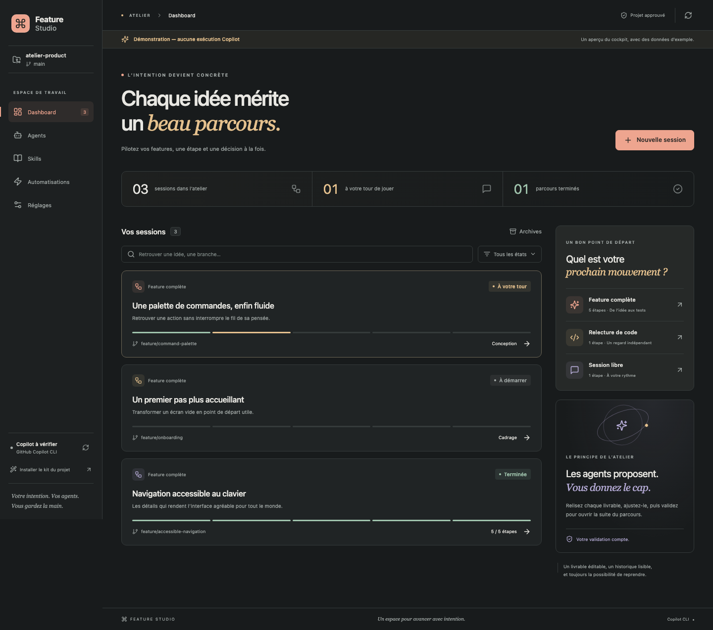

<p align="center"></p>

# Feature Studio

**Un cockpit visuel pour développer avec tes agents GitHub Copilot CLI, directement dans VS Code.**

Une feature devient un parcours : spécifications, plan, développement, tests, relecture. Chaque étape possède son agent, ses skills, son modèle, sa conversation Copilot et ses tentatives. Tu vois ce qui avance, tu réponds aux questions et tu valides avant de continuer.

[Télécharger le VSIX](releases/feature-studio-0.1.0.vsix) · [Architecture](docs/ARCHITECTURE.md) · [Créer un workflow](docs/WORKFLOWS.md) · [Intégration Copilot](docs/COPILOT.md) · [Validation et limites](docs/VALIDATION.md)



## Installation

1. Télécharge **[feature-studio-0.1.0.vsix](releases/feature-studio-0.1.0.vsix)** depuis ce dépôt (bouton Download raw file sur GitHub).
2. Dans VS Code ou VS Code Insiders : **Extensions → … → Installer à partir du VSIX…**.
3. Ouvre le dossier du projet que tu souhaites développer, puis approuve ce workspace.
4. Lance **Feature Studio : ouvrir le cockpit** dans la palette de commandes. Le bouton **Feature Studio** de la barre d’état ouvre aussi le cockpit.
5. Dans **Réglages**, clique sur **Vérifier la connexion**. Le diagnostic vérifie le CLI, le compte et les modèles sans envoyer de prompt.

Prérequis : **VS Code 1.110 ou ultérieur**, Git pour les branches/diffs, et **GitHub Copilot CLI** installé et authentifié avec un abonnement donnant accès au CLI. Installer le VSIX ne nécessite ni Node.js ni npm séparément. Le moteur Node embarqué dans les versions récentes de VS Code est utilisé par l’extension.

Si `copilot` n’est pas trouvé, renseigne le chemin complet dans **Réglages → Chemin du CLI dans VS Code** (`featureStudio.cliPath`). Sur macOS avec Homebrew, ce peut être `/opt/homebrew/bin/copilot`. L’extension ne met pas le CLI à jour automatiquement. Voir [l’installation officielle du CLI](https://docs.github.com/en/copilot/how-tos/copilot-cli/set-up-copilot-cli/install-copilot-cli).

**Feature Studio ouvre son propre onglet de travail.** Il utilise le CLI local et son authentification ; il ne remplace pas les composants internes de la vue Chat de l’extension GitHub Copilot. Les deux interfaces peuvent coexister. Aucun serveur applicatif supplémentaire n’est requis ; les requêtes IA passent naturellement par GitHub Copilot.

## Choisir un parcours

| Parcours | Pour quoi ? | Étapes |
| --- | --- | --- |
| Feature complète | Développer un besoin avec des décisions intermédiaires | Spécifications → plan → développement → tests → relecture |
| Relecture seule | Examiner les changements sans écrire, compiler ou tester | Relecture |
| Session libre | Confier une tâche à un seul agent, dans une vraie conversation | Une étape de développement configurable |

Le tableau de bord affiche les sessions, leur état, leur branche et leur progression. Recherche, filtres et archives permettent de retrouver les anciens travaux. Aucune session d’exemple n’est ajoutée à ton projet.

### Développer une feature

1. Clique **Nouvelle session**, choisis le parcours, donne un titre et décris le résultat attendu.
2. Ouvre une étape. **Configurer** permet de choisir l’agent, le modèle réellement proposé par le CLI, les skills, le raisonnement lorsqu’il est disponible et la limite de tentatives.
3. Clique **Exécuter cette étape**. Son personnage s’anime et l’onglet **Activité** reçoit les messages et les appels d’outils réels.
4. Si l’agent demande des précisions, réponds au formulaire, puis clique **Reprendre la session**. Les réponses sont conservées dans l’historique.
5. Relis le **Livrable**. Tu peux éditer son Markdown et l’enregistrer, ou donner un feedback pour une nouvelle tentative.
6. Clique **Valider cette étape**, puis **Continuer**. La validation débloque l’étape suivante ; elle ne lance pas de requête IA toute seule.
7. Après le développement, consulte **Fichiers → Voir le diff** pour ouvrir les modifications dans VS Code.
8. Configure les commandes de test nécessaires, exécute l’étape Tests, puis lance la relecture indépendante.


**Une correction après la relecture ?** Retourne sur Développement, précise ton feedback dans **Votre retour**, utilise **Rejouer cette étape**, puis fais revalider Tests et Relecture. Les anciens essais restent visibles. Une spécification ou un plan modifié rend également les étapes dépendantes **à actualiser**.

**Arrêter** annule le processus ; les fichiers déjà écrits restent présents pour inspection. Après fermeture ou interruption, la tentative devient annulée ou interrompue. **Reprendre** réutilise son identifiant Copilot ; **Nouvelle tentative** ouvre une nouvelle conversation avec les livrables approuvés et le contexte précédent. Une reprise consomme elle aussi une tentative. Si la limite est atteinte, **Configurer → Limite de tentatives** permet de la relever explicitement.

Les sessions restent liées à leur branche. Change de branche dans VS Code avant de créer la session si tu souhaites isoler une feature. Feature Studio ne crée pas de branche, commit, push, PR ou déploiement à ta place.

## Donner une personnalité aux agents

Dans **Agents**, ouvre un profil et change **Son petit nom**. Choisis l’un des huit personnages : le mage architecte, le hacker au café, le détective, le bûcheron, le scientifique, le robot, le ninja ou le capitaine.

<p>


</p>

Chaque avatar possède une image de repos, un **vrai GIF de travail à quatre images**, puis une pose de validation. Les animations respectent la préférence système de réduction des mouvements. Le pseudo et le personnage sont sauvegardés dans le profil du projet ; le rôle technique reste indépendant du petit nom.

Tu peux modifier les instructions, le modèle et les skills, ou créer un nouvel agent. Une personnalisation d’un profil fourni crée sa version dans `.github/agents/`. Les agents déjà présents dans le projet sont découverts, et leurs fichiers restent utilisables directement avec Copilot.

Les capacités reconnues sont `read`, `search`, `edit`/`write` et `execute`, ainsi que les noms précis des outils `studio_*`. `execute` donne accès uniquement aux commandes de tests déjà autorisées, et seulement dans une étape de profil Tests. Il n’ouvre aucun terminal libre. La permission effective est toujours l’intersection du profil d’étape et des outils de l’agent.

## Skills et kit Copilot

Le **kit Copilot 2.0.0 fourni par Matt** est embarqué avec ses quatre agents, sept skills, six templates et ses scripts. Cinq profils Feature Studio adaptent ce kit aux étapes du cockpit. Les skills sont disponibles immédiatement dans le catalogue.

Clique **Installer le kit du projet** pour matérialiser les agents, skills, templates et scripts dans le dépôt. Les fichiers identiques sont conservés, les fichiers personnalisés ne sont jamais écrasés. Un bilan indique les conflits ; leur détail apparaît dans la sortie **Feature Studio**. Aucun script d’installation, MCP, outil externe ou tâche n’est lancé par cette copie.

Dans **Skills**, tu peux consulter une méthode, éditer son Markdown ou en créer une. Associe-la ensuite au profil d’agent ou à une étape. Feature Studio injecte explicitement les skills sélectionnées dans le contexte. Les instructions générales du dépôt ne sont pas découvertes automatiquement par le runtime isolé : ajoute les règles pertinentes à un agent/skill ; l’agent peut lire `.ai/project.md` et les fichiers qu’on lui indique.

Le runner du kit concerne **.NET/VSTest**. Il est conservé comme option et n’est pas choisi automatiquement pour les projets JavaScript, Python ou d’autres stacks. [Provenance du kit](defaults/PROVENANCE.md).

## Autoriser les tests et les hooks

Dans **Réglages → Commandes de test autorisées**, ajoute un nom, un exécutable et ses arguments **un par ligne**. Par exemple, pour ce dépôt :

| Champ | Valeur |
| --- | --- |
| Nom | Tests unitaires |
| Exécutable | `npm` |
| Arguments | `test` puis `--` puis `--run` (trois lignes) |

Les **Chemins de test** sont des préfixes de dossiers, sans glob : `tests`, `test`, `__tests__` par défaut. Ajuste-les avant de demander la création de tests ailleurs. Le profil Tests peut écrire seulement dans ces dossiers et exécuter uniquement les commandes configurées. Leur code retour, leurs sorties et les échecs sont consignés.

L’enregistrement de nouvelles commandes affiche une confirmation VS Code avec leur contenu exact. Elles tournent sous ton compte : les scripts qu’elles appellent ne sont pas confinés dans une sandbox système. Sur Windows, utilise un exécutable natif (`node.exe`, `dotnet.exe`…) ; les lanceurs `.cmd` ne sont pas pris en charge par ce runner sans shell.

Dans **Automatisations**, les hooks `beforeRun` et `afterRun` exécutent des commandes locales facultatives. Ils sont désactivés à la création et nécessitent une activation explicite. Ils sont ignorés pour les étapes en lecture seule. Les hooks/MCP natifs de Copilot ne sont pas importés ni activés automatiquement.

## Données, permissions et consommation

- Les features, essais, réponses, validations et journaux sont sauvegardés dans le stockage local de l’extension VS Code, par dossier. Le format est versionné et les écritures sont atomiques.
- Les conversations Copilot utilisent un répertoire de données propre à Feature Studio. `~/.copilot` n’est pas modifié. Le trousseau existant est réutilisé si le CLI le permet.
- **Exporter** produit un fichier Markdown avec les livrables et l’historique de la session.
- Un seul cockpit est actif pour un même dossier sur une machine, et une seule tentative tourne à la fois. Cette règle évite les écritures concurrentes.
- Les écritures préexistantes non validées dans Git sont protégées. Les fichiers créés par la même feature peuvent être retravaillés si leur contenu n’a pas été modifié entre-temps. Les suppressions humaines, les chemins sensibles et les liens symboliques sont refusés.
- L’agent ne dispose d’aucun shell générique, outil MCP, accès réseau de navigation ou commande Git d’écriture. Le catalogue réel d’outils est vérifié avant l’envoi du prompt.
- L’interface affiche les tokens, le modèle effectivement utilisé et les nano-AIU uniquement si le CLI les fournit. Une donnée absente reste inconnue ; les nano-AIU ne sont pas des euros. La limite de tentatives aide à maîtriser le nombre d’appels ; il n’y a pas de plafond financier garanti.

## Développer l’extension

Node.js **22.12+** et npm sont nécessaires pour travailler sur les sources.

```bash
npm ci
npm run check          # TypeScript, tests unitaires/intégration, builds
npx playwright install chromium
npm run test:ui        # Parcours webview, sans requêtes IA
npm run test:extension # Vrai hôte VS Code isolé, sans prompt IA
npm run package       # Produit releases/feature-studio-0.1.0.vsix
```

Ouvre le projet et utilise **F5 → Feature Studio** pour un hôte de développement. `npm run dev` ouvre le frontend de développement ; `http://127.0.0.1:5173/?demo=1` affiche des données d’exemple avec un bandeau explicite. Sans ce paramètre et hors VS Code, aucune exécution n’est simulée.

Le test réel facultatif est séparé dans `scripts/smoke-copilot.ts` et exige `FEATURE_STUDIO_LIVE_TEST=1`. Il consomme du quota Copilot. Il ne fait partie ni de `npm test` ni de la CI. Les sources des avatars et leurs prompts sont dans [design/avatars](design/avatars/PROMPTS.md) ; `node scripts/pack-avatars.mjs` reconstruit leurs PNG/GIF.

Voir [la validation livrée et les limites connues](docs/VALIDATION.md) pour distinguer tests automatiques, test du CLI réel, versions testées et plateformes non vérifiées.
