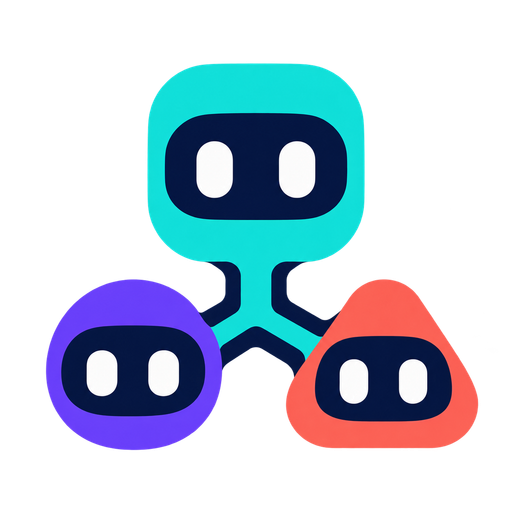
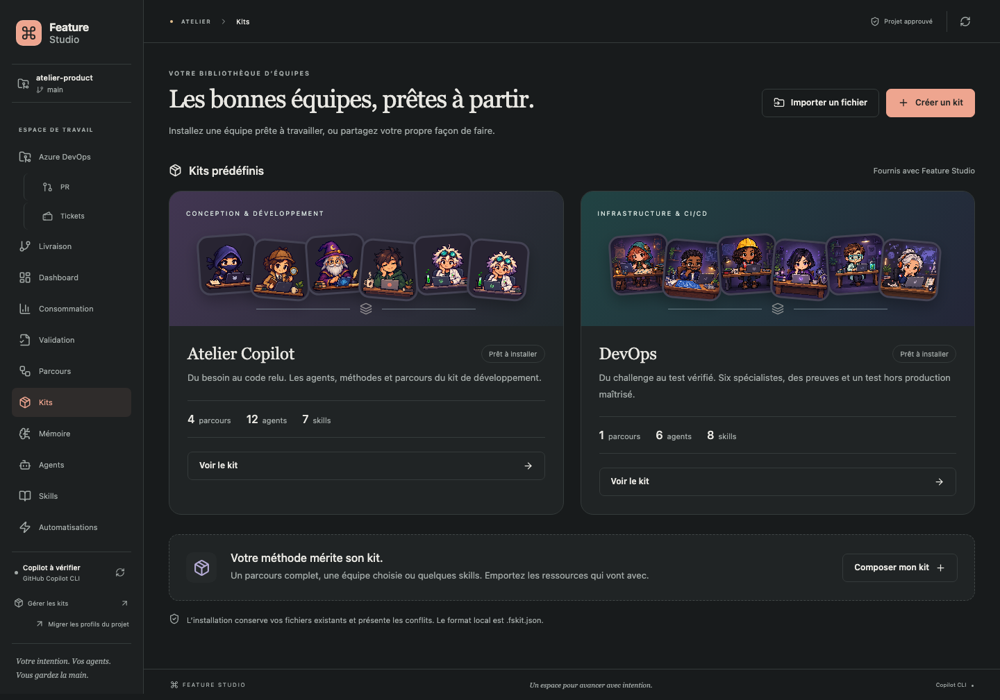
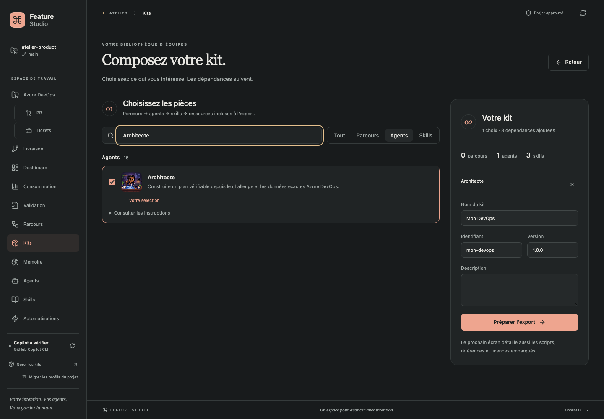

<p align="center"></p>

# Feature Studio

**Ton équipe d’agents Copilot, tes parcours, tes validations. Dans VS Code.**

Pars d’un besoin, choisis une équipe et avance étape par étape : challenge, plan, code, tests, relecture. Feature Studio rend visibles les instructions, le contexte, les permissions et les preuves de chaque agent. Tu peux personnaliser les parcours et emporter ta méthode dans un kit.

**[Dernière version publiée](https://github.com/MattDevBzh/KerAI/releases/latest)** · [Télécharger le VSIX v1.36.1](https://github.com/MattDevBzh/KerAI/releases/download/v1.36.1/feature-studio-1.36.1.vsix) · [Nouveautés](CHANGELOG.md) · [Guide complet](docs/GUIDE.md)

**Version actuelle : 1.36.1.** Correctif du lancement Copilot avec les outils MCP aux noms longs, notamment la lecture des commentaires de Pull Request Azure DevOps. L’espace Relecture de la 1.36.0 est conservé. [Notes de version](docs/releases/v1.36.1.md).

Cette version conserve la connexion au démarrage, les améliorations ergonomiques, les quêtes, les sept ambiances et les discussions liées aux comptes rendus.



## Commencer

1. Télécharge le [VSIX v1.36.1 sur GitHub](https://github.com/MattDevBzh/KerAI/releases/download/v1.36.1/feature-studio-1.36.1.vsix).
2. Dans VS Code : **Extensions → … → Installer à partir du VSIX…**. Si une ancienne version tourne déjà, recharge la fenêtre.
3. Ouvre ton dépôt et approuve le workspace. Clique sur l’icône **L’équipe** (trois agents) dans la barre latérale : Feature Studio s’ouvre directement dans un onglet de la fenêtre VS Code courante et enregistre ton projet.
4. Dans **Réglages**, clique sur **Vérifier la connexion** pour contrôler le CLI, le compte et les modèles disponibles.
5. Ouvre **Nouvelle session**, sélectionne tes projets et décris ton besoin. Choisis **Corriger un problème**, **Développer une évolution**, **Relire des changements** ou **Composer mon équipe**. Les **Options de travail** regroupent le dossier et les permissions, en mode **Manuel** par défaut. Crée la session, relis l’aperçu du contexte actualisé automatiquement, puis lance le premier agent.

Cette version inclut aussi la [consolidation](docs/CONSOLIDATION.md) : première session guidée, dépendance Zod corrigée et découpage des composants.

Après installation, la fiche **Feature Studio** dans Extensions doit afficher **1.36.1**. Installe directement le fichier `.vsix`, sans le décompresser. Son empreinte figure dans le [SHA256SUMS de la release](https://github.com/MattDevBzh/KerAI/releases/download/v1.36.1/SHA256SUMS). Pour la vérifier, calcule `shasum -a 256 feature-studio-1.36.1.vsix` sur macOS/Linux ou `Get-FileHash .\feature-studio-1.36.1.vsix -Algorithm SHA256` sur Windows, puis compare le résultat à la ligne du VSIX dans ce fichier.

**Prérequis :** VS Code **1.110+**, Git et GitHub Copilot CLI installé et authentifié avec un accès au CLI. Le VSIX utilise le moteur Node de VS Code ; il ne nécessite pas une installation séparée de npm. L’extension utilise le CLI local et ton authentification Copilot. Elle possède son propre cockpit et peut coexister avec la vue Chat de GitHub Copilot.

Le couple vérifié pour les outils natifs est **CLI 1.0.102 / SDK 1.0.20**. Un CLI trop ancien bloque le lancement natif avec un diagnostic ; l’extension ne le met pas à jour automatiquement.

Le CLI est détecté automatiquement. Si un ancien chemin est invalide, clique sur **Réglages → Détection automatique** : le chemin réellement utilisé apparaît après le diagnostic. Un chemin complet dans `featureStudio.cliPath` reste prioritaire. [Installation et diagnostic du CLI](docs/COPILOT.md). Les appels aux modèles utilisent ton quota Copilot ; consulter, configurer et exporter un kit ne lance aucun agent.

Le contrôle **Zoom** de l’en-tête et **Réglages → Apparence → Taille de l’interface** agrandissent ensemble les textes, boutons et avatars. **Auto** suit l’espace disponible ; un pourcentage fixe est conservé entre les projets et les réouvertures. Le compteur **Copilot** affiche les crédits du compte ; clique dessus pour consulter le renouvellement et les détails disponibles.

Le menu regroupe **Mes équipes, Agents, Skills, Kits et Consommation** dans **Atelier**, et **Azure DevOps, Tickets, PR et Livraison** dans **DevOps**. Un seul groupe se déplie à la fois ; celui de la page restaurée s’ouvre automatiquement. La roue dentée de l’en-tête, à côté du compteur Copilot, ouvre les **Réglages**. La recherche **Aller à…** retrouve toutes les pages, y compris celles des groupes repliés et les réglages.

## Sessions et Dashboard

Un thème secret **Dragon Ball** se débloque sur le Dashboard avec **↑ ↑ ↓ ↓ ← → ← →**. Le cockpit, le QG et les vingt agents changent d’univers ; le thème reste ensuite disponible dans les réglages. [Le dojo secret](docs/WORKFLOWS.md#le-thème-secret-dragon-ball).

**Quêtes** propose six récompenses à débloquer avec les trophées : thèmes, titres, célébration et mascotte. Une seule récompense à venir apparaît avec son aperçu, sa jauge et le nombre de trophées restants. Les trophées existants comptent, sans dépense ; les cadeaux débloqués s’activent à ton choix depuis la collection. [Les six paliers](docs/WORKFLOWS.md#quêtes-et-récompenses).

Dans **Équipe et parcours**, **Afficher le QG vivant** remplace la bande des agents par un atelier animé. Son décor, ses bureaux et ses lumières suivent le thème choisi : Jardin, Papier, Guilde, Halloween ou la palette de VS Code. Clique sur un poste pour sélectionner l’étape dont le détail reste en dessous ; décoche pour revenir à la bande classique. Ce choix personnel est mémorisé pour tous les projets. [Utilisation du QG](docs/WORKFLOWS.md#bande-des-agents-ou-qg-vivant).

À partir de la deuxième étape, un nouveau lancement fait voler **quatre avions en papier pendant cinq secondes**, du personnage de l’étape précédente vers celui qui démarre. L’agent commence immédiatement, y compris en pair. Les trajets suivent les postes lors d’un changement de taille ou de zoom. Avec la réduction des animations, une indication textuelle remplace le vol.

**Agrandir le QG** ouvre une scène de suivi pour ton écran secondaire. **Détacher** déplace le cockpit dans une fenêtre indépendante ; **Plein écran / fenêtré** bascule l’affichage de cette fenêtre. Les messages publics de l’agent courant apparaissent dans une bulle, et les sous-tâches ouvrent leur atelier avec une pancarte numérotée. **Réduire pour intervenir** (ou Échap) retrouve l’étape affichée et ses demandes en attente.

Le **tableau manuscrit** suit chaque agent et chaque tentative. Au lancement, l’agent reçoit un outil pour publier les étapes de son plan, ou uniquement sa tâche courante lorsqu’il n’a pas de plan. Il met à jour les notes et barre les tâches réalisées ; le plan initial reste consultable si les lignes évoluent. Les longues listes défilent par pages, les couleurs suivent le thème et les notes sont enregistrées avec la session. Les anciennes tentatives affichent leur plan disponible ou leur mission en attendant les notes de l’agent. Une case barrée indique un avancement déclaré : les réponses, autorisations et validations se font dans le cockpit.

**Sessions** conserve la création et le travail avec les agents. **Dashboard** offre un suivi Métro avec six modules personnalisables : sessions, interventions, PR, tickets, consommation et activité. **Ouvrir dans une nouvelle fenêtre** détache la **Tour de contrôle** pour un second écran, avec plein écran et retour vers la bonne étape du cockpit. La disposition, les tailles et les filtres sont conservés ; les sessions suivent le moteur et Azure se rafraîchit toutes les 60 secondes par défaut. [Guide du dashboard](docs/DASHBOARD.md).

## Relecture

Ouvre **Relecture** dans le menu latéral pour retrouver tes relectures actives et archivées. **Nouvelle relecture** propose **Branche Git** (modifications non commitées ou branche source vers branche destination) et **Pull Request** (URL GitHub ou Azure DevOps). Aucun contexte n’est obligatoire à la création.

L’écran reprend celui des sessions : équipe, agents et modèles modifiables, contexte facultatif au lancement, compte rendu et récapitulatif conservés. Les deux agents par défaut se choisissent dans **Réglages → Relecture**, pour le projet actif. Les relectures restent en lecture seule, y compris avec un autre agent.

Les comparaisons utilisent les branches locales et références distantes déjà présentes, sans checkout ni fetch. Pour GitHub, GitHub CLI (`gh`) doit être installé et connecté. Pour Azure DevOps, la connexion du projet doit correspondre à l’organisation et au projet de la PR. Les contenus de PR sont lus aux commits identifiés, et une modification de la PR pendant la tentative est signalée.

## Observateur de session

Dans **Paramètres et outils de la session**, **Analyser cette session** relit une feature entière, phase par phase : améliorations sourcées, coûts et modèles, commentaires globaux et bilan de l’Observateur. Le rapport se consulte dans le cockpit et s’exporte en HTML autonome ou Markdown. Les traces complètes disposent d’une limite initiale de 256 Mio configurable ; **Supprimer définitivement la session** nettoie ses archives, rapports et sauvegardes tout en préservant les objets partagés. [Mode d’emploi et limites](docs/OBSERVATEUR.md).

Pendant l’analyse, un bandeau animé indique la phase et les parties réellement examinées, puis la synthèse. Il reste visible lorsque le rapport est fermé et respecte la réduction des mouvements.

## Discuter avec ses agents

**Discussion**, dans le menu principal, ouvre un chat avec un historique à gauche, classé par date. Choisis l’agent, le modèle et le niveau de raisonnement proposé par ton compte Copilot. Ces choix s’appliquent à la conversation et préservent les valeurs par défaut du profil. Tes messages apparaissent à droite ; les réponses progressives de l’agent, avec son avatar, à gauche. **Arrêter** interrompt la réponse ; tu peux ensuite poursuivre le même échange. Entrée envoie, Maj + Entrée ajoute une ligne.

Dans **Agents → Nouvel agent** ou l’éditeur d’un profil existant, coche **Agent de discussion**. Ces profils sont proposés en priorité ; **Voir plus** révèle les autres agents. Les profils propres à un projet portent son nom dans la liste. Les instructions, skills et ton du profil accompagnent l’échange ; ajoute dans tes messages le contexte utile. Ce chat n’exécute pas de commandes et ne consulte pas automatiquement les fichiers des projets.

Les discussions sont enregistrées localement et retrouvées après rechargement de VS Code. Recherche une conversation dans le bandeau de gauche, ou supprime son historique avec la corbeille et la confirmation native. Les mesures remontées par Copilot sont incluses dans **Consommation**, sous **Discussions**.

## Travailler en pair dans une étape

**Démarrer en mode pair** ouvre la préparation du contexte, puis un espace de travail lié à la même étape. Choisis un rythme — petits pas, blocs ou travail en une fois après cadrage — et le niveau d’explication souhaité. L’agent propose une organisation ; échange avec lui pour l’ajuster, puis utilise **Valider l’organisation et démarrer**.

Chaque bloc se termine par un point de contrôle. Tu peux poser une question, revoir l’organisation, demander une correction ou **Continuer cette étape en solo**. **Reprendre en pair** rétablit l’arrêt au prochain point de contrôle ; **Mettre en pause** interrompt le travail en conservant les changements déjà réalisés. Revenir à la session conserve le mode convenu. Les messages envoyés pendant un bloc sont enregistrés et traités après ce bloc, avec retour au travail en pair.

Le contexte, les organisations successives, les échanges, les décisions et les résultats restent dans la tentative d’origine. Après une fermeture pendant une exécution, la reprise est explicite. À la fin, relis le compte rendu, demande les ajustements utiles, puis **Valider l’étape et revenir à la session**. Les critères, preuves de tests, permissions et validations habituelles restent appliqués. La validation finale de la feature reste distincte.

Les appels de cadrage et d’exécution sont inclus dans le budget et les mesures de consommation ; les temps d’attente d’une réponse humaine n’épuisent pas le délai de travail. Les exports de session incluent les organisations et les échanges. [Fonctionnement et vérifications du mode pair](docs/MODE-PAIR.md).

## Un choix de projet au bon endroit

Dashboard, Sessions, Stats, Discussion, Validation et Consommation réunissent les données de tous les projets. La création d’une feature conserve son propre choix de projets. Le sélecteur reste présent dans Mémoire, les bibliothèques qui utilisent les profils du projet, Azure DevOps et Livraison.

Dans **Réglages**, l’apparence, la connexion Copilot, les dossiers enregistrés et le raccourci sont réunis dans **Commun à tous les projets**. En dessous, **Paramètres par projet** propose une liste déroulante pour choisir le dépôt dont tu règles les modèles, budgets, MCP et tests. Le menu **Automatisations** propose le même choix pour les hooks. Enregistre ou annule un brouillon avant de changer de projet.

Dans **Mes équipes**, **Supprimer** retire le parcours du catalogue personnel pour tous les projets, après confirmation. Les sessions déjà créées et les fichiers de définition sont conservés. Réenregistrer explicitement une définition avec le même identifiant la rend de nouveau disponible.

## Une bibliothèque pour tes équipes

L’écran **Kits** propose deux équipes prêtes à utiliser :

| Kit                 | Contenu                                                  | Usage                                                                 |
| ------------------- | -------------------------------------------------------- | --------------------------------------------------------------------- |
| **Atelier Copilot** | 4 parcours, 13 agents, 7 skills et leurs ressources      | Cadrer, développer, tester, relire et préparer la livraison           |
| **DevOps**          | 1 parcours, 6 agents, 8 skills et un script Azure DevOps | Challenger les changements CI/CD et IaC, puis vérifier un test manuel |

Les profils fournis sont immédiatement disponibles dans le cockpit. **Installer ce kit** les copie dans ton catalogue personnel Copilot, accessible depuis tes autres projets.

**Créer un kit** ouvre un sélecteur de parcours, agents et skills. Choisir un parcours ajoute ses agents ; choisir un agent ajoute ses skills. Les dépendances communes apparaissent une seule fois, avec la raison de leur présence. Tu peux retirer tes choix, consulter les instructions et vérifier tous les fichiers avant d’exporter.

Le fichier **`.fskit.json`** emporte les profils, parcours, scripts, références et licences nécessaires. **Importer un fichier** présente son contenu et les éventuels conflits. Les fichiers personnels différents restent préservés ; les connexions MCP, secrets et hooks actifs ne font pas partie du format. [Utilisation et format des kits](docs/KITS.md).



## Un parcours DevOps qui va jusqu’aux preuves

| Étape                    | Agent          | Résultat attendu                                                                        |
| ------------------------ | -------------- | --------------------------------------------------------------------------------------- |
| 1. Challenge             | **Éclaireur**  | Confronter ta demande au code DevOps du dépôt et proposer des alternatives              |
| 2. Plan technique        | **Architecte** | Planifier les changements avec les faits utiles d’Azure DevOps                          |
| 3. Modifications locales | **Bâtisseur**  | Modifier les fichiers selon le plan approuvé                                            |
| 4. Relecture             | **Vigie**      | Examiner le diff, ses risques et les chemins d’échec                                    |
| 5. Guide de test         | **Laborantin** | Décrire le test hors production, ses prérequis, ses résultats attendus et son nettoyage |
| 6. Vérification          | **Contrôleur** | Vérifier le test que tu as exécuté et ses résultats réels                               |

<p>


</p>

Les portraits sont transparents et cohérents dans tous les écrans. Chaque personnage dispose d’une pose de repos, d’un GIF de travail à quatre images et d’une pose de réussite. Les animations respectent la réduction des mouvements.

Le pilote s’arrête avant la dernière étape. **Tu mets en place et exécutes le test hors production**, puis fournis les références exactes : pipeline, build, commit, branche et résultats attendus. Le host contrôle ces références, les stages, les artefacts demandés et les tests publiés. Une affirmation de l’agent ne remplace pas ces preuves.

La skill **devops-azure-preflight** adapte **[azure-validate de Microsoft](https://github.com/microsoft/azure-skills/blob/5aa6e04819634ca4945ef57d6aa059eb4f5944e7/skills/azure-validate/SKILL.md)** : contrôles Bicep/Terraform/azd, identités, rôles et périmètres. Sa version, ses sources et sa licence sont embarquées. Elle sert au plan, à la relecture, au guide et à la validation.

Le collecteur vise **Azure DevOps Services / Azure Repos Git**. Il lit les données du dépôt configuré ; le kit ne déploie rien. L’isolation reste une déclaration humaine à confronter au guide : un build vert ne prouve pas à lui seul l’absence d’impact en production. [Parcours, connexion, script et limites](docs/DEVOPS-KIT.md).

## Des interventions adaptées à ta feature

Dans **Mes équipes**, règle chaque intervention comme **Obligatoire** ou **Facultative**. Après avoir choisi une équipe pour une feature, **Modifier l’équipe → Participation** permet d’ajuster chaque membre avant de commencer, sans modifier le modèle enregistré. Un même agent peut être obligatoire pour une mission et facultatif pour une autre.

Lorsqu’il atteint une intervention facultative jamais exécutée, le pilote se met en pause et affiche une notification ainsi qu’un bandeau dans la session : **Exécuter et continuer**, **Passer et continuer** ou **Décider plus tard**. Fermer la notification laisse le choix en attente. En manuel, **Passer cette intervention** avance sans démarrer le pilote.

Une intervention passée est distinguée dans le parcours et le bilan : **Passée par l’humain — non exécutée** si elle n’a jamais été tentée, ou **Passée après tentative — non validée** si elle a déjà été exécutée. Le passage n’ajoute ni tentative, ni livrable, ni preuve de test ; il conserve les résultats, échecs et fichiers des tentatives précédentes sans les approuver. Une correction en amont remet les choix concernés à décider ; leur historique reste conservé. [Détails et règles de reprise](docs/GUIDE.md#interventions-obligatoires-et-facultatives).

## Garde la main sur le travail

- **Des parcours distincts.** Feature complète, relecture seule, session libre, recette visuelle et DevOps ; un éditeur permet d’ajouter, relier ou réordonner les étapes.
- **Un contexte relisible.** Inspecte et ajuste les blocs envoyés : demande, instructions, skills, livrables, mémoire et réponses humaines. Chaque lancement a son aperçu.
- **Un espace par feature.** Worktree isolé depuis un commit, branche dédiée et points de restauration. Les changements préexistants nécessitent une sélection explicite pour être repris.
- **Des validations visibles.** Livrables, questions, verdicts, preuves de tests et critères sont réunis. Le pilote s’arrête aux checkpoints et aux blocages.
- **Une équipe qui corrige avec toi.** Depuis un compte rendu ou une remarque, choisis où reprendre et inspecte le contexte transmis. L’éditeur conserve l’original, tes versions et les corrections du besoin. En fin de parcours, choisis **Valider définitivement** ou **Faire une correction** ; ta validation réussie déclenche la célébration d’équipe.
- **Des agents avec du répondant.** Active un roast léger, piquant ou sans pitié sur chaque profil. Les comptes rendus peuvent te taquiner ; les fichiers produits et les preuves restent précis.
- **Azure DevOps et livraison.** Recherche de tickets dans tout le projet, détail complet et préparation d’une session avec dépôt/worktree explicites, commentaires sélectionnés et copie du contexte importé. Tableau PR, liens aux sessions et préparation de commit, push et PR. Les écritures distantes ont leur confirmation hôte.
- **Des profils personnalisables.** Agents et skills personnels ou propres au projet, vingt avatars de métiers, modèles découverts via le CLI, MCP et commandes de tests explicitement autorisés.
- **Un cockpit à ton goût.** Trois univers en clair et sombre, Halloween et ses vingt costumes, suivi de VS Code, contraste élevé et navigation adaptée aux petits écrans.

Les données de session restent dans le stockage local de l’extension. Le PAT Azure DevOps est conservé dans SecretStorage. Dans les nouvelles sessions, les outils génériques dépendent du mode de permission Copilot choisi pour la session ; les outils métier gardent leurs contrôles propres. Les commandes natives s’exécutent avec les droits du processus. Un worktree ne constitue pas un bac à sable. La consommation affiche uniquement les mesures fournies par le SDK, avec les données manquantes signalées. [Détails d’utilisation](docs/GUIDE.md).

## Documentation

| Besoin                                              | Guide                                                                   |
| --------------------------------------------------- | ----------------------------------------------------------------------- |
| Utiliser le cockpit, les profils et les validations | [Guide complet](docs/GUIDE.md)                                          |
| Installer, créer, importer ou exporter un kit       | [Kits](docs/KITS.md)                                                    |
| Travailler sur les pipelines et l’infrastructure    | [Kit DevOps](docs/DEVOPS-KIT.md)                                        |
| Créer une équipe                                    | [Workflows](docs/WORKFLOWS.md)                                          |
| Comprendre les worktrees et restaurations           | [Espaces Git](docs/WORKSPACES.md)                                       |
| Configurer Azure DevOps et préparer une livraison   | [Livraison](docs/devops-delivery.md)                                    |
| Connecter Copilot et des MCP                        | [Copilot](docs/COPILOT.md) · [MCP](docs/MCP.md)                         |
| Vérifier une interface avec Playwright              | [Kit de recette](defaults/quality/README.md)                            |
| Analyser et supprimer une session                   | [Observateur](docs/OBSERVATEUR.md)                                      |
| Comprendre les mesures de consommation              | [Consommation](docs/consumption.md)                                     |
| Lire l’architecture et les résultats de recette     | [Architecture](docs/ARCHITECTURE.md) · [Validation](docs/VALIDATION.md) |
| Consulter les priorités et corrections ergonomiques | [Audit ergonomique](docs/ERGONOMIE.md)                                  |

## Développer et vérifier

Node.js **22.12+** et npm sont nécessaires pour travailler sur les sources.

```sh
npm ci
npm run check           # Format, TypeScript, tests et builds
npx playwright install chromium
npm run test:ui         # Scénarios du cockpit dans Chromium
npm run test:extension  # Vrai hôte VS Code, profil temporaire isolé
npm run package         # releases/feature-studio-1.36.1.vsix
```

**F5 → Feature Studio** ouvre l’hôte de développement. `npm run dev` fournit le frontend ; `http://127.0.0.1:5173/?demo=1` affiche les données de démonstration. Les opérations de fichiers et l’exécution des agents nécessitent l’extension.

La [CI Linux et Windows](https://github.com/MattDevBzh/KerAI/actions/workflows/ci.yml) vérifie le code, l’interface, l’hôte VS Code et le packaging. La publication d’une nouvelle version depuis `main` attend la réussite des deux jobs ; elle vérifie l’intégrité ZIP, les versions du manifeste et du paquet, puis charge le contenu extrait du VSIX dans un vrai hôte VS Code. Le fichier publié est téléchargé à nouveau et son SHA-256 est contrôlé avant de rendre la release visible. Chaque nouvelle version doit fournir ses notes dans `docs/releases/v<version>.md` ; une release déjà publiée reste inchangée.

Les tests automatiques n’envoient aucun prompt Copilot payant. Les contrôles Azure DevOps utilisent des réponses simulées ; ils ne remplacent pas une recette sur ton compte. Le smoke Copilot réel est séparé et exige `FEATURE_STUDIO_LIVE_TEST=1`. Les résultats, plateformes et limites sont consignés dans [VALIDATION.md](docs/VALIDATION.md). Le VSIX 1.36.1 et son [SHA256SUMS](https://github.com/MattDevBzh/KerAI/releases/download/v1.36.1/SHA256SUMS) sont joints à la [release GitHub](https://github.com/MattDevBzh/KerAI/releases/tag/v1.36.1) ; les anciens paquets conservés dans le dépôt sont documentés dans [releases](releases/README.md).

## Licence et provenance

Feature Studio est sous [licence MIT](LICENSE). Le kit Copilot d’origine est conservé avec son [inventaire et sa provenance](defaults/PROVENANCE.md). Les dépendances sont documentées dans [THIRD_PARTY_NOTICES.md](THIRD_PARTY_NOTICES.md), les sources des avatars dans [design/avatars](design/avatars/professions/PROMPTS.md), et le logo approuvé dans [design/logo-team](design/logo-team/PROMPT.md).

## Fenêtre dédiée et espaces de travail

L’icône **Feature Studio** et la commande **Feature Studio : ouvrir le cockpit** ouvrent directement toute l’interface dans un onglet de la fenêtre VS Code courante. Un nouveau clic retrouve cet onglet. Le compteur global des crédits Copilot reste visible dans l’en-tête ; un clic affiche son renouvellement et les autres détails disponibles.

Le **raccourci Windows** et la commande **Feature Studio : ouvrir la fenêtre dédiée** ouvrent le cockpit dans un espace de travail personnel « Feature Studio », à part. Les barres latérales, onglets et panneau sont masqués uniquement dans cette fenêtre dédiée. Le moteur reste VS Code, avec sa barre de titre et ses dialogues natifs.

1. Dans **Réglages → Espaces de travail**, ajoutez vos dossiers de projets. Donnez-leur des noms distincts si nécessaire. Masquer un dossier le retire des prochaines sélections sans supprimer ses fichiers ni ses sessions.
2. Sous Windows, cliquez sur **Créer le raccourci Windows**. Le raccourci `Feature Studio.lnk` est créé sur le Bureau avec l’exécutable de l’édition en cours (Code ou Code Insiders). Il ouvre le cockpit complet et utilise automatiquement le logo **L’équipe**. Relancer cette commande actualise aussi un raccourci déjà créé. L’icône est conservée dans les données du cockpit, indépendamment du dossier versionné de l’extension. La commande du même nom est aussi disponible dans la palette.
3. À la création d’une session, cochez un ou plusieurs projets dans **Projets de la session**. La sélection et son ordre sont mémorisés. L’étoile désigne le projet principal, dont les profils, skills et connexions MCP complètent le catalogue utilisateur.
4. Une session à plusieurs projets travaille dans leurs dossiers d’origine. Les sessions à un seul projet peuvent conserver l’isolation en worktree. Les racines imbriquées ne peuvent pas être sélectionnées ensemble.
5. **Projet actif** change le projet affiché dans les réglages et les menus Azure DevOps / Livraison. Ouvrir une session retrouve automatiquement son projet principal. Chaque dépôt conserve ses propres réglages de tests, scripts et connexion Azure DevOps.

Les outils d’une session multi-projets demandent un `projectId` explicite. Les rapports et preuves distinguent les fichiers avec `@projectId/chemin`. Le panneau Git et les points de restauration proposent un choix de dépôt ; restaurer un point ne modifie que ce dépôt. Les branches enregistrées sont vérifiées avant exécution. Une opération à la fois réserve les dossiers concernés pour éviter les écritures concurrentes par plusieurs cockpits.

Le catalogue est conservé dans les données utilisateur de l’extension. En ouvrant le cockpit depuis une fenêtre de projet existante, ses dossiers sont enregistrés et son stockage de sessions existant est réutilisé. Si un dossier a d’abord été ajouté manuellement au nouveau catalogue, il conserve ce nouveau stockage. Aucun workflow, agent ou skill du projet n’est déplacé automatiquement.

Pour changer l’icône à la main, télécharge [feature-studio.ico](https://github.com/MattDevBzh/KerAI/releases/download/v1.36.1/feature-studio.ico), puis utilise **Propriétés → Raccourci → Changer d’icône**. Le menu natif du clic droit sur VS Code reste géré par Windows et VS Code. Vous pouvez épingler l’espace de travail « Feature Studio » lorsqu’il apparaît dans les éléments récents ; le raccourci du Bureau fonctionne indépendamment de cette liste. La réutilisation vise la même édition de VS Code et les mêmes données utilisateur. Une autre édition, un autre profil ou un environnement distant conserve son propre contexte. Le lancement natif Windows doit être vérifié sur le poste Windows ; les tests Linux couvrent le script généré et la configuration du cockpit.
