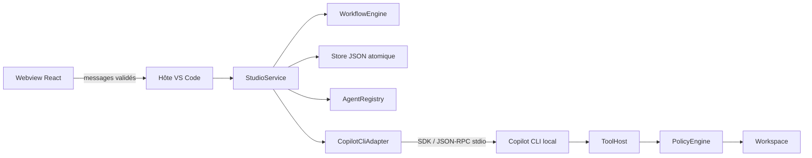

# Architecture

Feature Studio est une extension locale composée d’un hôte Node et d’un webview React. Le moteur métier ne dépend ni de VS Code ni de Copilot. Les contrats échangés se trouvent dans `src/shared/types.ts`.

## Modules

| Module | Responsabilité |
| --- | --- |
| `src/extension.ts` | Commandes, webview avec CSP, confiance VS Code, ouverture de diff/fichier, export, confirmations |
| `src/host/messages.ts` | Validation stricte des messages venant du webview |
| `src/host/StudioService.ts` | Verrou d’exécution, état affiché, hooks, orchestration, stockage périodique, annulation |
| `src/core/workflow.ts` | DAG d’étapes, préconditions, historique, approbation, obsolescence transitive |
| `src/core/store.ts` | JSON v1 validé, migration v0, écritures atomiques, récupération après interruption |
| `src/core/registry.ts` | Agents/skills/flows embarqués et workspace, installation additive du kit |
| `src/host/CopilotCliAdapter.ts` | Diagnostic, SDK, sessions, catalogue réel, flux, usage, questions, timeout |
| `src/host/ToolHost.ts` | Outils fichiers bornés, diff, commandes tests sélectionnées par identifiant |
| `src/host/PolicyEngine.ts` | Chemins, permissions, détection d’édition concurrente et protection Git |
| `src/host/WorkspaceLease.ts` | Exclusion entre fenêtres/processus sur un même dossier |
| `webview/` | Présentation et intentions utilisateur ; aucun accès direct aux fichiers ou processus |

## Une tentative

1. Le service vérifie confiance, connexion, branche, agent, skills et absence de tentative active.
2. Le moteur vérifie dépendances et budget, ajoute une tentative et rend les descendants obsolètes si nécessaire.
3. L’état est persisté avant le démarrage. Les hooks explicitement configurés s’exécutent uniquement hors lecture seule.
4. L’adaptateur crée ou reprend une session avec les seuls outils hôtes autorisés. L’introspection du catalogue confirme ce que voit le modèle avant le prompt.
5. Les événements alimentent une activité bornée (3 000 entrées par tentative, messages de 12 000 caractères au plus). Les fragments consécutifs sont regroupés. Le webview est actualisé au plus environ dix fois par seconde et l’état périodiquement enregistré.
6. Le résultat final complet devient un livrable à relire, ou une attente de réponses. Un échec et une annulation restent distincts. Le modèle ne valide jamais sa propre étape.
7. L’approbation humaine débloque la suite. Les étapes suivantes se lancent individuellement.

Chaque étape ouvre par défaut sa propre conversation. Une reprise réutilise une conversation antérieure, en réappliquant la politique et le catalogue d’outils. Les tentatives historiques sont consultables, mais seuls les livrables des dernières tentatives actuellement approuvées alimentent les étapes suivantes.

## Stockage

Le fichier `state.json` est placé sous `ExtensionContext.storageUri`, dans un sous-dossier déterminé par l’empreinte du chemin réel du workspace. L’identité ne dépend pas de l’ordre des dossiers multi-root. Un fichier temporaire privé est synchronisé, puis renommé atomiquement ; les écritures sont sérialisées. Une version inconnue ou un JSON corrompu échoue explicitement et préserve l’original.

Le CLI possède un `COPILOT_HOME` isolé sous `ExtensionContext.globalStorageUri`. Les configurations déclaratives utilisateur sont dans `.github/agents`, `.github/skills` et `.feature-studio/workflows`. Les réglages de scripts approuvés sont dans le stockage privé, pour éviter qu’un agent puisse élargir ses droits en éditant le dépôt.

Fermer le cockpit annule la tentative et attend son arrêt avant de libérer le verrou du dossier. Une fermeture brutale laisse un état `running` que le prochain chargement transforme en `interrupted`. Les fichiers déjà écrits ne sont pas annulés automatiquement.

## Limites de sécurité

La restriction porte sur les outils de l’agent. Les chemins sont vérifiés, les symlinks refusés, les fichiers sensibles usuels exclus ; cela ne constitue pas une sandbox du système d’exploitation. Une commande ou un hook approuvé par l’utilisateur possède les droits du processus local et peut appeler des scripts du projet. Le workspace doit être approuvé. Les types du SDK seuls ne sont pas une preuve de compatibilité ; le catalogue effectif est inspecté à chaque exécution.

Le masquage des secrets dans les journaux est une protection ciblée sur les formats courants, pas un outil universel de classification. Les prompts et livrables peuvent contenir du code privé ; le stockage reste local, hors des exports choisis par l’utilisateur et du contexte envoyé à Copilot.
