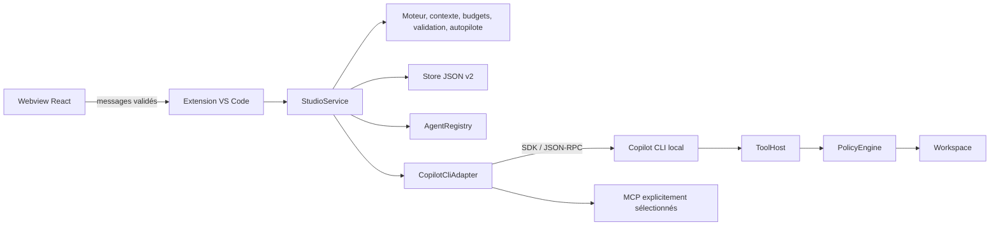

# Architecture — évolution v0.2

Feature Studio est une extension locale VS Code : un webview React transmet des intentions validées à un hôte Node. Le moteur métier ne dépend ni de VS Code ni du CLI. Les contrats sont définis dans `src/shared/types.ts` et `src/shared/evolutions.ts` ; le host conserve l'autorité sur les exécutions, permissions et écritures.

## Responsabilités

| Module | Responsabilité |
| --- | --- |
| `src/extension.ts` | Commandes VS Code, webview/CSP, confiance, secrets MCP, fichiers/diffs/export, verrou du dossier |
| `src/host/messages.ts` | Validation stricte et bornée des messages du webview |
| `src/host/StudioService.ts` | État, orchestration séquentielle, demandes humaines, compteurs, hooks, persistance et arrêt |
| `src/core/workflow.ts` | DAG, tentatives, transitions, révisions, approbations et invalidation transitive |
| `src/core/autopilot.ts` | Décision pure : exécuter, approuver, corriger, suspendre ou terminer |
| `src/core/context.ts` | Sélection locale de mémoire, compilation du prompt, aperçu et empreinte de lancement |
| `src/core/budgets.ts` | Agrégats de consommation mesurée et blocage entre tentatives |
| `src/core/validation.ts` | Critères, commentaires et preuves nécessaires à une approbation |
| `src/core/store.ts` | État v2 validé, migrations v0/v1, sauvegarde atomique et récupération |
| `src/core/registry.ts` | Catalogue embarqué/workspace, YAML strict, installation additive du kit |
| `src/core/evolutionSchemas.ts` | Schémas des contextes, MCP, budgets, pilote, preuves, relectures et mémoire |
| `src/host/CopilotCliAdapter.ts` | Diagnostic CLI, sessions, catalogue effectif, événements et résultats structurés |
| `src/host/McpRuntime.ts` | Résolution privée des secrets, sélection d'outils MCP, vérification de provenance et permissions |
| `src/host/ToolHost.ts` | Lecture/recherche/diff, éditions contrôlées, tests locaux et preuves hôtes |
| `src/host/PolicyEngine.ts` | Chemins, profils, protection des changements humains et contrôle avant écriture |
| `src/host/WorkspaceLease.ts` | Un cockpit par dossier entre fenêtres et processus |
| `webview/` | Présentation, édition et intentions ; aucun accès direct aux fichiers, secrets ou processus |

## Du lancement au résultat

Le service prépare une copie de la feature et des instructions sélectionnées. Un replay exclut les descendants qu'il rendra obsolètes. Le compilateur assemble besoin, mission, agent, skills, contexte manuel, mémoire choisie, derniers livrables actuellement approuvés, réponses, retour humain, critères et commentaires ouverts. Il ne sollicite aucun modèle pour produire cet aperçu.

L'empreinte SHA-256 couvre le prompt et les paramètres pertinents : modèle, raisonnement, outils, profil, réglages, MCP, session de reprise, état de l'étape, nombre de tentatives, budget, critères et commentaires. Un lancement manuel fourni avec une empreinte devenue différente est refusé. Les tokens de l'aperçu restent une estimation par longueur, distincte de l'usage mesuré.

Avant une tentative, le host vérifie confiance, disponibilité/authentification CLI, branche, agent, skills, configuration MCP, limites du contexte, budget et absence d'exécution concurrente. Le moteur vérifie dépendances et maximum de tentatives, crée la tentative et invalide les descendants concernés. L'état est enregistré avant l'appel. Les hooks explicitement configurés s'exécutent hors profil lecture seule.

L'adaptateur vérifie le catalogue réellement présenté au modèle avant le prompt. Seuls les outils hôtes autorisés et les outils des MCP sélectionnés sont attendus. Les événements alimentent des journaux bornés ; les fragments consécutifs sont regroupés. L'usage cumulatif est transmis pendant la tentative, afin de conserver les mesures même si elle échoue ou est annulée. Les preuves de tests sont ajoutées directement par le host.

Une question peut suspendre l'agent en cours via une demande humaine. Le pilote se met en pause ; la réponse réelle permet à cette tentative de continuer, sans réactiver automatiquement le pilote. Un bloc final de questions met l'étape en `waiting_input`. Un résultat complet devient `awaiting_review` ; erreur et annulation restent distinctes. Le modèle ne dispose d'aucun outil pour approuver son étape : l'approbation vient de l'humain ou des règles déterministes du pilote.

## Persistance et reprise

`state.json` utilise le schéma **2**. Il conserve features, historiques, contextes de lancement, empreintes, mesures, preuves, relectures, critères, commentaires, réglages et mémoire locale. Les versions 0 et 1 migrent vers 2 en conservant leurs données connues et en ajoutant les valeurs manquantes. Une ancienne feature sans configuration d'autopilote reste manuelle. Une version inconnue ou un JSON invalide est rejeté en préservant le fichier original.

Le fichier se trouve sous `ExtensionContext.storageUri`, dans un sous-dossier dérivé de l'empreinte du chemin réel du workspace. Les sauvegardes capturent leur instantané à l'appel, sont sérialisées par chemin dans le processus, écrivent un temporaire privé synchronisé puis le renomment atomiquement. Le verrou `WorkspaceLease` complète cette protection entre fenêtres/processus. Les sources déclaratives du dépôt restent `.github/agents`, `.github/skills` et `.feature-studio/workflows`.

Le CLI utilise un espace `COPILOT_HOME` isolé sous `globalStorageUri`. Les secrets MCP passent par `SecretStorage` ou des variables d'environnement référencées ; leurs valeurs ne sont pas des champs de configuration du webview. Le diagnostic CLI et la découverte MCP ne demandent aucun prompt modèle, mais une connexion MCP peut démarrer un processus ou contacter son serveur.

Fermer le cockpit suspend le pilote, annule la tentative active et attend son arrêt avant de libérer le verrou. Après arrêt brutal, `running` devient `interrupted` pour les tentatives et `paused` pour le pilote. Aucune reprise payante ne se produit au chargement. Les fichiers déjà écrits restent présents.

## Frontières et limites

Les outils hôtes contrôlent chemins, symlinks, fichiers sensibles usuels, profils et changements humains. Il s'agit d'un contrôle d'outils, pas d'une sandbox du système d'exploitation. Une commande de tests, un hook ou un serveur MCP configuré possède ses propres capacités locales ou distantes ; les profils de fichiers du host ne constituent pas une ACL sur le système externe. Une étape lecture seule refuse les opérations MCP dont la lecture seule n'est pas attestée.

La mémoire reste locale jusqu'à sa sélection explicite pour un prompt. Elle n'entraîne aucun appel IA de consolidation, résumé ou récupération. Les prompts sélectionnés sont ensuite transmis à Copilot ; une connexion MCP peut échanger avec le serveur choisi. Le masquage des secrets vise des formats connus et les valeurs MCP résolues, sans prétendre classer universellement toute donnée sensible.

Les limites de tokens et nano-AIU sont contrôlées avant une nouvelle tentative, à partir des mesures disponibles. Elles ne garantissent ni plafond financier strict pendant un appel ni conversion en euros. Les confirmations externes et l'usage réel des comptes se vérifient séparément des tests locaux simulés. Voir [les parcours et règles de validation](WORKFLOWS.md), [le transport Copilot](COPILOT.md) et [les connexions MCP](MCP.md).
