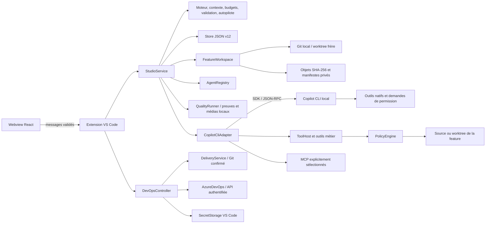

# Architecture — Feature Studio

État de référence : v1.32.0, avec le [découpage consolidé](CONSOLIDATION.md). Le stockage des sessions est en version 12.

Feature Studio est une extension locale VS Code : un webview React transmet des intentions validées à un hôte Node. Le moteur métier ne dépend ni de VS Code ni du CLI. Les contrats sont définis dans `src/shared/types.ts`, `src/shared/evolutions.ts`, `src/shared/collaboration.ts`, `src/shared/workspaces.ts`, `src/shared/profiles.ts`, `src/shared/quality.ts` et `src/shared/devops.ts` ; le host conserve l'autorité sur les exécutions, permissions et écritures.

## Responsabilités

| Module                          | Responsabilité                                                                                                                                     |
| ------------------------------- | -------------------------------------------------------------------------------------------------------------------------------------------------- |
| `src/extension.ts`              | Commandes VS Code, raccordement des contrôleurs, confiance, secrets MCP, fichiers/diffs/export, verrou du dossier                                  |
| `src/host/messages.ts`          | Validation stricte et bornée des messages du webview                                                                                               |
| `src/host/StudioService.ts`     | État, orchestration séquentielle, demandes humaines, compteurs, hooks, mutations Git réservées, points avant/après, persistance et arrêt           |
| `src/host/FeatureWorkspace.ts`  | Création/validation des worktrees, captures bornées, comparaisons, objets privés et restauration ciblée avec récupération persistée avant écriture |
| `src/core/workflow.ts`          | DAG, tentatives, transitions, révisions, approbations et invalidation transitive                                                                   |
| `src/core/autopilot.ts`         | Décision pure : exécuter, approuver, corriger, suspendre ou terminer                                                                               |
| `src/core/context.ts`           | Sélection locale de mémoire, compilation du prompt, aperçu et empreinte de lancement                                                               |
| `src/core/budgets.ts`           | Agrégats de consommation mesurée et blocage entre tentatives                                                                                       |
| `src/core/validation.ts`        | Critères, commentaires et preuves nécessaires à une approbation                                                                                    |
| `src/core/store.ts`             | État v12 validé, migrations des versions antérieures, sauvegarde atomique et récupération                                                          |
| `src/core/registry.ts`          | Catalogue embarqué/utilisateur/projet, priorités, versions, sauvegardes avec révision attendue, YAML strict, installation additive du kit          |
| `src/core/evolutionSchemas.ts`  | Schémas des contextes, MCP, budgets, pilote, preuves, relectures et mémoire                                                                        |
| `src/core/workspaceSchemas.ts`  | Schémas des liaisons worktree et métadonnées des points de restauration                                                                            |
| `src/host/CopilotCliAdapter.ts` | Diagnostic CLI, sessions, catalogue effectif, événements et résultats structurés                                                                   |
| `src/host/McpRuntime.ts`        | Résolution privée des secrets, sélection d'outils MCP, vérification de provenance et permissions                                                   |
| `src/host/ToolHost.ts`          | Lecture/recherche/diff, éditions contrôlées, tests locaux et preuves hôtes                                                                         |
| `src/host/PolicyEngine.ts`      | Chemins, profils, protection des changements humains et contrôle avant écriture                                                                    |
| `src/host/WorkspaceLease.ts`    | Un cockpit par racine entre fenêtres/processus et réservation du worktree pendant son utilisation                                                  |
| `webview/`                      | Présentation, édition et intentions ; aucun accès direct aux fichiers, secrets ou processus                                                        |

## Composition de l’interface et des contrôleurs

`App.tsx` garde la navigation et le raccordement des vues. `CreateSession.tsx` gère le formulaire et la demande de création idempotente ; `FirstSessionGuide.tsx` explique le démarrage sans lancer d’agent. Les choix de `src/shared/sessionStarters.ts` désignent des workflows du catalogue réel. Le parcours `bugfix` fournit une consigne de reproduction dans `initialContext`, conservée lors de l’héritage des profils.

`FeatureDetail.tsx` compose la session ; `StepPanel.tsx` présente l’étape, ses preuves et ses actions ; `StepConfig.tsx` édite sa configuration. `ProfileEditors.tsx`, `SettingsView.tsx` et `SessionPrimitives.tsx` regroupent les éditeurs, réglages et éléments communs. Ces modules n’accèdent pas aux fichiers ou au runtime directement.

`SessionReviewController.ts` traite les messages de validation, correction et édition après validation du protocole et résolution du service propriétaire. `WebviewPage.ts` construit le HTML, les racines autorisées et la CSP à nonce. `SessionProofs.ts` lit et vérifie les preuves, empreintes et sources via des dépendances explicites ; `StudioService` conserve les contrôles de confiance, de révision, les mutations et la persistance.

`StudioHub` agrège les sessions de tous les projets en conservant les catalogues du projet actif. Une publication réutilise l’instantané déjà détaché du service émetteur. Les autres projets fournissent une copie de leurs seules sessions, sans recopier leurs catalogues ou leur navigation. L’agrégateur ne modifie pas l’événement reçu. Les requêtes humaines et opérations sont également détachées. Ce gain d’assemblage de la consolidation précède le lot 1.32.0 : le premier état demeure complet et proportionnel à l’historique ; les publications suivantes utilisent désormais le transport par différences décrit plus bas. La pagination du rendu est gérée séparément dans le webview. [Mesures reproductibles](CONSOLIDATION.md#mesure-de-lagrégation).

## Modules ajoutés en v0.4

- `DevOpsController` conserve configuration, liens et conversation dans `devops.json`, garde le PAT hors du webview et partage les réservations de mutation de `StudioService`. `AzureDevOps` expose des lectures bornées et la création de PR brouillon ; `DeliveryService` prépare et vérifie les aperçus Git avant toute confirmation. Les règles fenced du profil de livraison sont déterministes ; cette voie ne passe pas par le runtime Copilot. [Contrat de livraison](devops-delivery.md).
- `QualityRunner` atteste les rapports et médias issus des commandes autorisées avec une identité de tentative ; `src/core/qualitySchemas.ts` borne les données et `QualityUI` expose les preuves. Le kit Playwright se copie uniquement sur action humaine dans la racine voulue. Le parcours `quality-feature` sépare recette, contre-exemples et relecture. [Configuration du reporter](../defaults/quality/README.md).
- `WorkspaceExplorer` fournit inventaires/recherches paginés, respecte Git ou les règles `ignore` hors Git et invalide les curseurs obsolètes. `GitFileContent` lit les blobs HEAD bornés sans transformer une erreur en baseline vide. `FilesystemPathIdentity` et `UnicodeCaseFold` contrôlent les alias physiques de chemins. [Exploration](explorer.md).
- `src/core/questions.ts` relie chaque réponse au texte, aux choix et à l’origine de sa question. `src/core/analytics.ts` agrège les mesures disponibles ; les données inconnues ne deviennent pas zéro. [Consommation](consumption.md).

## Du lancement au résultat

Le service prépare une copie de la feature et des instructions sélectionnées. Un replay exclut les descendants qu'il rendra obsolètes. Le compilateur assemble besoin, mission, agent, skills, contexte manuel, mémoire choisie, derniers livrables actuellement approuvés, réponses, retour humain, critères et commentaires ouverts. Il ne sollicite aucun modèle pour produire cet aperçu.

L'empreinte SHA-256 couvre le prompt et les paramètres pertinents : modèle, raisonnement, outils, profil, réglages, MCP, session de reprise, état de l'étape, nombre de tentatives, budget, critères et commentaires. Un lancement manuel fourni avec une empreinte devenue différente est refusé. Les tokens de l'aperçu restent une estimation par longueur, distincte de l'usage mesuré.

Avant une tentative, le host vérifie confiance, disponibilité/authentification CLI, racine et branche de la feature, agent, skills, configuration MCP, limites du contexte, budget et absence d’exécution ou de mutation concurrente. Le moteur vérifie dépendances et maximum de tentatives, crée la tentative et invalide les descendants concernés. L’état est enregistré avant l’appel. Pour une feature isolée, un point avant est capturé et persisté avant les hooks `beforeRun`. Les hooks explicitement configurés s’exécutent hors profil lecture seule, dans le dossier d’exécution de cette feature. La finalisation capture un point après si le point avant existe, y compris pour un échec ou une annulation ; un échec de capture reste signalé et ne devient pas une preuve de sauvegarde.

L’adaptateur vérifie les capacités du runtime et les modèles avant le prompt. Les nouvelles sessions utilisent Copilot natif : le CLI possède ses outils génériques et transmet ses demandes de permission au cockpit ; les règles gérées du runtime restent prioritaires. Les outils métier de KerAI et les MCP autorisés complètent ce catalogue. Les sessions historiques peuvent conserver le mode d’outils hôtes ; leurs contrôles ne constituent pas une protection système pour les outils natifs. [Frontières du runtime natif](COPILOT-NATIF.md). Les traces complètes sont écrites dans un journal privé par session ; les messages longs sont découpés sans perte. L’interface reçoit les 500 événements récents, avec fragments consécutifs regroupés, et consulte l’archive par pagination. L'usage cumulatif est transmis pendant la tentative, afin de conserver les mesures même si elle échoue ou est annulée. Les preuves de tests sont ajoutées directement par le host.

Une question peut suspendre l'agent en cours via une demande humaine. Le pilote se met en pause ; la réponse réelle permet à cette tentative de continuer ; le pilote reprend automatiquement si sa reprise après interaction reste autorisée. Une pause explicite, un refus de permission ou un redémarrage imposent une reprise manuelle. Un bloc final de questions met l'étape en `waiting_input`. Un résultat complet devient `awaiting_review` ; erreur et annulation restent distinctes. Le modèle ne dispose d'aucun outil pour approuver son étape : l'approbation vient de l'humain ou des règles déterministes du pilote.

## Persistance et reprise

`state.json` utilise le schéma **12** comme index léger des états de session, réglages et mémoire. Chaque état est un fichier immuable sous `sessions/<empreinte-id>/state-<empreinte-contenu>.json`, vérifié avant lecture. Tous les fichiers de session sont durables avant publication atomique de l’index ; les versions devenues inutiles sont ensuite collectées. Les versions 0 à 11 migrent en conservant leurs données connues ; depuis la version 5, l’index référence des fichiers de session séparés. Les historiques, contextes, preuves, relectures, worktrees, checkpoints, versions éditoriales, corrections et décision finale humaine restent conservés. Un binaire ne prenant pas en charge la version 12 refuse ce stockage. Une version inconnue ou un JSON invalide est rejeté en préservant l’original.

`src/shared/collaboration.ts` calcule la fermeture des corrections et une clé d’état relu, utilisables dans le webview et le host. Cette clé sert à refuser les sauvegardes et décisions obsolètes ; elle ne constitue pas une preuve d’exécution. Les anciennes versions et remarques d’un cycle sont des instantanés de diagnostic, séparés des livrables actuellement approuvés. Une modification du besoin coupe la reprise de l’ancienne conversation et des anciennes réponses. Les notes issues d’un compte rendu sont liées à sa révision.

Le moteur place le parcours en `awaiting_final_validation` une fois les interventions approuvées ou explicitement passées et les blocages résolus. Seul le message humain `finalizeFeature`, vérifié contre l’état relu et les empreintes actuelles des fichiers, enregistre `finalValidation` et passe à `completed`. Le webview attend l’accusé hôte et l’état correspondant avant l’animation. Le choix de roast est conservé avec la tentative ; il n’ajoute aucun appel modèle.

Le fichier se trouve sous `ExtensionContext.storageUri`, dans un sous-dossier dérivé de l'empreinte du chemin réel du workspace. Les sauvegardes capturent leur instantané à l'appel, sont sérialisées par chemin dans le processus, écrivent un temporaire privé synchronisé puis le renomment atomiquement. Le verrou `WorkspaceLease` complète cette protection entre fenêtres/processus. Les agents et skills du catalogue se sauvegardent explicitement dans la portée utilisateur (`~/.copilot` ou `COPILOT_HOME`) ou projet (`.github/agents` et `.github/skills`). La priorité est projet, utilisateur, puis profils embarqués. Une révision attendue et un verrou par fichier protègent la sauvegarde ; la migration vers le compte utilisateur demeure explicite avec sauvegarde. Les workflows personnalisés sont enregistrés sous `~/.copilot/feature-studio/workflows` (ou `COPILOT_HOME`). Les anciens YAML du projet restent lisibles pour compatibilité ; leur migration est manuelle.

Le CLI utilise un espace `COPILOT_HOME` isolé sous `globalStorageUri`. Les secrets MCP passent par `SecretStorage` ou des variables d'environnement référencées ; leurs valeurs ne sont pas des champs de configuration du webview. Le diagnostic CLI et la découverte MCP ne demandent aucun prompt modèle, mais une connexion MCP peut démarrer un processus ou contacter son serveur.

Fermer le cockpit suspend le pilote, annule la tentative active et attend son arrêt avant de libérer le verrou. Après arrêt brutal, `running` devient `interrupted` pour les tentatives et `paused` pour le pilote. Aucune reprise payante ne se produit au chargement. Les fichiers déjà écrits restent présents.

## Espaces Git et restauration

Le dossier source reste la racine du cockpit, du catalogue et de l’historique. Le dossier d’exécution est `feature.worktree.path` lorsqu’il existe, sinon le dossier source. Les outils de fichiers, tests, hooks et diffs reçoivent cette racine ; les ouvertures de fichiers/diffs sont routées par `featureId`. L’ouverture du dossier de feature utilise une nouvelle fenêtre VS Code et ne transfère pas son historique. Un cockpit distinct ouvert dans ce worktree tient le verrou de cette racine pendant toute sa vie ; le cockpit d’origine ne peut plus l’utiliser tant que ce verrou n’est pas libéré. Les vues de fichiers seules n’acquièrent pas ce verrou. Des cockpits de projets sources distincts peuvent fonctionner en parallèle, avec une tentative à la fois dans chacun.

La création d’un worktree frère appelle Git avec une branche dédiée et le commit HEAD explicite. Le host refuse une racine Git différente, un sous-dossier ou une destination existante. Les commandes Git neutralisent les hooks de checkout, `fsmonitor` et les filtres externes, y compris les filtres `clean` qu’un statut Git peut appeler ; la récursion des sous-modules est désactivée. LFS/smudge n’est pas matérialisé automatiquement : seul le contenu Git commité est extrait. Le host ne stage, stash ou reset aucun changement source et n’installe ni dépendances ni outils de préparation. Le lien de worktree est vérifié à chaque usage : emplacement déterminé par la feature, même dépôt Git commun, inscription dans `git worktree list`, branche attendue et absence de substitution symbolique.

Les points sont des captures privées de fichiers réguliers, avec octets, modes et empreintes SHA-256. Les objets et manifestes immuables restent hors des checkouts. Les fichiers non suivis ignorés par Git, chemins sensibles usuels, configurations, dépendances/builds et liens sont exclus. Une capture exclut les fichiers au-delà de 4 MiB et refuse un total au-delà de 64 MiB ou plus de 10 000 candidats. La liste affichée des exclusions est bornée, leur inventaire reste dans le manifeste. Ce périmètre ne constitue pas un backup exhaustif du projet.

Une comparaison relie un point à l’état actuel ou à un autre point. Son fingerprint couvre l’identité de la feature/racine, branche/HEAD, fichiers inclus et exclusions. La restauration exige une comparaison vers l’état actuel, une sélection distincte de chemins restaurables et l’empreinte encore valide. Les diffs sont fournis comme documents virtuels VS Code ; un fichier binaire reçoit une description, pas un diff textuel prétendument complet.

Le service réserve la mutation avant son premier `await` et prend le verrou de la racine d’exécution. Il refuse une tentative concurrente et exige la pause du pilote pour une opération manuelle. Avant toute écriture, il capture l’état actuel, rattache le point de récupération, invalide les étapes/révisions et critères concernés puis persiste le tout. Le pilote reste en pause. La confiance et les buffers dirty visibles dans la fenêtre courante sont revérifiés avant les écritures ; les fichiers sur disque sont recontrôlés après la sauvegarde et fichier par fichier.

La restauration remet uniquement le contenu et le mode des fichiers sélectionnés : elle ne restaure ni l’index Git, ni la branche, ni les commits. Chaque remplacement de contenu utilise un fichier temporaire synchronisé puis renommé, mais l’ensemble de la sélection n’est pas une transaction atomique. Une erreur peut donc laisser une restauration partielle ; la sauvegarde préalable et les invalidations restent persistées. Aucun rollback implicite n’efface cette situation.

Archiver une feature ne supprime ni son checkout ni ses points. La création et les opérations sur les points ne font aucun appel IA et ne publient rien. Voir [WORKSPACES.md](WORKSPACES.md) pour les boutons, exclusions détaillées et limites de récupération.

## Frontières et limites

Les outils hôtes contrôlent chemins, symlinks, fichiers sensibles usuels, profils et changements humains. Il s’agit d’un contrôle d’outils, pas d’une sandbox du système d’exploitation. Les buffers dirty d’une autre fenêtre VS Code ne sont pas visibles à ce host ; les modifications externes sur disque restent possibles malgré les recontrôles avant écriture. Une commande de tests, un hook ou un serveur MCP configuré possède ses propres capacités locales ou distantes ; les profils de fichiers du host ne constituent pas une ACL sur le système externe. Une étape lecture seule refuse les opérations MCP dont la lecture seule n'est pas attestée.

La mémoire reste locale jusqu'à sa sélection explicite pour un prompt. Elle n'entraîne aucun appel IA de consolidation, résumé ou récupération. Les prompts sélectionnés sont ensuite transmis à Copilot ; une connexion MCP peut échanger avec le serveur choisi. Le masquage des secrets vise des formats connus et les valeurs MCP résolues, sans prétendre classer universellement toute donnée sensible.

Les limites de tokens et nano-AIU sont contrôlées avant une nouvelle tentative, à partir des mesures disponibles. Elles ne garantissent ni plafond financier strict pendant un appel ni conversion en euros. Les confirmations externes et l'usage réel des comptes se vérifient séparément des tests locaux simulés. Voir [les espaces Git et points](WORKSPACES.md), [les parcours et règles de validation](WORKFLOWS.md), [le transport Copilot](COPILOT.md) et [les connexions MCP](MCP.md).

### Comparaisons Git des agents

`src/host/GitReview.ts` expose les lectures `studio_git_branches`, `studio_git_changes` et `studio_git_diff`, accessibles avec `read`. Les noms de branche sont validés avec Git puis résolus exclusivement sous `refs/heads` ou `refs/remotes` vers des commits explicites. Un nom court ambigu doit être qualifié. Le calcul de l’ancêtre commun utilise les SHA résolus ; l’absence ou la multiplicité des ancêtres ne déclenche aucun choix implicite.

Les chemins sont inventoriés avant le diff, contrôlés par `PolicyEngine` puis transmis sous forme de pathspecs littéraux. Les renommages sont désactivés pour éviter qu’un changement de nom fasse entrer un chemin exclu dans le diff. Les sous-modules sont ignorés, la lecture ne lance ni filtre, ni textconv, ni diff externe. Le workspace peut être un sous-dossier ou un worktree. Aucun fetch, checkout ou écriture d’index n’est réalisé.

Les sorties Git tronquées sont refusées. Le diff complet borné est masqué avant pagination, pour ne pas couper un secret entre deux pages. Son empreinte couvre le texte Git et les métadonnées de comparaison ; celle des listes couvre les références ou les noms/statuts, pas le contenu de tous les fichiers. Les réponses indiquent les exclusions, les limites et la continuation. Les pages suivantes exigent une empreinte identique ; la lecture de fichiers locaux reste non atomique vis-à-vis des modifications externes.

### Sélection de contexte par tentative

`RunLaunchOptions.contextMode` (`all` / `empty`, facultatif) choisit l’état initial des blocs optionnels ; sans valeur, `AgentProfile.emptyContextByDefault` s’applique. `contextBlocks` contient des overrides par identifiant stable (`artifact:plan`, `skill:ai-tdd`, etc.) avec inclusion et/ou texte de remplacement. Le schéma hôte limite les identifiants aux blocs optionnels et borne les tailles. Les blocs système ne sont ni éditables ni excluables par ces overrides.

Le compilateur retourne les sources disponibles et leur état pour l’aperçu, mais n’assemble que les blocs inclus dans le prompt. Les budgets utilisent uniquement ce texte transmis. L’empreinte couvre les choix et les sources de l’aperçu ; chaque édition invalide le lancement jusqu’à un nouvel aperçu. Les overrides sont sauvegardés dans `attempt.launch`, avec compatibilité de lecture des anciennes tentatives qui n’ont pas ces champs. Les modèles reçoivent exactement `preparedPrompt`.

Une sélection explicite ou un profil avec contexte vide désactive la reprise du transcript SDK. L’intention de reprise reste soumise aux validations du workflow, puis une nouvelle session est créée. Cela empêche qu’un bloc exclu reste présent dans l’ancien historique. Les permissions hôtes restent indépendantes du texte inclus ; les outils peuvent toujours lire leur périmètre autorisé.

### Reprise explicite des modifications locales

L’aperçu de lancement est asynchrone et ajoute l’inventaire Git des fichiers locaux éligibles. `launch.editableExistingFiles` ne contient que la sélection humaine ; le host calcule `RunInput.existingChangeGrants` à partir des octets actuels et les inclut dans l’empreinte de l’aperçu. Le lancement avec sélection exige cette empreinte puis recalcule les versions ; un appel de modèle ou le simple ajout de chemins dans un prompt ne peut pas créer de grant.

`ExistingChanges.ts` applique les limites et permissions de `PolicyEngine`, puis sauvegarde et vérifie les octets autorisés, avec un manifeste avant les hooks et le runtime. `attempt.existingChangesBackup` conserve le chemin de récupération. `ToolHost` ajoute uniquement les grants hôtes à ses empreintes d’édition ; ils ne deviennent pas des écritures possédées dans l’historique tant qu’aucune édition n’a eu lieu. La lecture préalable, le remplacement exact et les contrôles de version à chaque écriture restent obligatoires. Les copies ne constituent pas un verrou contre les modifications externes simultanées.

La validation manuelle partage `approvalBlockers` avec le moteur pour les motifs statiques. La réponse hôte `stepApprovalResult` est liée à la feature, l’étape et la tentative pour afficher les refus d’une validation asynchrone. Seul l’état hôte approuvé modifie le statut affiché ; l’interface ne simule jamais une validation réussie.

## Observateur et suppression de session

`SessionArchive` écrit les contextes, événements et outils sous une limite configurable de 256 Mio par défaut. `SessionObserver` produit des parties bornées sur disque, vérifie l’aperçu et les empreintes, puis analyse toutes les phases et synthétise les résultats. Ses outils sont imposés par le host et n’accèdent pas au projet, aux hooks ou aux MCP. Le rapport structuré conserve les sources, versions, appels, modèles et usages cumulés. Les remarques doivent citer une source du contexte transmis ; l’hôte calcule les coûts. Une revue interrompue reste partielle et nécessite une relance humaine.

Les suppressions enregistrent d’abord un manifeste durable sans transcript. L’index retire la session, puis le nettoyage efface son dossier et ses sauvegardes. Les manifests de checkpoints sont retirés et les objets sont collectés uniquement après validation de tous les manifests conservés. Les pièces jointes utilisées par d’autres sessions sont préservées. Le SDK reçoit uniquement les identifiants de sessions locales enregistrés. Un crash reprend le nettoyage au démarrage ; les fichiers du projet, branches et worktrees sont conservés. [Parcours, coûts, limites et stockage](OBSERVATEUR.md).

## Interventions facultatives et stockage v6

`WorkflowStep.optional` décrit la participation dans un modèle ou sa copie de feature. L’absence du champ signifie obligatoire. `teamSteps` retire les décisions et tentatives lors d’une copie ; les kits conservent le défaut de participation. Le stockage v6 lit et migre les index v5 et conserve les décisions courantes, leur historique et une éventuelle demande du pilote.

`stepResolved` permet à une intervention `skipped`, facultative et associée à une décision humaine `skip`, de satisfaire l’ordre des dépendances. Ce statut ne devient jamais une tentative, une preuve de test ou une approbation. Les validations de livrables restent réservées aux interventions exécutées. Les critères et remarques bloquantes sont vérifiés avant la validation finale humaine.

Le pilote produit une pause avec `optionalStepId` avant le premier lancement facultatif. Le service persiste un `optionalRequest` puis émet la notification après libération de l’exécution. `resolveOptionalStep` prend la réservation habituelle et le verrou du workspace, vérifie le jeton d’état et la demande, puis persiste le choix avant une éventuelle reprise. Un échec de sauvegarde restaure l’état précédent. Une réponse concurrente ou obsolète ne peut lancer la suite une seconde fois. Le webview et la notification utilisent le même contrat.

Les invalidations effacent le choix courant concerné, conservent son historique et ramènent une intervention non tentée à `pending`. Les interventions déjà tentées deviennent `stale`. Depuis la 1.31.1, une intervention facultative arrêtée ou en attente peut être passée explicitement lorsque ses préalables sont résolus, hors correction imposée et sans exécution active ; ses tentatives, échecs et fichiers restent conservés et son résultat n’est pas validé. La reprise d’une tentative conserve son historique sans fabriquer une nouvelle décision humaine.

## Apparence et récompenses personnelles

`QuestService` conserve les faits et trophées acquis dans `quests.json`. `RewardService` calcule les six déblocages depuis ce registre et conserve uniquement les choix de titre, célébration et mascotte dans `rewards.json`, avec validation, écritures ordonnées et verrou de fichier. Une récompense verrouillée ou un registre illisible ne permet pas une activation.

Le thème et le QG utilisent les réglages personnels de VS Code ; la découverte Dragon Ball utilise `globalState`. L’hôte valide les messages et accuse les sauvegardes. Les composants React conservent le dernier choix confirmé en cas d’erreur et ne changent ni les profils ni les décisions métier. Le QG projette les états de chaque intervention, notamment les questions et choix humains, les passages facultatifs et l’identité réellement exécutée.

La v1.13 avait introduit le stockage v6 pour les décisions facultatives. Le stockage actuel est en version 12 ; les migrations préservent ces décisions et leur historique. Les trophées et préférences de récompense disposent de leurs registres distincts. Le contrôle du VSIX vérifie les commandes hôte/interface et les assets publics avant publication.

## Transport et chargement des écrans (1.32.0)

Chaque surface dispose d’un `StateEncoder` indépendant. Le premier message transmet l’état complet ; les suivants ne contiennent que les champs et sessions modifiés, les suppressions et, si nécessaire, l’ordre des sessions. Le `StateReceiver` du bridge refuse atomiquement une révision discontinue et demande `resyncState`. Les abonnés continuent de recevoir un `state` cohérent, avec références stables pour les sessions inchangées. Le stockage et les contrôles d’autorisation restent côté hôte.

Les vues secondaires sont importées à l’ouverture avec un indicateur de chargement et un état d’erreur récupérable. Les scripts du webview restent limités au nonce initial et aux ressources locales autorisées du bundle. Le contrôle du VSIX vérifie tous les morceaux JavaScript et CSS. Les listes et conversations limitent le nombre d’éléments rendus, sans supprimer les archives.
