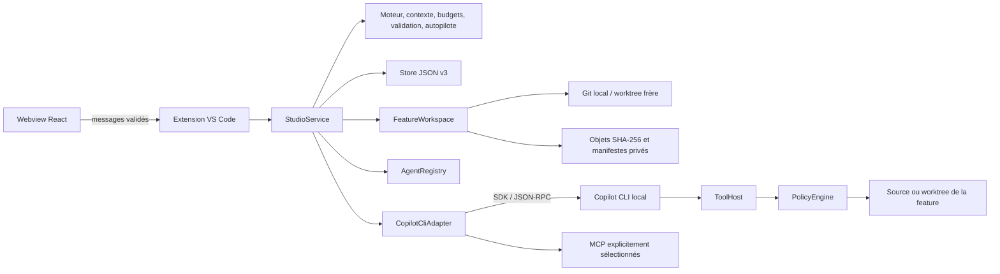

# Architecture — évolution v0.3

Feature Studio est une extension locale VS Code : un webview React transmet des intentions validées à un hôte Node. Le moteur métier ne dépend ni de VS Code ni du CLI. Les contrats sont définis dans `src/shared/types.ts`, `src/shared/evolutions.ts` et `src/shared/workspaces.ts` ; le host conserve l'autorité sur les exécutions, permissions et écritures.

## Responsabilités

| Module                          | Responsabilité                                                                                                                                     |
| ------------------------------- | -------------------------------------------------------------------------------------------------------------------------------------------------- |
| `src/extension.ts`              | Commandes VS Code, webview/CSP, confiance, secrets MCP, fichiers/diffs/export, verrou du dossier                                                   |
| `src/host/messages.ts`          | Validation stricte et bornée des messages du webview                                                                                               |
| `src/host/StudioService.ts`     | État, orchestration séquentielle, demandes humaines, compteurs, hooks, mutations Git réservées, points avant/après, persistance et arrêt           |
| `src/host/FeatureWorkspace.ts`  | Création/validation des worktrees, captures bornées, comparaisons, objets privés et restauration ciblée avec récupération persistée avant écriture |
| `src/core/workflow.ts`          | DAG, tentatives, transitions, révisions, approbations et invalidation transitive                                                                   |
| `src/core/autopilot.ts`         | Décision pure : exécuter, approuver, corriger, suspendre ou terminer                                                                               |
| `src/core/context.ts`           | Sélection locale de mémoire, compilation du prompt, aperçu et empreinte de lancement                                                               |
| `src/core/budgets.ts`           | Agrégats de consommation mesurée et blocage entre tentatives                                                                                       |
| `src/core/validation.ts`        | Critères, commentaires et preuves nécessaires à une approbation                                                                                    |
| `src/core/store.ts`             | État v3 validé, migrations v0/v1/v2, sauvegarde atomique et récupération                                                                           |
| `src/core/registry.ts`          | Catalogue embarqué/workspace, YAML strict, installation additive du kit                                                                            |
| `src/core/evolutionSchemas.ts`  | Schémas des contextes, MCP, budgets, pilote, preuves, relectures et mémoire                                                                        |
| `src/core/workspaceSchemas.ts`  | Schémas des liaisons worktree et métadonnées des points de restauration                                                                            |
| `src/host/CopilotCliAdapter.ts` | Diagnostic CLI, sessions, catalogue effectif, événements et résultats structurés                                                                   |
| `src/host/McpRuntime.ts`        | Résolution privée des secrets, sélection d'outils MCP, vérification de provenance et permissions                                                   |
| `src/host/ToolHost.ts`          | Lecture/recherche/diff, éditions contrôlées, tests locaux et preuves hôtes                                                                         |
| `src/host/PolicyEngine.ts`      | Chemins, profils, protection des changements humains et contrôle avant écriture                                                                    |
| `src/host/WorkspaceLease.ts`    | Un cockpit par racine entre fenêtres/processus et réservation du worktree pendant son utilisation                                                  |
| `webview/`                      | Présentation, édition et intentions ; aucun accès direct aux fichiers, secrets ou processus                                                        |

## Du lancement au résultat

Le service prépare une copie de la feature et des instructions sélectionnées. Un replay exclut les descendants qu'il rendra obsolètes. Le compilateur assemble besoin, mission, agent, skills, contexte manuel, mémoire choisie, derniers livrables actuellement approuvés, réponses, retour humain, critères et commentaires ouverts. Il ne sollicite aucun modèle pour produire cet aperçu.

L'empreinte SHA-256 couvre le prompt et les paramètres pertinents : modèle, raisonnement, outils, profil, réglages, MCP, session de reprise, état de l'étape, nombre de tentatives, budget, critères et commentaires. Un lancement manuel fourni avec une empreinte devenue différente est refusé. Les tokens de l'aperçu restent une estimation par longueur, distincte de l'usage mesuré.

Avant une tentative, le host vérifie confiance, disponibilité/authentification CLI, racine et branche de la feature, agent, skills, configuration MCP, limites du contexte, budget et absence d’exécution ou de mutation concurrente. Le moteur vérifie dépendances et maximum de tentatives, crée la tentative et invalide les descendants concernés. L’état est enregistré avant l’appel. Pour une feature isolée, un point avant est capturé et persisté avant les hooks `beforeRun`. Les hooks explicitement configurés s’exécutent hors profil lecture seule, dans le dossier d’exécution de cette feature. La finalisation capture un point après si le point avant existe, y compris pour un échec ou une annulation ; un échec de capture reste signalé et ne devient pas une preuve de sauvegarde.

L'adaptateur vérifie le catalogue réellement présenté au modèle avant le prompt. Seuls les outils hôtes autorisés et les outils des MCP sélectionnés sont attendus. Les événements alimentent des journaux bornés ; les fragments consécutifs sont regroupés. L'usage cumulatif est transmis pendant la tentative, afin de conserver les mesures même si elle échoue ou est annulée. Les preuves de tests sont ajoutées directement par le host.

Une question peut suspendre l'agent en cours via une demande humaine. Le pilote se met en pause ; la réponse réelle permet à cette tentative de continuer, sans réactiver automatiquement le pilote. Un bloc final de questions met l'étape en `waiting_input`. Un résultat complet devient `awaiting_review` ; erreur et annulation restent distinctes. Le modèle ne dispose d'aucun outil pour approuver son étape : l'approbation vient de l'humain ou des règles déterministes du pilote.

## Persistance et reprise

`state.json` utilise le schéma **3**. Il conserve features, historiques, contextes de lancement, empreintes, mesures, preuves, relectures, critères, commentaires, réglages, mémoire locale, liaisons de worktree et métadonnées des points. Les versions 0, 1 et 2 migrent vers 3 en conservant leurs données connues et en ajoutant les valeurs manquantes. Une ancienne feature sans configuration d’autopilote reste manuelle et, sans métadonnée de worktree, conserve le dossier source. La v0.2 refuse le schéma 3 : aucune migration inverse ne permet de rouvrir ces données en perdant silencieusement l’isolation. Une version inconnue ou un JSON invalide est rejeté en préservant le fichier original.

Le fichier se trouve sous `ExtensionContext.storageUri`, dans un sous-dossier dérivé de l'empreinte du chemin réel du workspace. Les sauvegardes capturent leur instantané à l'appel, sont sérialisées par chemin dans le processus, écrivent un temporaire privé synchronisé puis le renomment atomiquement. Le verrou `WorkspaceLease` complète cette protection entre fenêtres/processus. Les sources déclaratives du dépôt restent `.github/agents`, `.github/skills` et `.feature-studio/workflows`.

Le CLI utilise un espace `COPILOT_HOME` isolé sous `globalStorageUri`. Les secrets MCP passent par `SecretStorage` ou des variables d'environnement référencées ; leurs valeurs ne sont pas des champs de configuration du webview. Le diagnostic CLI et la découverte MCP ne demandent aucun prompt modèle, mais une connexion MCP peut démarrer un processus ou contacter son serveur.

Fermer le cockpit suspend le pilote, annule la tentative active et attend son arrêt avant de libérer le verrou. Après arrêt brutal, `running` devient `interrupted` pour les tentatives et `paused` pour le pilote. Aucune reprise payante ne se produit au chargement. Les fichiers déjà écrits restent présents.

## Espaces Git et restauration

Le dossier source reste la racine du cockpit, du catalogue et de l’historique. Le dossier d’exécution est `feature.worktree.path` lorsqu’il existe, sinon le dossier source. Les outils de fichiers, tests, hooks et diffs reçoivent cette racine ; les ouvertures de fichiers/diffs sont routées par `featureId`. L’ouverture du dossier de feature utilise une nouvelle fenêtre VS Code et ne transfère pas son historique. Un cockpit distinct ouvert dans ce worktree tient le verrou de cette racine pendant toute sa vie ; le cockpit d’origine ne peut plus l’utiliser tant que ce verrou n’est pas libéré. Les vues de fichiers seules n’acquièrent pas ce verrou. Des cockpits de projets sources distincts peuvent fonctionner en parallèle, avec une tentative à la fois dans chacun.

La création d’un worktree frère appelle Git avec une branche dédiée et le commit HEAD explicite. Le host refuse une racine Git différente, un sous-dossier ou une destination existante. Les commandes Git neutralisent les hooks de checkout, `fsmonitor` et les filtres externes, y compris les filtres `clean` qu’un statut Git peut appeler ; la récursion des sous-modules est désactivée. LFS/smudge n’est pas matérialisé automatiquement : seul le contenu Git commité est extrait. Le host ne stage, stash ou reset aucun changement source et n’installe ni dépendances ni outils de préparation. Le lien de worktree est vérifié à chaque usage : emplacement déterminé par la feature, même dépôt Git commun, inscription dans `git worktree list`, branche attendue et absence de substitution symbolique.

Les points sont des captures privées de fichiers réguliers, avec octets, modes et empreintes SHA-256. Les objets et manifestes immuables restent hors des checkouts. Les fichiers non suivis ignorés par Git, chemins sensibles usuels, configurations, dépendances/builds et liens sont exclus. Une capture exclut les fichiers au-delà de 4 MiB et refuse un total au-delà de 64 MiB ou plus de 10 000 candidats. La liste affichée des exclusions est bornée, leur inventaire reste dans le manifeste. Ce périmètre ne constitue pas un backup exhaustif du projet.

Une comparaison relie un point à l’état actuel ou à un autre point. Son fingerprint couvre l’identité de la feature/racine, branche/HEAD, fichiers inclus et exclusions. La restauration exige une comparaison vers l’état actuel, une sélection distincte de chemins restaurables et l’empreinte encore valide. Les diffs sont fournis comme documents virtuels VS Code ; un fichier binaire reçoit une description, pas un diff textuel prétendument complet.

Le service réserve la mutation avant son premier `await` et prend le verrou de la racine d’exécution. Il refuse une tentative concurrente et exige la pause du pilote pour une opération manuelle. Avant toute écriture, il capture l’état actuel, rattache le point de récupération, invalide les étapes/révisions et critères concernés puis persiste le tout. Le pilote reste en pause. La confiance et les buffers dirty visibles dans la fenêtre courante sont revérifiés avant les écritures ; les fichiers sur disque sont recontrôlés après la sauvegarde et fichier par fichier.

La restauration remet uniquement le contenu et le mode des fichiers sélectionnés : elle ne restaure ni l’index Git, ni la branche, ni les commits. Chaque remplacement de contenu utilise un fichier temporaire synchronisé puis renommé, mais l’ensemble de la sélection n’est pas une transaction atomique. Une erreur peut donc laisser une restauration partielle ; la sauvegarde préalable et les invalidations restent persistées. Aucun rollback implicite n’efface cette situation.

Archiver une feature ne supprime ni son checkout ni ses points. La création et les opérations sur les points ne font aucun appel IA et ne publient rien. Voir [WORKSPACES.md](WORKSPACES.md) pour les boutons, exclusions détaillées et limites de récupération.

## Frontières et limites

Les outils hôtes contrôlent chemins, symlinks, fichiers sensibles usuels, profils et changements humains. Il s’agit d’un contrôle d’outils, pas d’une sandbox du système d’exploitation. Les buffers dirty d’une autre fenêtre VS Code ne sont pas visibles à ce host ; les modifications externes sur disque restent possibles malgré les recontrôles avant écriture. Une commande de tests, un hook ou un serveur MCP configuré possède ses propres capacités locales ou distantes ; les profils de fichiers du host ne constituent pas une ACL sur le système externe. Une étape lecture seule refuse les opérations MCP dont la lecture seule n'est pas attestée.

La mémoire reste locale jusqu'à sa sélection explicite pour un prompt. Elle n'entraîne aucun appel IA de consolidation, résumé ou récupération. Les prompts sélectionnés sont ensuite transmis à Copilot ; une connexion MCP peut échanger avec le serveur choisi. Le masquage des secrets vise des formats connus et les valeurs MCP résolues, sans prétendre classer universellement toute donnée sensible.

Les limites de tokens et nano-AIU sont contrôlées avant une nouvelle tentative, à partir des mesures disponibles. Elles ne garantissent ni plafond financier strict pendant un appel ni conversion en euros. Les confirmations externes et l'usage réel des comptes se vérifient séparément des tests locaux simulés. Voir [les espaces Git et points](WORKSPACES.md), [les parcours et règles de validation](WORKFLOWS.md), [le transport Copilot](COPILOT.md) et [les connexions MCP](MCP.md).
