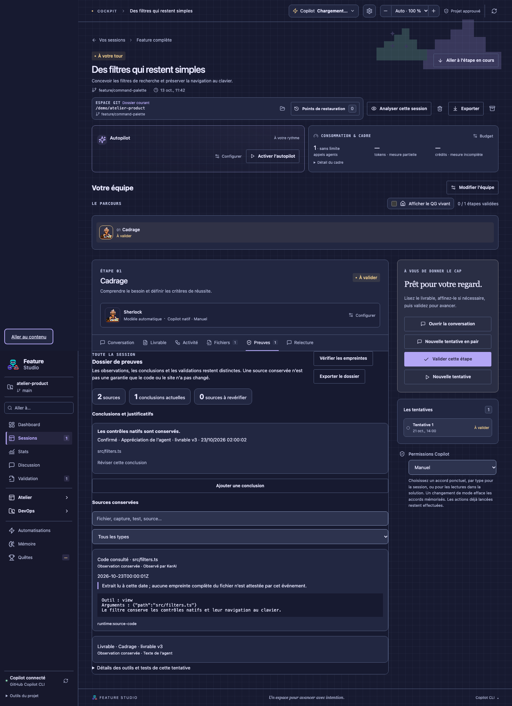

# Le dossier de preuves

Le dossier se trouve dans **Preuves** d’une étape et réunit les sources conservées pour la session. Il répond à trois questions : **qu’a-t-on observé, qu’en a-t-on conclu, qu’a validé l’humain ?** Ces trois éléments restent distincts.

## Sources et conclusions

Les sources sont dérivées des données enregistrées : captures jointes, résultats et pièces de tests, lectures de code, pages web consultées, contexte natif chargé, actions observées, versions du livrable et validations. Chaque source possède un identifiant, une origine, une date et un état. Les extraits tronqués sont signalés. Recherche un chemin ou filtre par type ; ouvre une source depuis une conclusion pour lire son détail.

L’agent dispose d’outils pour lister les sources réelles et proposer une conclusion avec leurs identifiants. Il ne peut pas fabriquer une provenance humaine ou un résultat d’outil. Son verdict reste une **appréciation de l’agent**, même affiché « Confirmé ». La présence d’un test réussi ne prouve que ce que ce test a effectivement contrôlé.

Tu peux ajouter une conclusion ou réviser une conclusion de la tentative courante, avec ses justificatifs et ton verdict : confirmé, contredit, non vérifié. La révision conserve le texte précédent. Une conclusion confirmée ne peut pas référencer une source absente, en attente, en échec ou à revérifier. Une contradiction actuelle doit être résolue ou explicitement réévaluée avant validation de l’étape. Enregistrer une conclusion ne valide jamais l’étape.

## Quand faut-il revérifier ?

Une tentative historique, un besoin modifié, une nouvelle révision du livrable, une source absente ou une écriture native observée après une lecture signalent les éléments concernés. Une conclusion révisée reste dans l’historique. Un nouveau résultat de la même commande de test remplace le précédent comme référence courante.

**Vérifier les empreintes** compare les fichiers enregistrés dans les preuves de tests à leur contenu actuel. Un changement ou une vérification impossible passe la preuve à revérifier. Un résultat inchangé signifie uniquement que ces fichiers sont identiques à la date de ce contrôle. Le bouton ne lance aucun test, ne consulte aucune page web et ne contrôle pas tous les fichiers du projet.

Une lecture native conserve l’extrait retourné, sans attester une empreinte du fichier complet. Une page web garde son URL, sa date et son extrait, sans garantie de fraîcheur actuelle. Une capture fournie par l’utilisateur décrit un symptôme ; elle n’atteste pas la correction. Les anciennes validations restent des événements historiques, sans devenir des garanties sur le code actuel.

## Exporter

**Exporter le dossier** produit un fichier Markdown avec les conclusions et les sources datées. Les pixels des captures restent dans la session et ne sont pas incorporés à cet export texte ; les pièces de tests s’ouvrent depuis l’application. Vérifie le contenu avant de partager ce fichier, qui peut contenir des extraits du code du projet.

Le dossier facilite la relecture et la transmission. Il ne constitue pas une certification de conformité, une validation automatique ni une preuve de déploiement.
