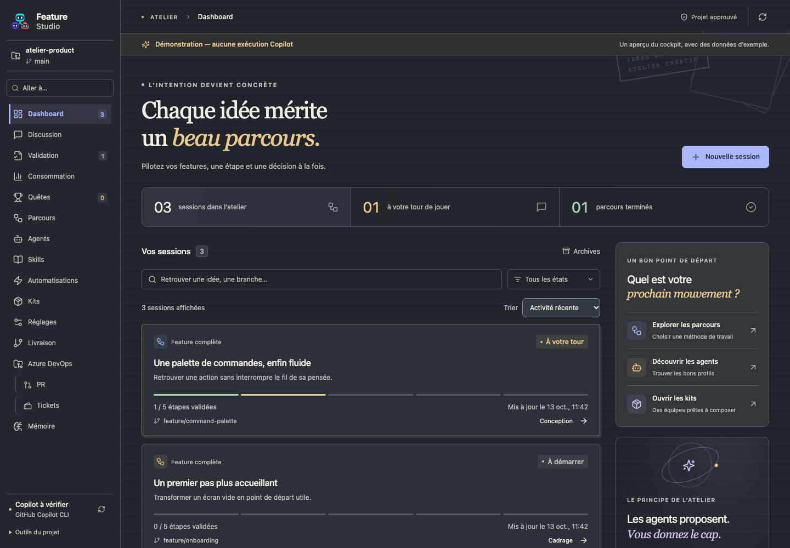
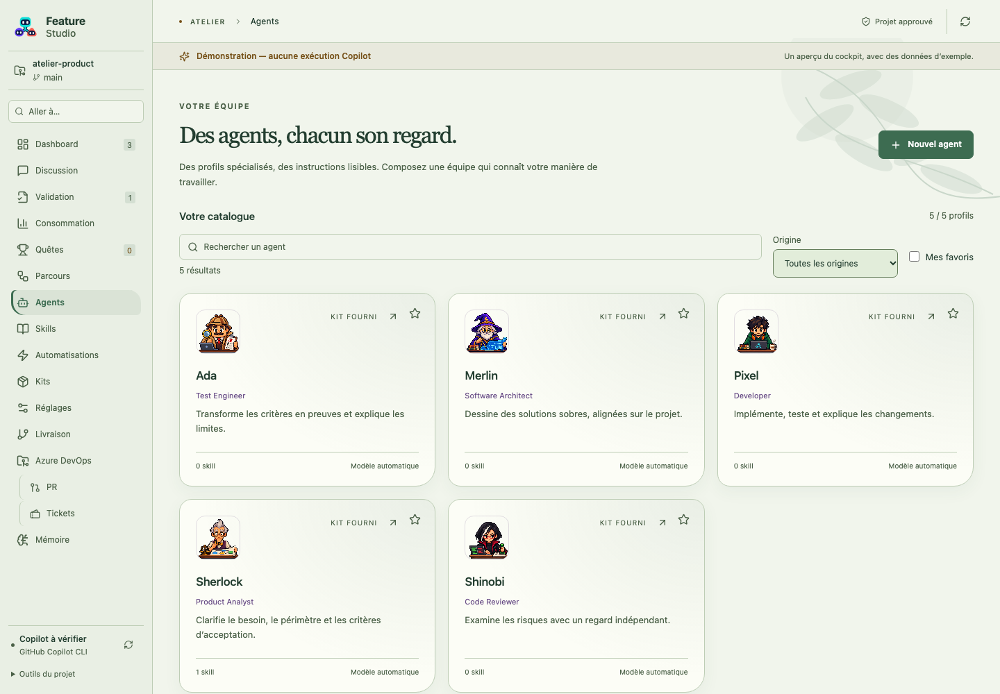
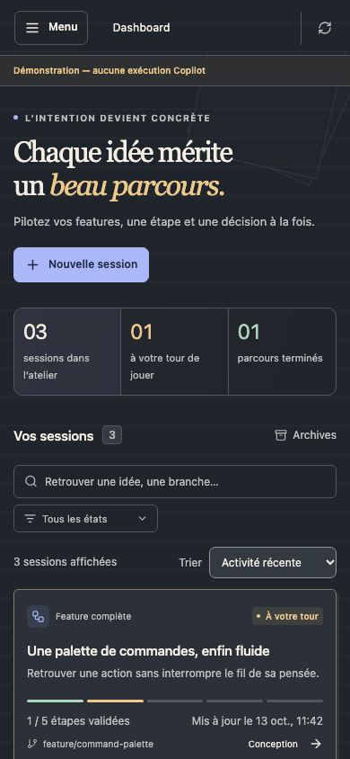

# Audit visuel et ergonomique — 16 octobre 2026

Base examinée : Feature Studio 1.9.0, commit `481651b`. Cet audit porte sur le cockpit local et ses seize écrans. Les corrections sont locales ; ce document ne constitue pas une preuve de publication ou d'installation.

Les corrections sont intégrées à la version 1.10.0 avec la connexion Copilot automatique. La [validation de cette version](VALIDATION.md) et ses [notes de release](https://github.com/MattDevBzh/KerAI/releases/tag/v1.10.0) complètent la campagne ergonomique décrite ici.

## Mon avis sur le visuel

L'application possède une identité reconnaissable : les personnages, les thèmes, les matières et les titres donnent une personnalité à l'atelier. Les états de travail sont visibles et le rapport entre équipe et parcours se comprend bien. Cette identité mérite d'être conservée.

Le problème principal était la densité : beaucoup de textes secondaires entre 7 et 11 pixels, seize destinations en concurrence dans le menu, des écrans de session chargés avant d'atteindre le livrable, et des options techniques occupant une grande partie du chat. Dans une fenêtre étroite, les icônes seules obligeaient à connaître le menu par cœur. Plusieurs actions utiles existaient déjà mais se trouvaient trop loin, notamment enregistrer ou annuler des réglages.

Le parti pris de cette correction est de rendre le travail plus lisible : garder les thèmes, clarifier les actions, donner toute la largeur au contenu sur petit écran, faciliter la recherche, et préserver le contexte lors des déplacements et des dialogues. Les variantes décoratives et les nouveaux modes de travail restent des propositions distinctes.

## Priorités et état

**1 = priorité maximale ; 10 = facultatif.** Le classement combine risque d'erreur ou de perte de contexte, fréquence d'utilisation, nombre d'écrans touchés et difficulté à contourner le problème. Il ne mesure pas le coût de réalisation.

**68 évolutions recensées : 44 de priorité 1 à 5, 24 de priorité 6 à 10.** Les 44 premières sont corrigées localement et la campagne de validation est réussie ; les autres restent des propositions.

### Dialogues, clavier et navigation

| ID | Priorité | Constat et évolution | État |
| --- | --- | --- | --- |
| E01 | 1 | Plusieurs dialogues pouvaient écouter Échap simultanément. Seul le dialogue au premier plan traite désormais Échap et Tab. | Corrigé localement |
| E02 | 2 | Le parcours clavier des dialogues omettait les liens et les éléments dépliables, et pouvait inclure des champs cachés. Ne parcourir que les contrôles visibles et utilisables. | Corrigé localement |
| E03 | 3 | Bloquer le défilement de l'arrière-plan pendant un dialogue et rétablir le défilement et le focus à sa fermeture. | Corrigé localement |
| E04 | 2 | Un clic à côté de certains formulaires fermait immédiatement la fenêtre. Retirer cette fermeture involontaire ; conserver les commandes explicites et Échap. | Corrigé localement |
| E05 | 3 | Garder le titre et le bouton Fermer visibles quand un long dialogue défile. | Corrigé localement |
| E06 | 3 | Garder les actions des dialogues accessibles en bas, avec retour à la ligne et hauteur adaptée à la fenêtre. | Corrigé localement |
| E07 | 3 | Donner à chaque dialogue un titre et une description accessibles uniques, y compris lorsque plusieurs sont ouverts. | Corrigé localement |
| E08 | 2 | Remplacer le rail d'icônes sans libellés sur petite fenêtre par un menu ouvrable contenant les noms des écrans. | Corrigé localement |
| E09 | 2 | Rendre le menu compact utilisable au clavier : focus initial, boucle de Tab, Échap, arrière-plan inactif et retour du focus. | Corrigé localement |
| E10 | 3 | Récupérer l'espace occupé par le pied de menu et la décoration ; garder les outils secondaires dans une section dépliable et un menu principal défilable. | Corrigé localement |
| E11 | 4 | Retrouver une destination parmi les seize écrans grâce à une recherche locale dans le menu, avec effacement et état sans résultat. | Corrigé localement |
| E12 | 3 | Ajouter un lien clavier « Aller au contenu » pour éviter de retraverser toute la navigation. | Corrigé localement |
| E13 | 2 | Revenir en haut au changement de page ou de session ; après un choix dans le menu compact, placer le focus sur le contenu. | Corrigé localement |

### Lisibilité et présentation

| ID | Priorité | Constat et évolution | État |
| --- | --- | --- | --- |
| E14 | 2 | Agrandir les microtextes dans les sessions, catalogues, consommation, Git, recette, observateur, DevOps et quêtes. Les textes auparavant de 7–11 px passent à 10–12 px selon leur rôle. | Corrigé localement |
| E15 | 3 | Agrandir les boutons à icône et les actions textuelles communes pour faciliter le clic et le toucher. | Corrigé localement |
| E16 | 2 | Uniformiser le focus visible, notamment sur les recherches, éléments dépliables et zones accessibles par Tab. Conserver le contraste élevé. | Corrigé localement |
| E17 | 4 | Rendre les comptes rendus plus confortables : texte de 14 px, interligne adapté, longueur des paragraphes limitée, tableaux plus lisibles. | Corrigé localement |
| E18 | 3 | Permettre aux noms, branches, métadonnées et barres d'actions de revenir à la ligne au lieu de pousser les autres contrôles hors cadre. | Corrigé localement |
| E19 | 3 | Garder les notifications visibles même loin du haut de page, sans les laisser dépasser de la fenêtre ; autoriser le défilement des messages longs. | Corrigé localement |

### Sessions et catalogues

| ID | Priorité | Constat et évolution | État |
| --- | --- | --- | --- |
| E20 | 4 | Rendre les trois compteurs d'accueil cliquables pour afficher toutes les sessions, celles qui attendent l'utilisateur ou les sessions terminées. | Corrigé localement |
| E21 | 3 | Aligner le filtre « À votre tour » avec le compteur en incluant la validation finale. | Corrigé localement |
| E22 | 5 | Trier les sessions par activité récente, ancienneté ou titre. | Corrigé localement |
| E23 | 4 | Afficher la progression en texte et la date de mise à jour sur chaque carte, avec une progression accessible sans dépendre de la couleur. | Corrigé localement |
| E24 | 3 | Proposer une remise à zéro des filtres, annoncer le nombre de résultats et retirer les filtres précédents lors du passage aux archives. | Corrigé localement |
| E25 | 3 | Corriger les raccourcis d'accueil : les anciens boutons de parcours ouvraient tous une création sans équipe. Les remplacer par des accès explicites aux parcours, agents et kits ; conserver la création sans équipe. | Corrigé localement |
| E26 | 4 | Rechercher les agents par nom, surnom, rôle ou skill et filtrer leur origine : projet, personnel ou kit fourni. | Corrigé localement |
| E27 | 5 | Filtrer le catalogue sur ses agents favoris et pouvoir sortir facilement d'une sélection vide. | Corrigé localement |
| E28 | 4 | Ajouter la recherche et le filtre d'origine aux skills, avec compteur et réinitialisation. | Corrigé localement |
| E29 | 4 | Remplacer l'intitulé « Dans votre projet », trompeur pour des ressources personnelles ou fournies, par « Votre catalogue ». | Corrigé localement |

### Réglages et discussions

| ID | Priorité | Constat et évolution | État |
| --- | --- | --- | --- |
| E30 | 3 | Ajouter un sommaire des réglages : apparence, connexion, projets, MCP, modèles/budgets, archives, sessions et tests. | Corrigé localement |
| E31 | 2 | Dès qu'un réglage du projet est modifié, maintenir Enregistrer et Annuler dans la fenêtre, même en remontant vers une autre section. | Corrigé localement |
| E32 | 3 | Annoncer le statut des modifications aux lecteurs d'écran et réserver de l'espace pour éviter que la barre de sauvegarde masque les derniers champs. | Corrigé localement |
| E33 | 2 | Quand aucun profil n'est marqué « Agent de discussion », montrer directement les agents disponibles au lieu d'un sélecteur initialement vide. | Corrigé localement |
| E34 | 4 | Permettre de replier les choix d'agent, modèle et raisonnement en conservant un résumé de la sélection. | Corrigé localement |
| E35 | 3 | Replier l'historique des discussions sur petite fenêtre et le refermer après la sélection ou la création d'un échange. | Corrigé localement |
| E36 | 3 | Ajouter « Derniers messages » quand on remonte dans une conversation, sans interrompre la lecture en imposant le défilement. | Corrigé localement |
| E37 | 3 | Expliquer près de la saisie quand l'envoi exige un agent ou l'approbation du projet. | Corrigé localement |
| E38 | 4 | Afficher le compteur de caractères à l'approche de la limite de message pour éviter une fin de saisie incompréhensible. | Corrigé localement |
| E39 | 4 | Afficher les titres de discussion sur deux lignes, rendre leur titre complet consultable et ajouter l'effacement rapide de la recherche. | Corrigé localement |

### Mémoire, quêtes et consommation

| ID | Priorité | Constat et évolution | État |
| --- | --- | --- | --- |
| E40 | 4 | Traduire les catégories de mémoire et distinguer « aucune note » de « aucun résultat », avec effacement de recherche. | Corrigé localement |
| E41 | 4 | Accepter une recherche sans accents dans les quêtes, la mémoire, les sessions et les discussions ; ajouter l'effacement rapide dans les quêtes. | Corrigé localement |
| E42 | 4 | Expliquer le défilement horizontal des tableaux de consommation et identifier leur zone de défilement pour les aides techniques. | Corrigé localement |
| E43 | 3 | Aérer le réglage des archives : titre, explication, champ borné et aide reliée au champ, au lieu de lignes collées. | Corrigé localement |
| E44 | 3 | Harmoniser les boutons de préparation de recette et d'ouverture des preuves visuelles ; espacer les instructions et rendre les exemples lisibles. | Corrigé localement |

### Évolutions proposées pour la suite

Ces évolutions n'ont pas été réalisées dans ce lot. Elles ajoutent des modes d'utilisation ou demandent une conception plus large ; elles ne constituent pas des corrections vérifiées.

| ID | Priorité | Évolution proposée | Bénéfice |
| --- | --- | --- | --- |
| E45 | 6 | Palette de commandes avec raccourci clavier, recherche d'actions et destinations. | Réduire les déplacements fréquents. |
| E46 | 6 | Recherche globale dans sessions, comptes rendus, discussions et mémoire. | Retrouver une décision sans connaître son écran d'origine. |
| E47 | 6 | Résumé de reprise d'une session avec prochaine action et blocages. | Revenir sur un projet après plusieurs jours. |
| E48 | 6 | Mode lecture du compte rendu masquant temporairement les réglages et panneaux annexes. | Se concentrer sur la validation. |
| E49 | 6 | Sauvegarde et restauration des brouillons d'éditeurs après fermeture ou redémarrage. | Retrouver un travail d'édition interrompu. |
| E50 | 6 | Navigation depuis un réglage modifié vers un dialogue proposant Enregistrer, Abandonner ou Rester. | Remplacer le blocage actuel par un choix directement utilisable. |
| E51 | 6 | Redimensionnement des colonnes discussion/historique et livrable/validation. | Adapter la surface à sa manière de travailler. |
| E52 | 6 | Diff visuel entre deux versions d'un compte rendu, accessible depuis son historique. | Comprendre les corrections d'un coup d'œil. |
| E53 | 6 | Guide de connexion Copilot organisé en étapes avec diagnostic et action de résolution. | Faciliter la première utilisation et les incidents. |
| E54 | 6 | Résumé des permissions et du budget en langage simple avant lancement, avec détail à la demande. | Décider sans lire toute la configuration. |
| E55 | 7 | Favoris et ordre personnel des destinations du menu. | Adapter l'atelier aux écrans réellement utilisés. |
| E56 | 7 | Filtres mémorisés séparément pour chaque catalogue et projet. | Retrouver une vue habituelle. |
| E57 | 7 | Épingler quelques sessions et discussions. | Garder ses sujets actifs à portée de clic. |
| E58 | 7 | Vue compacte en lignes pour les grandes listes d'agents, sessions et skills. | Comparer davantage d'éléments sur un même écran. |
| E59 | 7 | Affichage explicite du prochain blocage dans la carte d'une session. | Choisir où intervenir sans ouvrir chaque session. |
| E60 | 7 | Repères temporels relatifs, avec date exacte accessible. | Lire plus vite les historiques et les cartes. |
| E61 | 7 | Raccourcis clavier documentés pour les onglets, la recherche et les actions de lecture. | Accélérer les usages réguliers sans raccourcir les validations sensibles. |
| E62 | 7 | Glossaire contextuel de MCP, skill, worktree, hook et preuve. | Aider les nouveaux utilisateurs sans surcharger tous les écrans. |
| E63 | 8 | Découverte guidée à partir de la première quête et d'un exemple local. | Transformer l'arrivée dans l'atelier en premier succès. |
| E64 | 8 | Vue chronologique reliant événements, décisions, tentatives et corrections. | Comprendre le déroulement d'une longue session. |
| E65 | 8 | Annotation directe des captures de recette pour préparer une correction. | Exprimer les retours visuels plus précisément. |
| E66 | 8 | Préférence de densité et de taille de texte, indépendante du thème. | Adapter l'interface à son écran et à sa vision. |
| E67 | 9 | Microanimations cohérentes pour les changements d'état, avec variante sans mouvement. | Renforcer les repères sans perturber la lecture. |
| E68 | 10 | Variantes décoratives saisonnières et personnalisation des accessoires des agents. | Enrichir la personnalité une fois les usages consolidés. |

## Vérifications

- `npm run check` : format, TypeScript, **567 tests métier réussis**, 4 ignorés, puis compilation de l'extension et du cockpit.
- `npx playwright test --workers=4 --reporter=line` : **138 scénarios Chromium réussis**, dont 8 nouveaux scénarios d'ergonomie. Ils couvrent notamment les seize écrans à 390 px, le menu et le focus, la remise à zéro du défilement, les filtres, le tri, les catalogues, la sauvegarde visible, les dialogues et les discussions.
- Les scénarios existants vérifient aussi les sept thèmes en clair et sombre, le contraste élevé, les mouvements réduits et les parcours de session. Les tests de navigation ont été adaptés au menu compact ; les assertions du catalogue d'agents correspondent désormais au repli sur tous les profils lorsqu'aucun n'est marqué pour la discussion.
- `npm run test:extension` : chargement et smoke réussis dans **VS Code Insiders sur macOS**, avec profil et projet temporaires isolés. La recette vérifie activation, panneau, persistance et intégrations locales à partir du build courant.
- Revue visuelle des captures et parcours manuel dans le cockpit : accueil, catalogues, discussions, menu compact, réglages et dialogues. Les captures existantes des kits, du contexte de lancement, des parcours et de la restauration ont été actualisées.
- `git diff --check` : aucun défaut d'espacement. Cette campagne est locale ; elle n'inclut ni CI Linux/Windows, ni nouveau VSIX publié, ni installation dans le profil habituel.

Le premier passage simultané des tests métier et d'interface a dépassé le délai d'un test d'archives. Celui-ci a réussi seul, puis la suite métier complète a réussi lors du passage final séparé. Les chiffres ci-dessus concernent les campagnes complètes finales.

Les parcours connectés utilisent les fixtures du projet. Aucun prompt Copilot payant, push, publication ou déploiement n'est nécessaire pour cette campagne. La recette locale n'atteste pas l'installation chez l'utilisateur ni le fonctionnement de son compte Azure DevOps.

Les critères de contrôle s'appuient notamment sur les recommandations de [focus non masqué](https://www.w3.org/WAI/WCAG22/Understanding/focus-not-obscured-minimum) et de [taille des cibles](https://www.w3.org/WAI/WCAG22/Understanding/target-size-minimum.html). Cette campagne n'est pas une certification de conformité WCAG.

Sources de l'audit : inspection visuelle locale, parcours au clavier, lecture des composants et tests. Les principaux changements sont dans [App.tsx](../webview/App.tsx), [Ergonomics.tsx](../webview/Ergonomics.tsx), [ergonomics.css](../webview/ergonomics.css), [DiscussionUI.tsx](../webview/DiscussionUI.tsx) et [ExecutionUI.tsx](../webview/ExecutionUI.tsx).

## Aperçus après correction

Accueil sur grand écran, thème Papier vivant sombre :

Catalogue avec recherche et filtres, thème Jardin des idées clair :

Accueil sur une fenêtre de 390 px :

