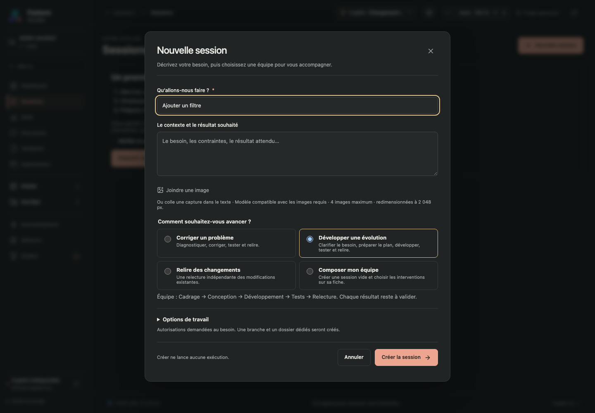

# Guide d’utilisation de Feature Studio

[Captures et Documentation technique](IMAGES-DOCUMENTATION.md) · [Dossier de preuves](DOSSIER-PREUVES.md)

[Retour au README](../README.md) · [Kits](KITS.md) · [Kit DevOps](DEVOPS-KIT.md)

## Préparer sa première session

Ce parcours fait partie de la [consolidation intégrée](CONSOLIDATION.md). Sans session enregistrée, la page **Sessions** explique les trois étapes du travail et affiche l’état de la connexion Copilot. Si le projet n’est pas approuvé, **Approuver le projet dans VS Code** ouvre la gestion native de la confiance. Tu peux préparer une session avant de connecter Copilot ; le premier lancement exigera un runtime compatible, un compte connecté et un modèle disponible.

1. Clique **Préparer ma première session** ou **Nouvelle session**. Choisis le projet, donne un titre puis décris le résultat attendu et les contraintes.
2. Choisis une équipe : **Corriger un problème** prépare plan, développement, tests et relecture ; **Développer une évolution** ajoute le cadrage ; **Relire des changements** prépare une relecture seule. **Composer mon équipe** crée une session à composer ensuite. La liste affiche les membres du parcours effectivement disponible dans le projet ; si un membre manque, choisis un autre parcours ou une composition libre.
3. **Options de travail** permet d’ajuster les permissions et le dossier. Le mode **Manuel** est sélectionné au départ. Pour un projet Git compatible, correction et évolution proposent un worktree séparé. La relecture propose le dossier courant pour examiner les changements qui s’y trouvent. Plusieurs projets utilisent leurs dossiers d’origine. Le résumé reste visible quand les options sont repliées.
4. Clique **Créer la session**. Le dernier parcours choisi est mémorisé, y compris la composition libre. Sans préférence disponible, l’évolution est proposée si son équipe existe au catalogue ; sinon, la composition libre est sélectionnée. Une proposition issue de Discussion conserve son équipe. Aucun agent ne démarre à la création.
5. Dans la session, prépare le contexte du premier agent, vérifie-le puis lance le travail. Relis et valide chaque résultat avant de poursuivre.

Si l’enregistrement échoue, l’erreur apparaît dans la fenêtre et la saisie est conservée. Réessayer un formulaire inchangé réutilise la même demande. Les boutons restent accessibles en bas de la fenêtre pendant le défilement.



Capture de démonstration, avec données fictives. [Vue en fenêtre étroite](images/first-session-390.png).

## Sous-plans et sous-équipes

Ajoute une carte **Sous-plan** dans une équipe enregistrée ou dans **Modifier l’équipe** d’une feature. Sa carte possède un visuel dédié. Choisis son orchestrateur, son mode de découpage et sa sous-équipe ; celle-ci peut contenir d’autres sous-plans. Le chat sert à discuter le découpage et à ajouter des tâches. Clique sur la carte pour afficher son chat et ses tâches au même niveau. Clique ensuite sur une tâche dans le panneau des sous-tâches pour ouvrir sa sous-équipe, avec retour au niveau précédent ou à l’équipe de base. [Guide détaillé](SOUS-PLANS.md).

## Conversation intégrée de l’étape

Depuis la v1.23.0, l’onglet **Conversation** remplace l’attente opaque pendant une nouvelle tentative native. Il reste disponible avec le livrable. Pendant une exécution solo, passe en pair pour intervenir. Dès que le résultat attend ta validation, tu peux écrire directement : le premier message reprend l’échange en pair dans la même conversation, avec les mêmes permissions et le livrable conservé. Reviens en solo pour confier le travail convenu. Le chat reste actif jusqu’à la validation de l’étape, puis devient consultable. Rythme, explications et permissions se règlent séparément. [Parcours complet, messages et reprise](MODE-PAIR.md).

## Outils natifs et permissions

Les nouvelles sessions démarrent en **Copilot natif**, avec le mode **Manuel** par défaut. Le choix est disponible dans **Options de travail** à la création, dans la préparation d’un lancement et dans la session. Réponds aux demandes de Copilot par **Autoriser une fois** ou **Refuser**. Le mode **Tout autoriser** accepte les actions natives, sous réserve des règles imposées par Copilot ; **Assisté** n’est sélectionnable que si le runtime le confirme. Ces choix ne changent ni le solo/pair ni les validations du parcours.

Le CLI 1.0.102 avec le SDK embarqué 1.0.20 constitue le couple vérifié. Un ancien CLI peut se connecter tout en étant incompatible avec l’exécution native : le lancement est alors bloqué et le diagnostic explique la mise à jour nécessaire. [Guide des permissions et des résultats natifs](COPILOT-NATIF.md).

## Installation

1. Télécharge le VSIX et son fichier `SHA256SUMS` depuis la [release indiquée dans le README](../README.md). Le guide peut décrire des changements en préparation : consulte les notes de la version installée.
2. Dans VS Code ou VS Code Insiders : **Extensions → … → Installer à partir du VSIX…**.
3. Ouvre le dossier du projet que tu souhaites développer, puis approuve ce workspace.
4. Clique sur l’icône **L’équipe** de Feature Studio dans la barre latérale de VS Code : le cockpit s’ouvre directement dans la fenêtre courante. La commande **Feature Studio : ouvrir le cockpit** et le bouton de la barre d’état restent disponibles.
5. Copilot se connecte automatiquement à l'ouverture du cockpit dans un espace de travail approuvé : le diagnostic vérifie le CLI, le compte et les modèles sans envoyer de prompt. En cas d'échec, consulte **Réglages → Connexion**, corrige le problème indiqué, puis clique sur **Vérifier la connexion** pour réessayer.

Prérequis : **VS Code 1.110 ou ultérieur**, Git pour les branches/diffs, et **GitHub Copilot CLI** installé et authentifié avec un abonnement donnant accès au CLI. Installer le VSIX ne nécessite ni Node.js ni npm séparément. Le moteur Node embarqué dans les versions récentes de VS Code est utilisé par l’extension.

Le réglage `featureStudio.cliPath` vaut **auto** par défaut : recherche dans le PATH du processus VS Code, puis les installations utilisateur usuelles. Dans **Réglages**, le diagnostic affiche le chemin trouvé et sa provenance. Le bouton **Détection automatique** remplace un ancien chemin personnalisé et relance le diagnostic si le projet est approuvé et disponible. Les lanceurs intermédiaires VS Code (`copilotCli` et `bin/copilot-shim`) sont ignorés. Pour imposer une installation, renseigne son chemin complet dans **Chemin du CLI dans VS Code**. Sur macOS avec Homebrew, ce peut être `/opt/homebrew/bin/copilot`. L’extension ne met pas le CLI à jour automatiquement. Voir [l’installation officielle du CLI](https://docs.github.com/en/copilot/how-tos/copilot-cli/set-up-copilot-cli/install-copilot-cli).

**Feature Studio ouvre son propre onglet de travail.** Il utilise le CLI local et son authentification ; il ne remplace pas les composants internes de la vue Chat de l’extension GitHub Copilot. Les deux interfaces peuvent coexister. Aucun serveur applicatif supplémentaire n’est requis ; les requêtes IA passent naturellement par GitHub Copilot.

## Accéder au cockpit depuis la barre latérale

L’entrée **Feature Studio**, reconnaissable à son logo de trois agents, ouvre directement le cockpit dans un onglet de la fenêtre courante. Son volet de lancement se referme automatiquement après l’ouverture ; aucun second clic n’est nécessaire. Plusieurs clics retrouvent le même onglet. Sans dossier ouvert, tu peux ajouter tes projets depuis les réglages du cockpit. Si l’ouverture échoue, le volet conserve un bouton pour réessayer.

Le **raccourci Windows** et la commande **Feature Studio : ouvrir la fenêtre dédiée** conservent une fenêtre à part. Les autres commandes de l’extension et la restauration d’un onglet après rechargement restent dans leur fenêtre d’origine.

Afficher le volet seul ne démarre aucune session et n’appelle aucun modèle. L’avatar en couleur apparaît dans le volet ; sa déclinaison monochrome dans la barre d’activité suit les couleurs de VS Code. Si tu l’as masquée, fais un clic droit sur la barre d’activité pour réafficher **Feature Studio**.

## Choisir l’apparence du cockpit

En haut de **Réglages**, **L’ambiance du cockpit** propose **Suivre VS Code**, puis **Jardin des idées**, **Papier vivant** et **Guilde pixel**, chacun en clair et sombre. Le septième thème, **Halloween**, transforme le décor et habille les vingt personnages (repos, travail animé et réussite). Ce thème événement est entièrement facultatif, sans activation automatique à une date donnée. Les portraits habituels reviennent dès que tu choisis une autre ambiance. Si un costume ne se charge pas, le portrait original prend le relais.

Clique une carte : le thème s’applique dès l’enregistrement confirmé, sans redémarrer le cockpit. Ta préférence est personnelle, conservée dans le réglage utilisateur VS Code `featureStudio.appearance.theme` et partagée entre tes projets ; ce choix n’écrit aucun fichier du projet et n’invalide pas le travail en cours. Un thème explicite conserve ses couleurs et costumes même avec un thème VS Code classé à contraste élevé, comme Bearded Milkshake Vanilla Banana. **Suivre VS Code** reprend la palette de l’éditeur ; les couleurs forcées du système restent prioritaires. Dans la démonstration, le choix sert uniquement d’aperçu pendant la session et n’est pas enregistré.

Le thème secret **Dragon Ball** se découvre sur **Dashboard** ou sa Tour de contrôle en saisissant **↑ ↑ ↓ ↓ ← → ← →**, hors des champs de saisie et des dialogues. Après la révélation, il reste disponible dans les réglages et habille les vingt agents. [Le dojo secret](WORKFLOWS.md#le-thème-secret-dragon-ball).

## Afficher le QG vivant

Dans une session, déplie **Équipe et parcours**, puis coche **Afficher le QG vivant**. Chaque poste ouvre le détail de son intervention ; le décor suit le thème. Les questions humaines, choix facultatifs et interventions passées restent visibles avec leur état réel. La case conserve ton choix entre projets et permet de revenir à la bande classique, sans perdre la sélection ni un brouillon. Elle est désactivée par défaut. [Utilisation du QG](WORKFLOWS.md#bande-des-agents-ou-qg-vivant).

Quand une nouvelle tentative démarre à partir de la deuxième étape, **quatre avions en papier** volent du personnage de l’étape immédiatement précédente vers celui qui prend le relais. Le passage dure **cinq secondes** et accompagne le lancement réel, classique ou en pair, sans le retarder. Il ne se rejoue pas à chaque réponse, lors de la reprise d’un lot en pair ou en rouvrant la session. Les trajectoires s’adaptent aux postes sur plusieurs lignes et au zoom. En mouvement réduit, seul le libellé du passage de contexte s’affiche.

## Agrandir l’interface

Le bandeau supérieur propose **− / Auto / +**. Le zoom agrandit ensemble textes, boutons, icônes et avatars. Choisis **80 à 200 %** pour garder une taille fixe ; **Auto** adapte l’affichage lorsque tu redimensionnes la fenêtre ou changes d’écran.

Le mode Auto utilise l’espace disponible : par exemple 125 % en 1920 × 1080, 150 % en 2560 × 1440 et 175 % en 3840 × 2160, lorsque ces dimensions sont disponibles après la mise à l’échelle de Windows et de VS Code. Une fenêtre basse conserve davantage d’espace vertical.

Le choix se trouve également dans **Réglages → Votre atelier → Taille de l’interface**. Il est enregistré dans les réglages personnels de VS Code, commun à tous tes projets, et conservé après fermeture. Changer de zoom ne lance aucun agent et ne consomme aucun crédit.

## Quêtes et trophées

Le menu **Quêtes** affiche ton total de trophées. Le carnet propose **100 quêtes**, chacune valant **1 à 10 trophées** : 80 missions réparties en 16 séries de cinq paliers, et 20 défis uniques.

**À jouer** montre les missions disponibles. Réussir une mission de série révèle la suivante : créer un agent, puis deux, cinq, dix et vingt ; composer une équipe, puis trois, cinq, dix et vingt compositions différentes. **Accomplies** garde les réussites. **Collection** montre les 100 missions, y compris celles encore verrouillées. Filtre par famille ou cherche une action ; **Comment la réussir** précise les conditions. Le bouton d’une quête ouvre l’écran utile, sans lancer d’agent automatiquement.

Les premières missions couvrent la création et le lancement d’une feature. D’autres invitent à répondre aux questions, relire et valider les rapports, les modifier, commenter, créer des checkpoints, écrire des skills, enrichir la mémoire ou utiliser l’Observateur. **Les six fantastiques** exige six agents différents qui terminent leurs interventions avec succès, de suite, dans une même feature : un échec ou une annulation interrompt la série. Des relances du même agent ne suffisent pas.

Les trophées sont attribués automatiquement, une seule fois par quête. Une réponse d’agent en échec, un aperçu de lancement ou une sauvegarde répétée ne simulent pas une action réussie. Les checkpoints automatiques ne remplacent pas les checkpoints manuels demandés. Les trophées sont conservés même si tu archives ou supprimes ensuite une session.

La progression est personnelle, commune aux projets et enregistrée localement dans le stockage du cockpit (`quests.json`). Les sessions encore présentes et les profils personnels disponibles peuvent compléter des quêtes à l’installation. L’historique ne permet pas de reconstruire toutes les actions anciennes (par exemple les exports et les créations de parcours) ; celles-ci sont comptées à partir de cette version. Les identités d’exécution des nouveaux lancements sont figées pour éviter de réinterpréter une ancienne intervention après modification de l’étape.

Si le fichier de progression est illisible, le carnet le signale et le conserve. **Relire la progression** retente sa lecture ; le compteur affiche un tiret au lieu d’inventer un total. Les trophées ne sont jamais dépensés : ils débloquent six cadeaux aux seuils de 5, 20, 40, 70, 110 et 200. **Prochain cadeau** montre le seul palier à venir ; **Mes récompenses** permet d’activer ou de retirer les thèmes, titres, la célébration Eiffel et le chaton déjà acquis. [Consulter les récompenses](WORKFLOWS.md#quêtes-et-récompenses). La démo présente le carnet sans enregistrer de récompense personnelle.

## Héritage des profils dans une équipe

Un agent ajouté seul et un agent ajouté depuis une équipe reprennent le profil du menu **Agents** au lancement : instructions, skills, outils métier, contexte vide par défaut et ton. Les outils génériques natifs et leurs permissions sont ceux de la session. Dans une équipe, seuls **Modèle de l’intervention** et **Niveau de réflexion** peuvent remplacer les valeurs du profil. Les autres paramètres sont affichés en lecture seule ; modifie-les dans **Agents**. L’ajout, le retrait, l’ordre et la participation obligatoire ou facultative restent des choix de composition.

Depuis la v1.24, le modèle et la réflexion sont copiés à l’ajout puis conservés sur chaque carte, y compris le choix automatique. Une modification du profil source actualise ses autres champs sans remplacer ces deux choix. Si tu changes le profil après avoir préparé l’aperçu, recalcule l’aperçu. Un profil de modèle explicitement activé dans le budget de la feature garde sa priorité, signalée dans le compositeur.

L’éditeur **Agents** propose maintenant une réflexion et des permissions par défaut. Pour les profils anciens sans permissions explicites, les outils demandés déterminent le profil : `execute` ou `studio_run_test` sélectionne les tests préautorisés, sinon un outil d’édition sélectionne l’écriture dans le projet, et les autres profils restent en lecture seule. Une commande de test doit toujours être autorisée dans les réglages du projet.

Les modèles d’équipes déjà enregistrés sont adaptés automatiquement à leur lecture, en conservant leurs remplacements explicites de modèle et de réflexion. Les anciennes sessions conservent leur définition : avant leur premier lancement, ouvre **Modifier l’équipe**, puis valide pour activer l’héritage. Une session en cours reste modifiable : les changements attendent la fin de l’appel actif, et les membres déjà utilisés conservent leur historique. Les exécutions archivées ne changent pas.

## Discuter avec ses agents

**Discussion**, dans le menu principal, ouvre un chat avec un historique à gauche, classé par date. Choisis l’agent, le modèle et le niveau de raisonnement proposé par ton compte Copilot. Ces choix s’appliquent à la conversation et préservent les valeurs par défaut du profil. Tes messages apparaissent à droite ; les réponses progressives de l’agent, avec son avatar, à gauche. **Arrêter** interrompt la réponse ; tu peux ensuite poursuivre le même échange. Entrée envoie, Maj + Entrée ajoute une ligne.

Dans **Agents → Nouvel agent** ou l’éditeur d’un profil existant, coche **Agent de discussion**. Ces profils sont proposés en priorité ; **Voir plus** révèle les autres agents. Les profils propres à un projet portent son nom dans la liste. Les instructions, skills et ton du profil accompagnent l’échange ; ajoute dans tes messages le contexte utile. Ce chat n’exécute pas de commandes et ne consulte pas automatiquement les fichiers des projets.

Les discussions sont enregistrées localement et retrouvées après rechargement de VS Code. Recherche une conversation dans le bandeau de gauche, ou supprime son historique avec la corbeille et la confirmation native. Les mesures remontées par Copilot sont incluses dans **Consommation**, sous **Discussions**.

### Questionner un compte rendu

Dans une session, clique **Discuter avec l’agent** à côté du livrable terminé. Le chat reprend le profil de cette exécution, son modèle et son niveau de raisonnement lorsqu’ils ont été archivés, le prompt de lancement (dont les skills et livrables sélectionnés), les échanges et résultats d’outils disponibles, les réponses humaines et la sortie. Le bouton n’envoie pas de prompt : le premier appel part à ta première question. Le même rapport et la même révision retrouvent le même fil, même après rechargement ou modification du profil.

Le bandeau rappelle la session et l’étape. Déplie **Compte rendu au début de cette discussion** ou **Contexte transmis à l’agent** pour vérifier les sources. **Revenir au compte rendu** retrouve la tentative ; **Modifier le compte rendu actuel** ouvre l’éditeur de la dernière tentative. Si la sortie a évolué, un message le précise et la copie discutée reste intacte. Un brouillon de rapport non enregistré doit être terminé ou annulé avant de changer de vue.

Les anciens lancements sans archives ne permettent pas de recréer leur contexte d’origine. Les données manquantes, un raisonnement non archivé ou des traces écartées pour rester dans la capacité du chat sont signalés ; le prompt et la sortie ne sont pas résumés silencieusement. Les grandes archives sont transmises par extraits bornés, avec leurs avertissements historiques et une indication de troncature ; les originaux restent conservés. Des instructions de profil ou des skills qui dépassent encore le budget total peuvent faire refuser l’envoi. La discussion conserve une copie distincte : supprimer la session empêche le retour au rapport mais conserve ce fil, supprimable séparément.

### Passer d’une idée à une feature

Après avoir échangé avec l’agent, clique **Créer une feature**. L’agent prépare une proposition à partir de la conversation, avec le modèle choisi ; cet appel est comptabilisé dans la consommation du chat. La proposition utilise les agents disponibles du projet actif et n’exécute aucun outil.

Un formulaire présente le titre, le besoin, les critères de réussite (un par ligne) et les interventions proposées. Choisis les projets, remplace ou retire des agents, change leur ordre et vérifie les paramètres hérités de leur profil. Seuls leur modèle et leur réflexion peuvent être remplacés pour cette équipe. La proposition et les ajustements de la vue sont conservés ; une erreur de création laisse le formulaire ouvert. **Actualiser la proposition** demande une nouvelle synthèse des échanges.

**Créer la feature** enregistre une session en brouillon, ses critères encore à vérifier et l’équipe relue. Aucun agent ne démarre automatiquement. Tu retrouves les réglages complets dans **Composer mon équipe**, puis l’aperçu habituel avant lancement. **Discussion d’origine** revient à l’échange ayant préparé la feature.

## Projet actif et réglages

Sessions, Stats, Discussion, Validation et Consommation réunissent les données de tous les projets. La création d’une feature conserve son propre choix de projets. Le sélecteur reste présent dans Mémoire, les bibliothèques qui utilisent les profils du projet, Azure DevOps et Livraison.

Dans **Réglages**, l’apparence, la connexion Copilot, les dossiers enregistrés et le raccourci sont réunis dans **Commun à tous les projets**. En dessous, **Paramètres par projet** propose une liste déroulante pour choisir le dépôt dont tu règles les modèles, budgets, MCP et tests. Le menu **Automatisations** propose le même choix pour les hooks. Enregistre ou annule un brouillon avant de changer de projet.

Dans **Mes équipes**, **Supprimer** retire le parcours du catalogue personnel pour tous les projets, après confirmation. Les sessions déjà créées et les fichiers de définition sont conservés. Réenregistrer explicitement une définition avec le même identifiant la rend de nouveau disponible.

## Interventions obligatoires et facultatives

Le caractère facultatif appartient à une **intervention dans un parcours**. Le même agent peut relire obligatoirement l’US et proposer facultativement une documentation. Les équipes existantes restent obligatoires par défaut.

Dans **Mes équipes**, ouvre ou duplique une équipe et règle la **Participation** de chaque intervention. Dans une feature, ouvre **Composer mon équipe** ou **Modifier l’équipe** : le choix est directement visible sur chaque membre, avant de lancer le travail. L’adaptation concerne uniquement cette feature, même si elle reprend un modèle d’équipe. La composition reste modifiable pendant son utilisation ; une carte déjà utilisée ne peut pas être supprimée ou remplacée.

**En manuel**, une intervention facultative disponible propose **Passer cette intervention**. Ses préalables doivent être validés ou explicitement passés. Le bouton habituel permet de l’exécuter avec l’aperçu de lancement. Passer ne lance ni l’agent ni le pilote automatique.

**Avec le pilote**, une intervention facultative jamais exécutée suspend le parcours avant tout appel de modèle. Une notification VS Code et un bandeau dans la feature proposent :

- **Exécuter et continuer** : enregistrer ton choix puis reprendre les règles normales du pilote.
- **Passer et continuer** : enregistrer le passage puis poursuivre les interventions suivantes.
- **Décider plus tard** : garder le pilote en pause. Fermer la notification produit le même résultat.

Les confirmations propres à l’intervention, checkpoints, budgets et limites de tentatives restent applicables après ton choix. La décision en attente est enregistrée ; fermer puis rouvrir le cockpit ne lance rien. Une notification devenue ancienne après une modification est refusée : utilise le bandeau actuel de la session.

**Passée par l’humain — non exécutée** désigne une intervention jamais tentée. **Passée après tentative — non validée** conserve les exécutions précédentes, leurs résultats, échecs et éventuels fichiers modifiés ; ce passage ne les transforme pas en résultats approuvés. Le bilan liste ces interventions séparément des validations ; les exports conservent la date et l’historique des décisions. Les agents suivants reçoivent la liste des interventions passées pour éviter de supposer qu’elles ont produit un résultat. Les critères de réussite, les remarques bloquantes et les preuves exigées pour les interventions réellement exécutées restent nécessaires.

Depuis la 1.31.1, une intervention facultative arrêtée ou en attente peut être passée après confirmation, si ses préalables sont résolus et qu’aucune exécution ou correction imposée ne l’empêche. Ce choix n’efface pas un échec ni les changements déjà réalisés. Pour exécuter finalement une intervention passée, sélectionne-la et utilise **Exécuter finalement cette étape** : les interventions qui en dépendent devront être revues. Modifier le contexte, rejouer un préalable, inclure une intervention passée dans une correction ou restaurer des fichiers remet les choix concernés en attente tout en gardant leur historique.

Pour ton parcours quotidien, tu peux par exemple garder **US → plan → code → tests → relecture** obligatoires, ajouter la **documentation** facultative avant la **PR**, puis alléger la composition avant le départ selon la tâche. Le choix facultatif ne déclenche aucune publication à lui seul.

## Choisir un parcours

| Parcours          | Pour quoi ?                                                    | Étapes                                                    |
| ----------------- | -------------------------------------------------------------- | --------------------------------------------------------- |
| Feature complète  | Développer un besoin avec des décisions intermédiaires         | Spécifications → plan → développement → tests → relecture |
| Correction de bug | Reproduire un problème et vérifier sa correction               | Plan → développement → tests → relecture                  |
| Relecture seule   | Examiner les changements sans écrire, compiler ou tester       | Relecture                                                 |
| Session libre     | Confier une tâche à un seul agent, dans une vraie conversation | Une étape de développement configurable                   |

La page **Sessions** affiche une liste compacte sur toute la largeur : nom, branche, projets, état, progression et dernière activité. **Ouvrir** consulte une session ; un clic sur la ligne ou sa case la sélectionne. Aucune session d’exemple n’est ajoutée à ton projet.

Le filtre **Projet** est propre à cette liste et ne modifie pas le projet d’exécution. Une session multi-projets apparaît pour chacun de ses projets. Recherche, état et tri se combinent ; ils sont conservés quand tu ouvres une session puis reviens à la liste. Les badges identifient les projets ; leur infobulle donne le chemin complet.

Pour agir en masse, sélectionne une première ligne puis utilise **Maj+clic** sur une autre : toutes les lignes visibles entre les deux sont ajoutées. La case de l’en-tête sélectionne toutes les sessions affichées. Un changement de filtre ou de tri vide la sélection. Les cases fonctionnent aussi au clavier avec Espace et Maj+Espace.

**Archiver** conserve les données ; l’onglet **Archives** permet de les consulter et de les **Restaurer**. **Supprimer** demande une seule confirmation pour le lot sélectionné. Les sources, branches, worktrees et exports externes sont conservés. La progression et les éventuels échecs apparaissent sur la page ; une session en cours d’exécution doit d’abord être arrêtée. Les mêmes actions existent individuellement à droite de chaque ligne.

### Explorer les statistiques

**Stats**, accessible directement dans le menu principal, réunit les sessions de tous les projets chargés. Les archives sont incluses par défaut. Choisis un **projet**, un **parcours** et une **période** : aujourd’hui, 7/30/90 jours, mois courant/précédent, année, tout l’historique ou dates personnalisées. Le regroupement du graphique se règle par **jour**, **semaine** (lundi) ou **mois**. Les dates utilisent le fuseau de l’écran ; les deux bornes personnalisées sont incluses. Les longues périodes basculent explicitement en vue mensuelle.

- Les indicateurs distinguent sessions du périmètre, créations, finalisations datées et tentatives. Une ancienne session reprise aujourd’hui contribue à l’activité d’aujourd’hui sans devenir une nouvelle création.
- Le graphique d’activité propose créations, finalisations, lancements ou crédits observés. Son tableau donne les valeurs exactes. Les autres vues montrent le podium des agents, les modèles utilisés, les heures habituelles de lancement, les séries de jours actifs, les relances et les états actuels des sessions.
- La taille est présentée sous plusieurs angles : étapes par session, tentatives par session, caractères moyens des contextes et des livrables conservés. **Calculer le stockage** mesure les fichiers privés des sessions sélectionnées, par petits lots, sans appel IA. Sources, worktrees, points de restauration et pièces jointes partagées sont exclus. Ce chiffre correspond au stockage actuel, pas à une taille historique.
- Les projets multiples ne doublent pas les totaux globaux. Une session apparaît toutefois dans chaque ligne de projet concernée : ces lignes ne s’additionnent pas. Les sessions supprimées et les projets indisponibles ne peuvent pas être comptés ; les discussions et analyses d’observateur sont hors périmètre.
- Les crédits absents restent « — » et les mesures partielles sont indiquées. Le modèle communiqué est prioritaire ; à défaut, le modèle demandé au lancement est utilisé. Le total d’une tentative n’est jamais additionné une seconde fois à sa ventilation par modèle.

Le classement mesure la fréquence d’utilisation, pas la qualité. Les durées mesurent le temps entre lancement et fin d’une tentative, sans estimation de temps humain économisé. **Comprendre les chiffres et leur couverture** expose les définitions et les données manquantes. Les filtres sont conservés après ouverture d’une session depuis le classement.

### Les menus du cockpit

**Sessions** regroupe les sessions. **Azure DevOps** conserve l’aperçu et la configuration ; ses sous-menus **PR** et **Tickets**, toujours visibles, ouvrent deux tableaux dédiés ; **Livraison** prépare les opérations Git du dépôt ouvert. Ces deux menus fonctionnent sans session active. **Consommation** regroupe les mesures SDK par session, parcours et modèle, avec filtres et couverture inconnue/partielle, sans estimation. [Consommation et validations](../docs/consumption.md). **Validation** rassemble questions, livrables et preuves ; **Mes équipes**, **Agents**, **Skills**, **Mémoire**, **Automatisations** et **Réglages** permettent de configurer le travail.

### Développer une feature

1. Clique **Nouvelle session**, choisis le parcours, donne un titre et décris le résultat attendu. **L’espace de cette session** propose un **Worktree isolé** pour une feature ou une session libre, et le **Dossier courant** pour une relecture. Tu peux changer ce choix avant la création.
2. Ouvre une étape. **Configurer** permet de régler le modèle réellement proposé par le CLI, la réflexion et la limite de tentatives. Pour les équipes liées aux profils, les skills et les autres paramètres proviennent du menu Agents ; les anciennes sessions conservent leurs réglages historiques.
3. Clique **Exécuter cette étape** : colle ta **US, demande ou contexte initial**, choisis les MCP utiles, puis attends l’aperçu actualisé automatiquement après la saisie ; **Préparer l’aperçu** permet aussi de le demander immédiatement. Relis les sources et le prompt assemblé ; **Lancer cette étape** démarre ensuite la vraie session. Le même dialogue apparaît pour une reprise ou une nouvelle tentative. Tout changement invalide l’aperçu précédent.
4. Si l’agent utilise `studio_ask_human`, sa question apparaît pendant l’exécution : réponds et clique **Transmettre la réponse**. L’appel attend réellement ta réponse. Si le modèle termine plutôt avec un bloc de questions, réponds au formulaire puis **Reprendre la session**. Les échanges sont conservés.
5. Relis le **Livrable**. Tu peux éditer son Markdown et l’enregistrer, ou donner un feedback pour une nouvelle tentative.
6. Clique **Valider cette étape**, puis **Continuer**. La validation débloque l’étape suivante ; elle ne lance pas de requête IA toute seule.
7. Après le développement, consulte **Fichiers → Voir le diff** pour ouvrir les modifications dans VS Code.
8. Configure les commandes de test nécessaires, exécute l’étape Tests, puis lance la relecture indépendante.


**Une correction après la relecture ?** Clique **Demander une correction** sur le compte rendu ou sur une remarque. Décris le souci, choisis où l’équipe reprend et consulte les étapes ainsi que le contexte à transmettre. La correction enchaîne jusqu’à la relecture en respectant les validations habituelles ; les anciennes tentatives et les branches indépendantes restent visibles. Le choix avancé permet de repartir de plusieurs étapes.

**Une coquille dans ta demande ou dans un compte rendu ?** Ouvre **Modifier le compte rendu**. Le même écran réunit le texte, son aperçu, l’original de l’agent, l’historique des versions et le besoin initial. Tu peux **Enregistrer et valider** ta correction ou **Faire réviser par l’agent**. Modifier un rapport remet ses dépendants à actualiser ; modifier le besoin remet conservativement le parcours à revoir. Les agents suivants utilisent la version corrigée et approuvée. Une édition du texte ne change ni un résultat de tests ni un verdict structuré.

**Télécharger un compte rendu :** dans **Livrable**, clique **Télécharger .md**, puis choisis le fichier dans la fenêtre d’enregistrement. L’export contient le Markdown intégral de la tentative affichée, y compris une ancienne tentative. Attends la fin d’une tentative en cours et enregistre ou abandonne un éventuel brouillon avant l’export. Aucun agent n’est lancé et aucun crédit n’est consommé.

**À la fin du parcours**, choisis **Valider définitivement** ou **Faire une correction**. Seule la validation finale réussie termine la session et affiche la célébration d’équipe. Les fichiers liés aux preuves sont revérifiés avant ce choix. Tu peux rejouer la célébration ou désactiver ses effets ; la réduction des animations est respectée. [Historique, corrections et décision finale](WORKFLOWS.md).

**Arrêter** annule le processus ; les fichiers déjà écrits restent présents pour inspection. Après fermeture ou interruption, la tentative devient annulée ou interrompue. **Reprendre** peut réutiliser son identifiant Copilot si le contexte reste compatible ; une sélection explicite de contexte ou un profil à contexte vide peut exiger une nouvelle conversation, annoncée dans l’aperçu. **Nouvelle tentative** ouvre une nouvelle conversation avec les livrables approuvés et le contexte précédent. Dans la conversation native intégrée, la reprise conserve la tentative et compte un nouvel appel dans le budget. Dans le parcours historique, elle consomme une nouvelle tentative. Par défaut, les appels et relances manuels ne sont pas plafonnés. **Configurer → Limite de tentatives** et **Budget → Nombre maximal d’exécutions** permettent de fixer une limite ; laisse le champ vide pour la retirer. Les limites déjà enregistrées restent appliquées. L’autopilot conserve son propre plafond.

Les sessions restent liées à leur branche et à leur dossier d’exécution. À la création d’une session isolée, Feature Studio crée une branche et un worktree local depuis le dernier commit **HEAD**. Il ne crée aucun commit, push, PR ni déploiement automatiquement.

## Recette Playwright et contre-exemples

Le parcours **Feature avec recette et contre-exemples** (`quality-feature`) ajoute une **Recette visuelle**, puis une recherche de **Contre-exemples** par un agent indépendant, avant la relecture. Il cible d’abord les applications web disposant de tests Playwright locaux. Une description de test dans un livrable ne suffit pas : les scénarios et leurs pièces sont recueillis depuis une commande réellement exécutée par l’hôte.

Dans **Réglages → Commandes de test autorisées**, installe explicitement le reporter qualité et configure une commande Playwright avec la collecte **Recette visuelle** ou **Contre-exemples** et le chemin de rapport. Dans une session isolée, **Preuves → Installer le reporter dans cette session** copie le kit dans son worktree. Installe toi-même les dépendances, le navigateur et l’environnement local nécessaires ; Feature Studio ne le fait pas automatiquement. Le reporter doit aussi être déclaré dans la configuration Playwright.

Les preuves affichent cas, attendu/observé, reproduction, captures et traces conservées localement. Lorsqu’une collecte qualité est configurée, un rapport manquant, ancien, invalide, vide, incomplet ou échoué est une preuve bloquante pour la validation. Les critères restent à approuver humainement ; les corrections du pilote exigent une route et des limites déjà configurées. [Configuration complète](../defaults/quality/README.md).

## Azure DevOps et livraison confirmée

Ouvre **Azure DevOps** pour renseigner organisation, projet, dépôt et remote. Le PAT se saisit dans une fenêtre VS Code masquée et reste dans **SecretStorage**. Le push utilise tes identifiants Git locaux. L’aperçu charge les tickets assignés et les PR créées du compte et permet de créer/retrouver une feature liée à un ticket. La configuration et les liens persistent localement.

Les sous-menus **PR** et **Tickets** restent visibles, même sans connexion ou session active. Chaque tableau propose des compteurs sur les éléments reçus, une recherche, des filtres par état et lien avec une feature, et un tri par date, numéro ou titre. Les cartes affichent les branches, l’auteur et les relecteurs pour les PR ; le type, les dates, les tags, la description, les critères et les commentaires chargeables pour les tickets, selon les données disponibles. Tu peux ouvrir Azure DevOps et retrouver les features liées depuis les cartes. Les votes des relecteurs sont indicatifs : les politiques de validation se vérifient dans Azure DevOps. Les listes partielles sont signalées ; les filtres et compteurs portent uniquement sur les éléments reçus.

Dans **Livraison**, inspecte le dépôt ouvert, sélectionne les fichiers complets concernés, saisis l’intention puis clique sur **Générer le titre du commit**. Tu peux modifier ce titre ou le saisir directement. **Valider le commit**, juste à côté, vérifie les fichiers et le titre puis demande la confirmation VS Code. **Push** et **PR brouillon** conservent leur aperçu et leur confirmation séparés. Le staging des fichiers non sélectionnés est conservé. Le push est sans force ; la PR n’active aucune fusion ni auto-complétion.

Le profil **Livraison** (`fs-delivery.agent.md`) se modifie dans **Agents**. Son bloc fenced `delivery-rules` définit les types conventionnels et le titre de repli selon des règles déterministes. La conversation de livraison reste locale et ne déclenche aucune opération Git ; la livraison ne fait aucun appel modèle. Les hooks, filtres et signatures Git ne sont pas exécutés dans ce mode. [Fonctionnement, limites et récupération](../docs/devops-delivery.md).

## Personnaliser l’écran de session

**Personnaliser l’affichage**, en haut de chaque session, ouvre la liste des modules. Coche ceux à afficher et déplace-les par glisser-déposer ou avec les flèches, puis clique **Appliquer l’affichage**. Le choix est enregistré dans tes réglages utilisateur VS Code et s’applique aux autres sessions et projets. **Rétablir l’affichage par défaut** prépare l’ordre initial avec tous les modules visibles ; clique ensuite **Appliquer**. Les modules conditionnels, comme le ticket d’origine ou le bilan, apparaissent lorsqu’ils ont un contenu.

Masquer ou déplacer un module ne supprime aucune donnée et ne lance aucune action d’agent. Les composants conservent leur état. Une question en attente ou une validation finale garde un raccourci visible pour rouvrir le module concerné ; **Aller à l’étape en cours** réaffiche aussi le détail de l’étape. Ces ouvertures ponctuelles ne changent pas la préférence globale.

## Un espace Git et des points de restauration par feature

Le **Worktree isolé** est un dossier frère du projet, avec sa branche `codex/feature-studio-…`. Il contient uniquement l’état commité de HEAD : les modifications non commitées, les fichiers non suivis et les changements déjà stagés restent dans le dossier source. Aucune dépendance ni préparation d’outils n’est installée automatiquement. Les hooks Git, `fsmonitor` et filtres externes sont neutralisés ; LFS/smudge n’est pas matérialisé automatiquement. Prépare cet environnement avant de demander des tests qui en ont besoin.

L’isolation demande d’ouvrir la racine d’un dépôt Git ayant un commit HEAD. Si elle est indisponible, son choix est désactivé et le cockpit affiche la raison. La **relecture seule** utilise le dossier courant par défaut pour examiner le diff déjà présent. Les sessions créées avant la v0.3 conservent aussi leur dossier courant ; elles ne sont pas déplacées automatiquement.

Le bandeau **ESPACE GIT** affiche le dossier et la branche de la feature. **Ouvrir le dossier** ouvre une nouvelle fenêtre VS Code ; le cockpit d’origine garde l’historique et le pilotage de la session. Si tu ouvres un autre cockpit dans le worktree, son verrou bloque l’accès du cockpit d’origine à cette feature jusqu’à sa fermeture ; les vues de fichiers normales restent utilisables. Les fichiers, diffs, tests et hooks de cette feature sont résolus dans son propre espace.

Dans **Points de restauration** :

1. Une tentative isolée conserve un point **Avant la tentative**, avant les hooks, puis un point **Après la tentative**, y compris après annulation ou échec lorsque la capture reste possible. **Avant**, **Après** et **Comparer** sont accessibles depuis son historique.
2. **Nouveau point → Créer le point** ajoute un point manuel nommé, également disponible pour les anciennes sessions dans le dossier courant.
3. Choisis un point, puis **Comparer les fichiers** avec **État actuel du dossier** ou un autre point. **Diff** ouvre sa comparaison dans VS Code. Une comparaison point-vers-point est consultative.
4. Pour revenir à un point depuis l’état actuel, coche explicitement les fichiers voulus ; la sélection est vide au départ. **Restaurer la sélection → Confirmer la restauration** demande au host de vérifier l’empreinte de la comparaison. Les fichiers ajoutés depuis le point choisi seront supprimés seulement si tu les coches.
5. Une sauvegarde de récupération est enregistrée et rattachée durablement à l’historique **avant toute écriture**. Les validations et preuves d’acceptation deviennent à revalider et le pilote est mis en pause. Si les fichiers ont changé depuis la comparaison, il faut **Actualiser la comparaison**.


Ces points conservent le contenu et les permissions des fichiers inclus ; ils ne restaurent ni l’index Git, ni la branche, ni les commits. Les fichiers ignorés non suivis, secrets usuels, dossiers de configuration, dépendances, sorties de build et liens sont exclus. Les fichiers déjà présents dans Git sont référencés sans recopier leur contenu. Les limites de **64 MiB et 10 000 fichiers** s’appliquent aux contenus supplémentaires à sauvegarder hors de Git ; la limite individuelle reste de **4 MiB**. Le panneau distingue les fichiers référencés de ceux effectivement copiés. Ce mécanisme est une restauration ciblée, pas une sauvegarde exhaustive du projet. **Archiver la session** conserve son dossier et ses points sur disque.

La création, la comparaison et la restauration Git n’ajoutent aucune requête IA. Elles ne publient rien. Les opérations sont verrouillées pendant une tentative ou une autre mutation ; le host recontrôle racine, branche et fichiers. Les buffers non enregistrés sont protégés dans la fenêtre VS Code courante seulement : les autres fenêtres et processus restent hors sandbox. [Périmètre, exclusions et limites détaillés](../docs/WORKSPACES.md).

**Stockage v12 :** les formats v0 à v11 migrent en conservant leurs données connues. Les anciennes interventions restent obligatoires ; les choix facultatifs et demandes en attente sont conservés. Les anciens binaires refusent le nouveau format. Il n’existe pas de migration inverse automatique. Les sessions possèdent leurs propres archives et états, avec un index léger.


## MCP et Azure DevOps : apporter les bonnes US

Dans **Réglages → Connexions MCP**, le preset **Azure DevOps** demande ton organisation et propose la connexion interactive ou une connexion Azure CLI existante. Il configure le serveur Microsoft `@azure-devops/mcp@2.10.0`, domaine `work-items`, avec seulement **`wit_work_item`** autorisé pour consulter les US. Il reste désactivé à la création.

1. Ajoute le preset, puis enregistre les réglages.
2. **Découvrir les outils** lance le serveur et liste ses capacités **sans requête IA**. La première utilisation de `npx` peut télécharger le package et l’authentification Microsoft peut ouvrir un navigateur.
3. Vérifie la liste autorisée, active le serveur et confirme sa configuration dans VS Code.
4. Au lancement d’une étape, coche ce MCP et colle par exemple : « Consulte l’US 208 du projet MonProjet, puis prépare ses critères d’acceptation. » Tu peux aussi coller directement le contenu de l’US sans connexion externe.
5. Une question humaine ou une demande d’autorisation reste accessible dans le cockpit pendant le travail.

Tu peux ajouter tes propres serveurs **stdio, HTTP ou SSE**. La liste d’outils est explicite : aucun joker pendant les sessions. Les clés d’environnement et les en-têtes référencent le **coffre VS Code** ou des variables du processus ; les valeurs secrètes ne sont pas enregistrées dans la configuration du cockpit. N’inscris pas de token dans les arguments ou l’URL. Les lectures automatiques sont facultatives et exigent une annotation de lecture seule du runtime. Une écriture MCP demande une autorisation pour chaque appel ; en profil lecture seule, écriture et opération sans garantie de lecture sont refusées.

**Recette MCP historique : le CLI 1.0.63 était trop ancien pour ce parcours.** Il permettait la découverte, mais l’exécution MCP était refusée avant tout prompt car sa politique de permissions ne pouvait pas être vérifiée. La compatibilité alors observée sans MCP concernait les sessions historiques d’outils hôtes. Les nouvelles sessions natives demandent leurs propres capacités vérifiées ; le couple de référence actuel est CLI 1.0.102 / SDK 1.0.20. Le contrôle porte sur les capacités effectives, sans supposer qu’un numéro de version suffit.

Les sept scénarios de permissions ont été vérifiés avec une fixture locale et le **runtime 1.0.96 fourni avec le SDK**, sans appel modèle. Ce runtime de test n’est pas installé par le VSIX et ne remplace pas ton CLI. L’accès à **ton organisation Azure DevOps** reste à valider avec ton authentification. [Configuration et preuves MCP](../docs/MCP.md).

## Pilote automatique, validation et coût

**Configurer** propose trois profils : **Valider chaque étape**, **Valider le plan et la revue**, ou **Enchaîner jusqu’au bilan**. Les cases permettent un choix personnalisé. Ces profils règlent les validations, pas les permissions Copilot ; les validations obligatoires des sous-équipes et de la documentation restent applicables.

Avant **Démarrer**, KerAI présente la prochaine action, les appels et corrections restants, les arrêts attendus, les connexions MCP, la mémoire, les permissions et le contexte de navigation de chaque étape. Cette vérification n’envoie aucun prompt. Une erreur empêche le démarrage ; les points de validation futurs sont annoncés. Le contexte de navigation de la session est repris par défaut ; choisir aucune application dans une étape l’exclut explicitement pour cette étape.

Une demande de parcours manquant suspend le pilote dès le premier appel. **Compléter la navigation** ouvre l’étape concernée : prépare une nouvelle tentative avec un parcours vérifié. Les autres pauses proposent de relire le résultat ou de reprendre l’étape. **Demander la pause** laisse finir l’appel actif ; **Arrêter maintenant** l’annule.

Le **Journal du pilote** conserve les 200 dernières décisions avec l’heure, l’étape et les compteurs : configuration, lancement, correction, validation et pause. Modifier la configuration conserve les compteurs ; pour donner des appels supplémentaires, augmente explicitement le plafond. Une correction refusée avant l’appel, par exemple sur une mauvaise branche, ne consomme aucun cycle.

Pour valider automatiquement les tests, configure leurs commandes dans **Réglages → Commandes de test autorisées**. Le terminal natif peut produire une preuve lorsqu’il exécute exactement une commande configurée, en mode synchrone, dans le dossier de la session. KerAI compare les fichiers et le commit avant/après, puis à la validation. Il refuse une preuve incomplète, concurrente ou périmée. Si le CLI ne fournit pas son code de sortie structuré, KerAI réexécute la commande autorisée, sans appel IA supplémentaire ; ce second passage est annoncé dans l’aperçu, l’activité et le nom de la preuve. L’arrêt de la tentative annule aussi cette vérification.

Les commandes avec arguments complexes et les rapports qualité/visuels utilisent toujours **studio_run_test**. La capture native est limitée à 5 000 fichiers Git suivis ou non ignorés, 8 Mo par fichier et 64 Mo au total ; un inventaire incomplet exige une preuve hôte ou une reprise humaine. Cette mesure ne couvre pas les dépendances ignorées ni les services externes. Une validation finale humaine reste nécessaire.

Les équipes DevOps peuvent enregistrer leur pilote avant de connaître le résultat du test hors production. L’étape de validation DevOps attend toujours son lancement manuel et ses références vérifiées. Une sauvegarde refusée garde le formulaire et sa saisie ouverts.

Le stockage passe à la version 12 pour conserver ces preuves et le journal. Les formats précédents migrent à la lecture ; les anciens binaires refusent ce nouveau format.

Dans une feature, le **pilote automatique** enchaîne les étapes disponibles suivant les dépendances. Configure les points de validation humaine, le contexte/MCP de chaque étape et les limites avant de le démarrer. Il s’arrête sur une question, une permission MCP, un échec, un seuil atteint ou un checkpoint. **Pause** laisse finir la tentative courante ; **Arrêter** l’annule. Après une réponse, le pilote reprend automatiquement, sauf si tu as demandé une pause. Une permission accordée permet aussi la reprise ; une permission refusée conserve la pause. Les questions possédant un unique choix explicitement marqué « Recommandé » ou « Recommended » sont traitées automatiquement. Le bouton **Réponses automatiques** ouvre les questions et réponses choisies, avec l’étape et l’heure (200 dernières réponses conservées). Sans recommandation claire, le pilote attend ta réponse. **Rester en pause** désactive la reprise automatique. Après un redémarrage, la reprise demeure manuelle. Une tentative échouée ou interrompue se relance manuellement.

La case **Répondre automatiquement aux choix recommandés** permet de désactiver ces choix dans la configuration du pilote ou directement dans son bandeau, même pendant une exécution. Le réglage est mémorisé par session et reste activé par défaut pour les anciennes configurations. Lorsqu’il est désactivé, chaque question attend ta réponse, puis le pilote reprend. Une question déjà affichée reste à traiter manuellement. Le récapitulatif des anciennes réponses automatiques est conservé.

La boucle de correction est facultative : choisis une étape de relecture et une étape de développement en amont. Le pilote utilise le verdict structuré de la relecture ou une preuve de tests en échec ; il rejoue ensuite les étapes devenues obsolètes. Un checkpoint reste prioritaire sur cette boucle. Par défaut, **zéro cycle de correction supplémentaire** : augmente le nombre seulement si tu le souhaites. Il n’y a aucun agent chargé de décider du prochain agent ; l’orchestration est du code local.

Depuis la **1.33.0**, l'option **Suivre les progrès de la boucle** ajoute un contrat figé au premier démarrage : besoin, critères d'acceptation, commandes autorisées et organisation du parcours. Le panneau compare les contrôles entre tentatives et explique les arrêts pour stagnation ou oscillation. **Démarrer une nouvelle boucle** conserve les budgets et l'historique, puis attend une reprise explicite. [Activation, preuves et limites](BOUCLES-CORRECTION.md).

Le **centre de validation** rassemble le livrable, les fichiers/diffs, les commandes de test et leurs sorties réelles, les critères d’acceptation et tes commentaires, éventuellement associés à un fichier/une ligne. Un constat du modèle est distingué d’une preuve issue du runner. Les critères sans preuve et les contrôles de tests restent bloquants. Depuis la 1.31.1, une validation humaine peut accepter les remarques de relecture après un avertissement explicite : la confirmation est conservée pour la clôture, mais les remarques restent visibles et ne sont pas marquées corrigées. Le pilote conserve ses propres règles de validation. Le pilote ne valide pas une étape Tests sans résultat hôte réussi. Une édition du livrable invalide l’ancienne validation ; les preuves sont revérifiées par empreinte des fichiers observés. Le diff de **Fichiers → Voir le diff** compare HEAD aux fichiers de l’espace de la feature. **Points de restauration** propose en plus les comparaisons propres à ses points avant/après ou manuels.

Le panneau **consommation** cumule les mesures reçues et indique les tentatives dont l’usage est inconnu. Tu peux fixer un nombre total de runs, des seuils de tokens/crédits et une taille maximale de contexte. Les validations, aperçus et éditions locales n’appellent pas de modèle. Les profils **économie / équilibré / qualité** utilisent les modèles que tu leur attribues dans les réglages parmi ceux réellement disponibles ; leur nom ne promet aucun tarif. Si le CLI n’annonce que `auto`, aucun modèle moins cher n’est inventé.

## Mémoire locale, à coût maîtrisé

Ajoute les conventions, décisions, informations d’architecture et contexte durable dans **Mémoire**. Tu peux aussi conserver un extrait d’un livrable validé avec son origine. Le texte est enregistré localement, sans agent de résumé ni indexation IA. Une entrée provenant d’une version ensuite invalidée est refusée à la prochaine injection.

La mémoire est **décochée à chaque lancement manuel**. Si tu l’actives, seules les entrées actives que tu coches sont envoyées ; une sélection vide n’ajoute rien. Le total injecté est plafonné à **4 000 caractères**, sans troncature ni résumé automatique. L’aperçu montre chaque entrée ajoutée. Elle peut donc ajouter des tokens au prompt si tu l’actives, mais ne déclenche jamais une requête supplémentaire. Le même choix explicite s’applique au contexte enregistré des étapes du pilote.

## Construire ses propres équipes

Le parcours **DevOps — du besoin au test vérifié** fournit six agents : challenge, plan technique, modifications locales, relecture indépendante, guide de test hors production et validation du test exécuté manuellement. Les outils Azure DevOps lisent uniquement le dépôt configuré. Le pilote s’arrête avant la vérification finale ; renseigne le pipeline, le build, le SHA complet, la branche, les stages et les preuves attendues dans son formulaire de lancement. [Kit, script et limites](../docs/DEVOPS-KIT.md).

Dans **Mes équipes**, crée ou modifie une équipe avec le même compositeur visuel que dans une feature. La composition apparaît sous forme de cartes avec avatars ; le catalogue permet de chercher et d’ajouter des agents ou une équipe existante. Le glisser-déposer et les boutons de déplacement permettent de réordonner les interventions. Donne un nom et une description à ton équipe, puis ajuste les réglages de chaque membre et les sous-plans avant de l’enregistrer. Les dépendances et références invalides restent refusées.

L’enregistrement produit un YAML au niveau utilisateur, dans `~/.copilot/feature-studio/workflows/` (ou `COPILOT_HOME/feature-studio/workflows/` si configuré). Les anciens YAML du projet peuvent être déplacés manuellement vers ce dossier ; aucune migration automatique n’est effectuée. Les sessions existantes conservent leur définition ; le nouveau parcours s’applique aux sessions créées ensuite. **Demander avant de lancer** impose une pause avant l’étape, même avec le pilote. [Détails et format de workflow](../docs/WORKFLOWS.md).


## Donner une personnalité aux agents

Dans **Agents**, ouvre un profil et change **Son petit nom**. Choisis l’un des vingt portraits de métiers : architecture, développement, tests, documentation, infrastructure, DevOps, sécurité, données, design, produit, support ou livraison. Ils partagent le même style pixel art, une vue de face et un fond transparent.

<p>


</p>

Chaque avatar utilise son portrait transparent. Un GIF à quatre images montre le geste de travail ; une pose distincte célèbre la réussite. Les animations respectent la préférence système de réduction des mouvements. Les anciens identifiants d’avatars sont reconnus à l’affichage sans réécrire automatiquement les fichiers personnels. Le pseudo et le personnage sont sauvegardés dans la portée choisie du profil ; le rôle technique reste indépendant du petit nom.

Tu peux modifier les instructions, le modèle et les skills, ou créer un nouvel agent. L’éditeur propose **PERSONNEL**, dans `~/.copilot/agents/` et `~/.copilot/skills/` (ou `COPILOT_HOME`), ou **PROJET**, dans `.github/agents/` et `.github/skills/`. Un profil du kit fourni commence en portée personnelle ; un profil personnalisé commence dans sa portée active. Le chemin et la révision attendue sont affichés avant sauvegarde. Les agents déjà présents dans le projet sont découverts, et leurs fichiers restent utilisables directement avec Copilot.

Dans le mode historique d’outils hôtes, les capacités reconnues sont `read`, `search`, `edit`/`write` et `execute`, ainsi que les noms précis des outils `studio_*`. `execute` y donne accès uniquement aux commandes de tests déjà autorisées, dans une étape de profil Tests ; il n’ouvre aucun terminal libre. Ces outils appliquent l’intersection du profil d’étape et des capacités de l’agent. Les nouvelles sessions natives disposent du catalogue Copilot, qui peut inclure un terminal : le mode de permissions et les règles gérées de Copilot en contrôlent les accords. Les restrictions de cadrage, de documentation et de navigation peuvent réduire ce catalogue ; relis les capacités indiquées avant le lancement. Les profils des outils hôtes ne constituent pas une restriction système du terminal natif.

## Skills et kit Copilot

Le **kit Copilot 2.0.0 fourni par Matt** est embarqué avec ses quatre agents, sept skills, six templates et ses scripts. Huit profils Feature Studio adaptent ce kit aux étapes du cockpit et à la livraison. Les skills sont disponibles immédiatement dans le catalogue.

Ouvre **Kits → Atelier Copilot → Voir le kit → Installer ce kit** pour rendre ce kit disponible dans tous tes projets. Le kit DevOps se sélectionne séparément. [Composer, importer et exporter des kits](../docs/KITS.md). La destination est `~/.copilot` (`%USERPROFILE%\.copilot` sous Windows), ou le répertoire `COPILOT_HOME` s’il est configuré dans l’environnement de VS Code.

| Ressource | Destination relative à ce dossier utilisateur |
| --------- | --------------------------------------------- |
| Agents    | `agents/*.agent.md`                           |
| Skills    | `skills/*/SKILL.md`                           |

| Workflows Feature Studio | `feature-studio/workflows/*.yaml` |
| Templates, scripts et documentation du kit | `feature-studio/kit/` |
| Exemples propres aux projets | `feature-studio/kit/examples/` |

L’installation ne crée aucun fichier dans le projet. Les fichiers identiques sont conservés et les fichiers personnalisés ne sont jamais écrasés ; la sortie **Feature Studio** donne le détail des conflits. Les anciennes copies du projet sont conservées tant que tu ne demandes pas leur migration. Dans le cockpit, les définitions du projet ont priorité sur celles de l’utilisateur, puis sur celles fournies par l’extension. L’éditeur montre les versions existantes et leur priorité. Changer de portée charge la version correspondante et conserve un brouillon par portée ; si cette portée est absente, il annonce la copie des instructions affichées. Modifier la version personnelle pendant qu’une version projet existe affiche qu’elle restera masquée dans ce projet. La migration reste une action distincte et facultative.

Les sauvegardes de profils passent par l’hôte dans un espace approuvé : empreinte SHA256 attendue (ou cible explicitement absente), verrou exclusif par fichier et remplacement atomique. Si une autre fenêtre ou un éditeur externe a modifié le fichier, la sauvegarde est refusée et le brouillon reste ouvert. Les identifiants déjà existants ne sont pas écrasés lors d’une création ; ouvre la version à modifier ou choisis un nouvel identifiant. Les métadonnées YAML supplémentaires des agents, leurs commentaires et les fichiers SKILL.md complets sont conservés.

Les liens des agents et skills installés pointent vers les templates utilisateur. La carte `.ai/project.md`, lorsqu’elle existe, reste celle du projet courant. Les exemples de configuration et le runner .NET restent optionnels : depuis le projet concerné, le runner utilisateur peut être appelé explicitement avec `python "$HOME/.copilot/feature-studio/kit/scripts/ai_tools.py" --help` (adapter le chemin si `COPILOT_HOME` est défini). La documentation originale du kit décrit aussi son ancien mode d’installation dans un dépôt. Aucun script, MCP ou outil externe n’est exécuté pendant la copie.

Dans **Skills**, tu peux consulter une méthode, éditer son Markdown ou en créer une. Associe-la ensuite au profil d’agent ou à une étape. Feature Studio injecte explicitement les skills sélectionnées dans le contexte. Les instructions générales du dépôt ne sont pas découvertes automatiquement par le runtime isolé : ajoute les règles pertinentes à un agent/skill ; l’agent peut lire `.ai/project.md` et les fichiers qu’on lui indique.

Le runner du kit concerne **.NET/VSTest**. Il est conservé comme option et n’est pas choisi automatiquement pour les projets JavaScript, Python ou d’autres stacks. [Provenance du kit](../defaults/PROVENANCE.md).

## Autoriser les tests et les hooks

Dans **Réglages → Commandes de test autorisées**, ajoute un nom, un exécutable et ses arguments **un par ligne**. Par exemple, pour ce dépôt :

| Champ      | Valeur                                       |
| ---------- | -------------------------------------------- |
| Nom        | Tests unitaires                              |
| Exécutable | `npm`                                        |
| Arguments  | `test` puis `--` puis `--run` (trois lignes) |

Les **Chemins de test** sont des préfixes de dossiers, sans glob : `tests`, `test`, `__tests__` par défaut. Ajuste-les avant de demander la création de tests ailleurs. Le profil Tests peut écrire seulement dans ces dossiers et exécuter uniquement les commandes configurées. Leur code retour, leurs sorties et les échecs sont consignés.

L’enregistrement de nouvelles commandes affiche une confirmation VS Code avec leur contenu exact. Elles tournent sous ton compte : les scripts qu’elles appellent ne sont pas confinés dans une sandbox système. Sur Windows, utilise un exécutable natif (`node.exe`, `dotnet.exe`…) ; les lanceurs `.cmd` ne sont pas pris en charge par ce runner sans shell.

Dans **Automatisations**, les hooks `beforeRun` et `afterRun` exécutent des commandes locales facultatives. Ils sont désactivés à la création et nécessitent une activation explicite. Ils sont ignorés pour les étapes en lecture seule. Les hooks/MCP natifs de Copilot ne sont pas importés ni activés automatiquement.

## Données, permissions et consommation

- Les features, essais, réponses, validations, journaux et métadonnées de worktree sont sauvegardés dans le stockage local de l’extension VS Code, par dossier. Le format v3 est versionné et les écritures sont atomiques. Les contenus des points de restauration restent dans le stockage privé de l’extension, hors des checkouts.
- Les conversations Copilot utilisent un répertoire de données propre à Feature Studio. `~/.copilot` n’est pas modifié. Le trousseau existant est réutilisé si le CLI le permet.
- **Exporter** produit un fichier Markdown avec les livrables et l’historique de la session.
- Un seul cockpit est actif pour une même racine sur une machine, et une seule tentative tourne à la fois dans ce cockpit. Deux projets sources distincts peuvent tourner en parallèle. La racine du worktree est également verrouillée pendant son utilisation. Une mutation Git exige l’absence de tentative active et un pilote en pause.
- Les écritures préexistantes non validées dans Git sont protégées. Les fichiers créés par la même feature peuvent être retravaillés si leur contenu n’a pas été modifié entre-temps. Les suppressions humaines, les chemins sensibles et les liens symboliques sont refusés.
- L’agent dispose des outils hôtes et des seuls outils MCP explicitement choisis. Il ne dispose d’aucun shell générique, accès de navigation natif ou commande Git d’écriture. Le catalogue réel et la provenance des outils MCP sont vérifiés avant l’envoi du prompt.
- L’interface affiche les tokens, le modèle effectif et les crédits uniquement si le CLI communique une mesure de coût. Elle cumule également les tentatives échouées/annulées et signale les données inconnues. Les plafonds sont contrôlés avant chaque nouveau run ; un run en cours peut dépasser un seuil de tokens ou de crédits. Ce ne sont pas des euros ni un plafond financier garanti.

Les listes et recherches des outils agents sont paginées avec des curseurs vérifiés. Les exclusions Git et les `.gitignore` imbriqués hors Git sont respectés ; une modification pendant le parcours impose de recommencer. [Contrat d’exploration et limites](../docs/explorer.md).

## Développer l’extension

Node.js **22.12+** et npm sont nécessaires pour travailler sur les sources.

```bash
npm ci
npm run check          # TypeScript, tests unitaires/intégration, builds
npx playwright install chromium
npm run test:ui        # Parcours webview, sans requêtes IA
npm run test:extension # Vrai hôte VS Code isolé, sans prompt IA
npm run smoke:mcp     # Diagnostic MCP local explicite, sans prompt IA
npm run package       # Produit releases/feature-studio-1.0.0.vsix
```

Ouvre le projet et utilise **F5 → Feature Studio** pour un hôte de développement. `npm run dev` ouvre le frontend de développement ; `http://127.0.0.1:5173/?demo=1` affiche des données d’exemple avec un bandeau explicite. Sans ce paramètre et hors VS Code, aucune exécution n’est simulée.

Le test réel facultatif est séparé dans `scripts/smoke-copilot.ts` et exige `FEATURE_STUDIO_LIVE_TEST=1`. Il consomme du quota Copilot. Il ne fait partie ni de `npm test` ni de la CI. Les sources des avatars et leurs prompts sont dans [design/avatars](../design/avatars/professions/PROMPTS.md) ; `node scripts/pack-avatars.mjs` reconstruit leurs PNG et GIF transparents.

Voir [la validation livrée et les limites connues](../docs/VALIDATION.md) pour distinguer tests automatiques, test du CLI réel, versions testées et plateformes non vérifiées.

### Déplacer les anciennes personnalisations vers ton compte

Dans le projet concerné, utilise **Migrer les profils du projet** dans la barre latérale, ou la commande **Feature Studio : migrer les agents et skills vers le compte utilisateur**. Sélectionne les profils à migrer dans la liste. L’action prépare les ressources du kit utilisateur, puis sauvegarde et déplace uniquement ta sélection.

- Les agents sont placés dans `~/.copilot/agents/` ; chaque skill est copiée avec tout son dossier, y compris scripts et ressources.
- Une copie identique ou une version standard non personnalisée du kit peut être remplacée. Une version utilisateur personnalisée différemment reste intacte : le conflit est détaillé dans **Sortie → Feature Studio** et le profil du projet est conservé.
- Les liens des templates du kit sont adaptés. Un lien Markdown relatif vers une ressource absente à la nouvelle destination bloque la migration du profil concerné.
- Les fichiers source sont sauvegardés sous `~/.copilot/feature-studio/migrations/<identifiant>/project/`. Les versions utilisateur remplacées sont sauvegardées sous `user/`. `manifest.json` indique le projet et les destinations ; `result.json` contient le bilan. Pour restaurer manuellement, reprends la version voulue depuis ces sauvegardes après avoir vérifié les fichiers actuels.
- Le retrait du fichier du projet n’arrive qu’après vérification des sauvegardes, copies et sources. Les profils non sélectionnés, configurations du projet et workflows restent en place. Si un fichier retiré était versionné, Git affichera une suppression à relire avant commit.

La migration s’exécute sur le poste où l’extension est installée ; installer le VSIX seul ne déplace aucun fichier. Les autres fenêtres déjà ouvertes doivent actualiser leur catalogue pour voir les changements partagés.

### Relecture contre une branche locale ou distante

Depuis la version 0.3.4, un agent disposant de l’outil `read` peut comparer la branche de son espace de travail avec `develop`, `main`, `origin/develop` ou une autre branche existante. Indique par exemple dans ta demande : **« Relis ma branche courante par rapport à origin/develop, en incluant mes changements non commités. »** Aucun changement de branche n’est nécessaire.

- `studio_git_branches` liste les branches locales et les références distantes déjà connues, ainsi que la branche courante et son SHA. Aucun fetch automatique : si une référence distante manque ou doit être actualisée, actualise-la avec Git avant la relecture.
- `studio_git_changes` liste les fichiers concernés. `baseRef` choisit la branche ; `comparison: "merge-base"` (par défaut) retient les changements introduits depuis l’ancêtre commun. `comparison: "direct"` compare les deux versions de branche et peut donc montrer aussi les changements présents uniquement sur la base.
- `studio_git_diff` accepte ces mêmes paramètres et un `path` de fichier relatif au workspace, avec `/`. Avec une base explicite, seuls les changements commités sont inclus par défaut. `includeLocal: true` ajoute les changements indexés et non indexés ; les fichiers non suivis sont listés séparément et lus avec `studio_read_file`. Sans base, le comportement reste le diff local contre HEAD.
- Pour les grandes réponses, l’agent suit `nextOffset` (listes) ou `nextStartLine` (diff), en fournissant le `sha256` précédent comme `expectedSha256` et en conservant les paramètres de comparaison. Les lignes de pagination sont celles du **diff**, pas les numéros du fichier source. Les en-têtes `@@` du diff donnent les positions dans les fichiers.

Chaque comparaison indique la base résolue, son SHA, le SHA de HEAD et le SHA réellement utilisé pour le départ du diff. Les branches absentes ou ambiguës provoquent une erreur explicite ; il n’y a pas de remplacement silencieux par HEAD. Les renommages sont présentés comme suppression/ajout, les sous-modules sont exclus et les fichiers binaires restent signalés par Git. L’accès aux chemins sensibles reste interdit. Les modèles n’ont pas besoin de permissions d’écriture ou d’exécution pour utiliser ces outils.

Les réponses de diff sont limitées à 64 000 octets par page. Un diff global de plus de 100 fichiers ou de 12 000 caractères de chemins doit être parcouru fichier par fichier. La collecte Git est plafonnée à 16 millions de caractères pour un diff et 4 millions pour une liste ; au-delà, une erreur explicite remplace tout résultat tronqué. Une ligne dépassant 64 000 octets ne peut pas être paginée par lignes. Les empreintes détectent les modifications entre pages ; elles ne verrouillent pas les fichiers contre des modifications externes pendant la lecture.

### Donner du piquant aux comptes rendus d’un agent

Dans **Agents**, ouvre sa fiche puis choisis **Mode roast** : **Désactivé** (par défaut), **Léger**, **Piquant** ou **Sans pitié**. La fiche affiche le niveau actif et l’éditeur propose un aperçu des consignes. Enregistre-le dans la portée **Utilisateur** pour tes projets, ou **Projet** pour ce dépôt ; chaque portée conserve son propre niveau et son brouillon. Les kits exportés/importés transportent ce réglage avec le profil.

Le roast concerne le compte rendu conversationnel en français affiché dans le cockpit, y compris la réponse finale : l’agent chambre les choix et le code avec un diagnostic précis et une action utile. Les documents du projet, specs et plans formels, code, documentation, commits et descriptions de PR restent professionnels ; les rapports structurés gardent leur format. Si le compte rendu contient une spec ou un plan, les taquineries restent dans un commentaire clairement séparé. Le niveau est fixé au lancement d’une tentative, sans réécrire les rapports précédents ni ajouter d’appel au modèle. Les anciens profils restent désactivés tant que tu ne choisis pas un niveau.

### Choisir et éditer le contexte avant lancement

Depuis la version 0.3.5, ouvre une tentative puis **Préparer l’aperçu**. Chaque bloc optionnel possède sa propre case : besoin, instructions de l’agent, skills, livrables validés, mémoire sélectionnée, réponses et retours humains. Pour le développeur, tu peux par exemple décocher le livrable de spec et conserver le plan technique. **Lire ou modifier** ouvre un éditeur ; **Rétablir le contenu d’origine** annule la modification de ce bloc. Les fichiers, skills et livrables d’origine restent intacts.

**Tout cocher** et **Tout décocher** agissent sur les blocs optionnels. La mission de l’étape, les permissions des outils, les consignes d’interaction et le format de sortie restent regroupés sous **Cadre d’exécution toujours inclus**. Les connexions MCP se sélectionnent séparément : décocher un bloc de texte ne modifie pas les permissions des outils.

Dans l’éditeur d’un agent, active **Contexte vide par défaut** : chaque nouveau lancement manuel commence avec tous les blocs optionnels décochés. Pour un testeur, il suffit ensuite de cocher la spec. Les champs humains que tu saisis explicitement sont inclus ; tu peux les décocher dans l’aperçu. La mémoire du projet demeure opt-in. Ce réglage est enregistré dans le profil utilisateur sous `emptyContextByDefault: true` et s’applique également aux lancements automatisés qui n’ont pas de sélection explicite.

Après une modification, prépare à nouveau l’aperçu pour valider le prompt final et son compteur de caractères/tokens. Les choix et les textes personnalisés sont conservés avec la tentative exécutée, sans modifier les choix par défaut des lancements suivants. Une personnalisation démarre une nouvelle session Copilot, même depuis une demande de reprise : cela évite de transmettre involontairement l’ancien historique. Cette sélection concerne le contexte transmis au lancement ; elle ne retire pas à l’agent son accès autorisé aux fichiers ou outils.

### Reprendre du code déjà modifié

Depuis la version 0.3.6, le développeur peut continuer une fonctionnalité dont les fichiers contiennent déjà des changements locaux, sans devoir les commiter ou les supprimer au préalable :

1. Ouvre une nouvelle tentative dans le dossier contenant tes changements, puis **Préparer l’aperçu**.
2. Dans **Reprendre des modifications existantes**, coche uniquement les fichiers concernés, par exemple `SyfadisProvider.cs`.
3. Prépare à nouveau l’aperçu, puis lance la tentative.

Le host lie l’autorisation à la version exacte des fichiers sélectionnés. Un changement intervenu après l’aperçu impose un nouvel aperçu ; après lancement, une nouvelle édition humaine reste protégée même si l’agent relit le fichier. Les permissions de l’agent et du profil restent applicables : un relecteur ne gagne pas l’écriture, et un testeur reste limité à ses dossiers. Les fichiers supprimés, sensibles, liés symboliquement ou physiquement, non UTF-8 ou de plus de 4 Mio ne peuvent pas être repris par cette autorisation. La sélection est limitée à 100 fichiers et 32 Mio ; l’aperçu liste au plus 250 chemins non sensibles et signale les omissions.

Une sauvegarde vérifiée des octets de chaque fichier sélectionné est enregistrée avant les hooks et l’agent. Son dossier est indiqué dans l’activité de la tentative : `existing-changes/<attemptId>` sous le stockage de Feature Studio. `manifest.json` associe chaque chemin source à sa copie `.bin`, son empreinte et son mode d’origine. Pour une restauration manuelle, arrête d’abord l’agent, consulte ce manifeste puis recopie uniquement la sauvegarde voulue vers son chemin source, après avoir conservé toute modification plus récente. La sauvegarde couvre le contenu de travail, pas l’index Git ; aucun stage, reset ou stash automatique n’est effectué.

Les cases ne sont pas reprises automatiquement au lancement suivant. Le pilote automatique ne peut pas réutiliser une telle sélection sans aperçu confirmé : reprends ces fichiers lors d’une tentative manuelle. Les fichiers effectivement modifiés par l’agent continuent ensuite à suivre le mécanisme habituel d’empreintes de la feature.

### Comprendre une validation refusée

Le bouton **Valider cette étape** affiche les blocages connus avant confirmation : livrable absent, questions, corrections demandées, tests ou critères incomplets, commentaires bloquants. Le lien **Voir les critères et commentaires** mène aux contrôles correspondants. La dernière étape exige aussi que les critères globaux soient validés avec leur preuve et que les commentaires bloquants soient résolus.

Les vérifications physiques (par exemple un fichier modifié depuis les tests) restent effectuées au clic côté host ; leur motif de refus est alors affiché durablement près du bouton. Une validation réussie actualise le statut et confirme **session terminée** si toutes les conditions de fin sont satisfaites. Ces messages ne contournent pas les règles de validation.

### Crédits du compte Copilot

Dans l’en-tête du cockpit, le compteur **Copilot** affiche les crédits consommés et inclus du compte connecté au CLI. Un clic ouvre les détails : renouvellement, dépassement autorisé et heure du relevé lorsque ces informations sont disponibles. Le quota est actualisé toutes les 10 secondes lorsque le cockpit est visible, sans ouvrir de session ni envoyer de prompt. Le relevé GitHub peut être différé. Un quota absent, une API incompatible ou une unité non confirmée est indiqué comme indisponible, jamais comme zéro. Les crédits inclus ne constituent pas un plafond de facturation si GitHub autorise un dépassement. Les totaux des sessions du cockpit restent distincts de ce relevé du compte.

Les coûts et les seuils sont présentés en crédits. Les mesures historiques sont conservées dans leur précision d’origine (1 crédit = 1 milliard de nano-AIU) ; les valeurs partielles ou inconnues restent signalées.

## Analyser et supprimer une session

Dans **Paramètres et outils de la session**, **Analyser cette session** ouvre l’Observateur : aperçu local, modèle et budget, analyse de toutes les phases, améliorations sourcées, coûts et modèles rappelés par phase, commentaires globaux et bilan de l’Observateur. Les rapports se conservent par version et s’exportent en HTML ou Markdown. Une revue interrompue garde ses résultats et sa consommation mesurée.

Les archives complètes ont une limite initiale de 256 Mio, configurable dans **Réglages → Archives de session**. Le journal s’affiche par pages. **Supprimer définitivement la session** demande une confirmation native, nettoie journaux, rapports, sauvegardes et objets non partagés, puis affiche l’espace libéré. Archiver conserve les données. [Guide complet de l’Observateur et du stockage](OBSERVATEUR.md).

### Skill absente lors de la préparation du contexte

L’aperçu reste accessible si une skill configurée ne figure pas dans le catalogue. Le bloc « Skill introuvable » indique son identifiant et l’agent ou l’étape qui la référence. Restaure son fichier `SKILL.md`, corrige la référence, ou décoche le bloc pour cette tentative puis actualise l’aperçu. Le lancement reste bloqué tant qu’un bloc indisponible est inclus. Le catalogue est relu lors de l’aperçu et du lancement pour prendre en compte les installations manuelles.

## Composer une équipe pour une feature

Créer une session depuis Sessions utilise l’équipe choisie dans le formulaire ; seule la composition libre démarre sans équipe. Depuis une discussion, elle reçoit l’équipe proposée et ajustée dans le formulaire. Le bouton **Composer mon équipe** affiche votre composition en haut, les équipes existantes et les agents en dessous. Glissez une photo pour ajouter un agent ou une carte d’équipe pour copier toutes ses interventions. Les boutons **Ajouter**, **Monter** et **Descendre** permettent aussi de travailler au clavier.

Chaque intervention affiche le rôle, le modèle et le niveau de réflexion effectifs. Le bouton de réglages permet de modifier sa mission, ses permissions et ses choix de modèle. Un agent ajouté seul commence en lecture seule : choisissez explicitement l’écriture ou les tests si nécessaire. Les équipes copiées conservent leurs réglages, skills et dépendances. Un profil de budget peut avoir priorité sur le modèle choisi.

Un même agent peut intervenir plusieurs fois. Les nouveaux identifiants et noms de livrables évitent les collisions. Un parcours simple suit l’ordre des cartes ; les dépendances particulières d’une équipe existante restent obligatoires. Aucun nombre fixe de places n’est imposé.

**Valider l’équipe** enregistre la composition ; **Annuler** conserve la précédente. Une équipe vide laisse la feature en brouillon. La composition reste modifiable pendant le travail. Un changement enregistré pendant un appel est appliqué à sa fin. Les cartes déjà utilisées et leurs résultats sont conservés. Une nouvelle carte placée avant une intervention utilisée attend un retour par le parcours de correction ; une carte placée après sera jouée normalement. Le pilote conserve les réglages des membres restants, avec validation de chaque étape des sous-équipes.

L’étoile ajoute ou retire un agent des favoris. Cette préférence est enregistrée dans les réglages utilisateur de VS Code, commune aux projets, sans modifier les profils ni les fichiers du dépôt. Les favoris remontent dans les catalogues et sélecteurs, jamais dans l’ordre d’une équipe déjà composée.

## Dashboard et second écran

La nouvelle page **Dashboard** affiche le suivi Métro et ses modules personnalisables. **Ouvrir dans une nouvelle fenêtre** ouvre la Tour de contrôle. Consulte le [guide détaillé](DASHBOARD.md) pour les filtres, les réglages persistants, le plein écran et les limites de rafraîchissement.

### Création d’un worktree sur un gros dépôt

Le checkout du nouveau worktree dispose de dix minutes, et les lectures Git de deux minutes par commande. La fenêtre de création indique que le checkout peut prendre plusieurs minutes. Une expiration identifie la commande concernée et son dernier message ; un échec de création indique aussi le dossier et la branche demandés. Une interruption peut laisser ces éléments sur disque : vérifie-les avant de relancer, sans supprimer de modifications existantes.

## Parcours simplifié de la version 1.32.0

- **Démarrer** : le dernier parcours choisi est conservé. Le formulaire de lancement expose les capacités réellement disponibles et les conditions à remplir. L’aperçu s’actualise après une modification ; le lancement attend une réponse correspondant au contexte courant.
- **Naviguer** : le diagnostic distingue les éléments configurés des contrôles encore à effectuer. Le propriétaire doit disposer de la capacité navigation. Une permission demandée par interaction reste une décision humaine ; un changement de contexte gelé nécessite une nouvelle tentative.
- **Travailler** : l’étape sélectionnée précède les outils de session repliés. Les titres de la liste ouvrent la session ; les cases servent à la sélection multiple. Les pages conservent cette sélection.
- **Discuter** : cette vue n’a pas accès aux fichiers ni aux outils. Le bouton de préparation de session transmet le besoin pour travailler dans le projet. Quatre images au maximum participent à une requête ; on peut en retirer ou sélectionner d’anciennes captures sans effacer les messages. Les longues conversations utilisent une fenêtre récente dont les omissions sont signalées ; les originaux restent dans l’archive, sans résumé automatique.
- **Valider et livrer** : le centre de validation rapproche résultat, critères déclarés, tests attestés, blocages et fichiers. Livraison prépare une description à relire depuis la session sélectionnée. Le brouillon survit à une erreur ou un rechargement ; le titre de PR reste indépendant du message de commit. L’aperçu de PR compare les commits avec la cible et exclut les modifications locales non commitées. Les confirmations de publication restent nécessaires.
