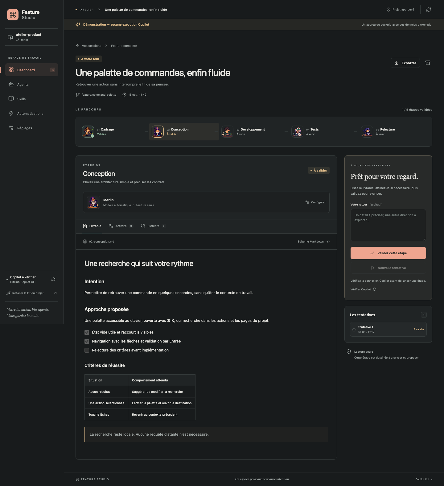
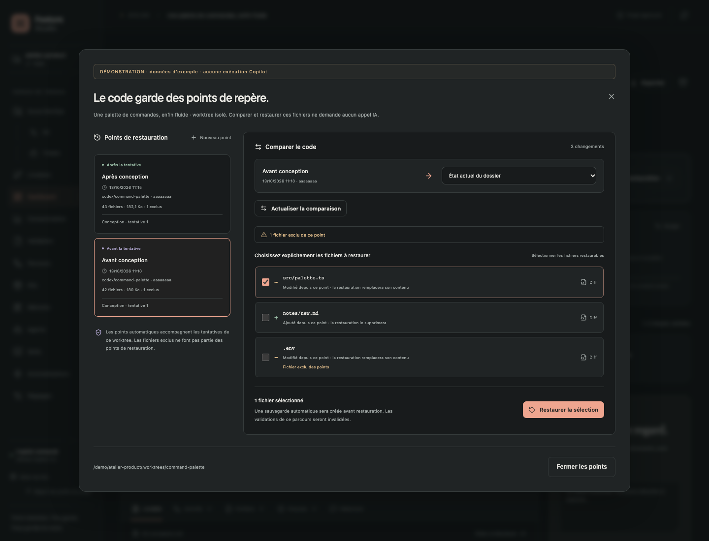
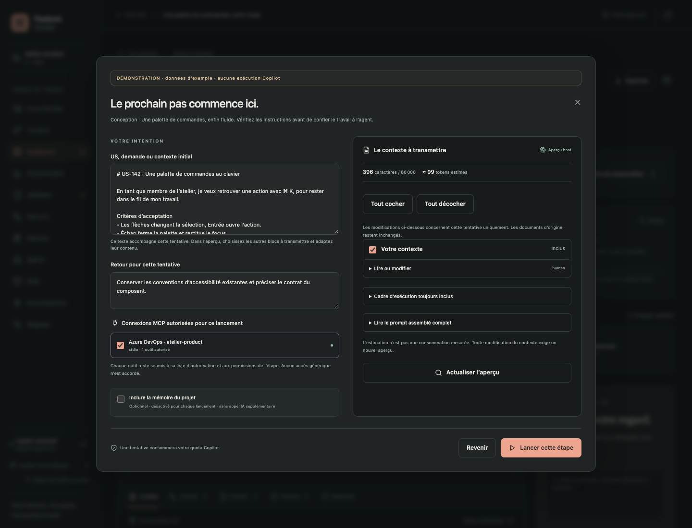
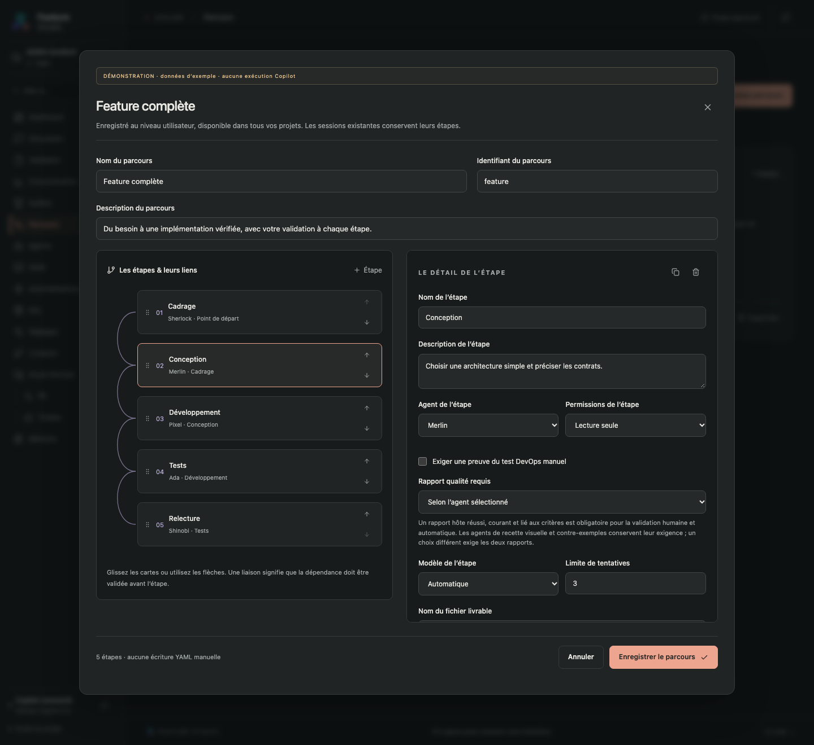

# Guide d’utilisation de Feature Studio

[Retour au README](../README.md) · [Kits](KITS.md) · [Kit DevOps](DEVOPS-KIT.md)

## Installation

1. Télécharge **[feature-studio-1.0.0.vsix](../releases/feature-studio-1.0.0.vsix)** depuis ce dépôt (bouton Download raw file sur GitHub).
2. Dans VS Code ou VS Code Insiders : **Extensions → … → Installer à partir du VSIX…**.
3. Ouvre le dossier du projet que tu souhaites développer, puis approuve ce workspace.
4. Clique sur le **petit geek au portable** dans la barre latérale de VS Code, puis sur **Ouvrir le cockpit**. La commande **Feature Studio : ouvrir le cockpit** et le bouton de la barre d’état restent disponibles.
5. Dans **Réglages**, clique sur **Vérifier la connexion**. Le diagnostic vérifie le CLI, le compte et les modèles sans envoyer de prompt.

Prérequis : **VS Code 1.110 ou ultérieur**, Git pour les branches/diffs, et **GitHub Copilot CLI** installé et authentifié avec un abonnement donnant accès au CLI. Installer le VSIX ne nécessite ni Node.js ni npm séparément. Le moteur Node embarqué dans les versions récentes de VS Code est utilisé par l’extension.

Si `copilot` n’est pas trouvé, renseigne le chemin complet dans **Réglages → Chemin du CLI dans VS Code** (`featureStudio.cliPath`). Sur macOS avec Homebrew, ce peut être `/opt/homebrew/bin/copilot`. L’extension ne met pas le CLI à jour automatiquement. Voir [l’installation officielle du CLI](https://docs.github.com/en/copilot/how-tos/copilot-cli/set-up-copilot-cli/install-copilot-cli).

**Feature Studio ouvre son propre onglet de travail.** Il utilise le CLI local et son authentification ; il ne remplace pas les composants internes de la vue Chat de l’extension GitHub Copilot. Les deux interfaces peuvent coexister. Aucun serveur applicatif supplémentaire n’est requis ; les requêtes IA passent naturellement par GitHub Copilot.

## Accéder au cockpit depuis la barre latérale

L’entrée **Feature Studio**, reconnaissable à son geek de trois quarts devant un ultrabook, ouvre un volet d’accueil avec son avatar en pixel art et le bouton **Ouvrir le cockpit**. Ce bouton ramène à l’onglet existant ; plusieurs clics pendant son ouverture ne créent pas de doublon. Sans projet ouvert, le volet propose **Ouvrir un dossier**.

Afficher le volet seul ne démarre aucune session et n’appelle aucun modèle. L’avatar en couleur apparaît dans le volet ; sa déclinaison monochrome dans la barre d’activité suit les couleurs de VS Code. Si tu l’as masquée, fais un clic droit sur la barre d’activité pour réafficher **Feature Studio**.

## Choisir l’apparence du cockpit

En haut de **Réglages**, la section **L’ambiance du cockpit** propose six cartes : **Suivre VS Code** (automatique), trois thèmes clairs — **Aube** (crème et corail), **Brume** (bleu et ardoise), **Sauge** (vert et lin) — et deux thèmes sombres — **Minuit** (bleu et indigo), **Forêt** (vert et cuivre).

Clique une carte : le thème s’applique dès l’enregistrement confirmé, sans redémarrer le cockpit. Ta préférence est personnelle, conservée dans le réglage utilisateur VS Code `featureStudio.appearance.theme` et partagée entre tes projets ; ce choix n’écrit aucun fichier du projet et n’invalide pas le travail en cours. Le contraste élevé de VS Code reste prioritaire, avec ta préférence conservée pour son retour. Dans la démonstration, le choix sert uniquement d’aperçu pendant la session et n’est pas enregistré.

## Choisir un parcours

| Parcours         | Pour quoi ?                                                    | Étapes                                                    |
| ---------------- | -------------------------------------------------------------- | --------------------------------------------------------- |
| Feature complète | Développer un besoin avec des décisions intermédiaires         | Spécifications → plan → développement → tests → relecture |
| Relecture seule  | Examiner les changements sans écrire, compiler ou tester       | Relecture                                                 |
| Session libre    | Confier une tâche à un seul agent, dans une vraie conversation | Une étape de développement configurable                   |

Le tableau de bord affiche les sessions, leur état, leur branche et leur progression. Recherche, filtres et archives permettent de retrouver les anciens travaux. Aucune session d’exemple n’est ajoutée à ton projet.

### Les menus du cockpit

**Dashboard** regroupe les sessions. **Azure DevOps** conserve l’aperçu et la configuration ; ses sous-menus **PR** et **Tickets**, toujours visibles, ouvrent deux tableaux dédiés ; **Livraison** prépare les opérations Git du dépôt ouvert. Ces deux menus fonctionnent sans session active. **Consommation** regroupe les mesures SDK par session, parcours et modèle, avec filtres et couverture inconnue/partielle, sans estimation. [Consommation et validations](../docs/consumption.md). **Validation** rassemble questions, livrables et preuves ; **Parcours**, **Agents**, **Skills**, **Mémoire**, **Automatisations** et **Réglages** permettent de configurer le travail.

### Développer une feature

1. Clique **Nouvelle session**, choisis le parcours, donne un titre et décris le résultat attendu. **L’espace de cette session** propose un **Worktree isolé** pour une feature ou une session libre, et le **Dossier courant** pour une relecture. Tu peux changer ce choix avant la création.
2. Ouvre une étape. **Configurer** permet de choisir l’agent, le modèle réellement proposé par le CLI, les skills, le raisonnement lorsqu’il est disponible et la limite de tentatives.
3. Clique **Exécuter cette étape** : colle ta **US, demande ou contexte initial**, choisis les MCP utiles, puis **Préparer l’aperçu**. Relis les sources et le prompt assemblé ; **Lancer cette étape** démarre ensuite la vraie session. Le même dialogue apparaît pour une reprise ou une nouvelle tentative. Tout changement invalide l’aperçu précédent.
4. Si l’agent utilise `studio_ask_human`, sa question apparaît pendant l’exécution : réponds et clique **Transmettre la réponse**. L’appel attend réellement ta réponse. Si le modèle termine plutôt avec un bloc de questions, réponds au formulaire puis **Reprendre la session**. Les échanges sont conservés.
5. Relis le **Livrable**. Tu peux éditer son Markdown et l’enregistrer, ou donner un feedback pour une nouvelle tentative.
6. Clique **Valider cette étape**, puis **Continuer**. La validation débloque l’étape suivante ; elle ne lance pas de requête IA toute seule.
7. Après le développement, consulte **Fichiers → Voir le diff** pour ouvrir les modifications dans VS Code.
8. Configure les commandes de test nécessaires, exécute l’étape Tests, puis lance la relecture indépendante.



**Une correction après la relecture ?** Retourne sur Développement, précise ton feedback dans **Votre retour**, utilise **Rejouer cette étape**, puis fais revalider Tests et Relecture. Les anciens essais restent visibles. Une spécification ou un plan modifié rend également les étapes dépendantes **à actualiser**.

**Arrêter** annule le processus ; les fichiers déjà écrits restent présents pour inspection. Après fermeture ou interruption, la tentative devient annulée ou interrompue. **Reprendre** réutilise son identifiant Copilot ; **Nouvelle tentative** ouvre une nouvelle conversation avec les livrables approuvés et le contexte précédent. Une reprise consomme elle aussi une tentative. Si la limite est atteinte, **Configurer → Limite de tentatives** permet de la relever explicitement.

Les sessions restent liées à leur branche et à leur dossier d’exécution. À la création d’une session isolée, Feature Studio crée une branche et un worktree local depuis le dernier commit **HEAD**. Il ne crée aucun commit, push, PR ni déploiement automatiquement.

## Recette Playwright et contre-exemples

Le parcours **Feature avec recette et contre-exemples** (`quality-feature`) ajoute une **Recette visuelle**, puis une recherche de **Contre-exemples** par un agent indépendant, avant la relecture. Il cible d’abord les applications web disposant de tests Playwright locaux. Une description de test dans un livrable ne suffit pas : les scénarios et leurs pièces sont recueillis depuis une commande réellement exécutée par l’hôte.

Dans **Réglages → Commandes de test autorisées**, installe explicitement le reporter qualité et configure une commande Playwright avec la collecte **Recette visuelle** ou **Contre-exemples** et le chemin de rapport. Dans une session isolée, **Preuves → Installer le reporter dans cette session** copie le kit dans son worktree. Installe toi-même les dépendances, le navigateur et l’environnement local nécessaires ; Feature Studio ne le fait pas automatiquement. Le reporter doit aussi être déclaré dans la configuration Playwright.

Les preuves affichent cas, attendu/observé, reproduction, captures et traces conservées localement. Lorsqu’une collecte qualité est configurée, un rapport manquant, ancien, invalide, vide, incomplet ou échoué est une preuve bloquante pour la validation. Les critères restent à approuver humainement ; les corrections du pilote exigent une route et des limites déjà configurées. [Configuration complète](../defaults/quality/README.md).

## Azure DevOps et livraison confirmée

Ouvre **Azure DevOps** pour renseigner organisation, projet, dépôt et remote. Le PAT se saisit dans une fenêtre VS Code masquée et reste dans **SecretStorage**. Le push utilise tes identifiants Git locaux. L’aperçu charge les tickets assignés et les PR créées du compte et permet de créer/retrouver une feature liée à un ticket. La configuration et les liens persistent localement.

Les sous-menus **PR** et **Tickets** restent visibles, même sans connexion ou session active. Chaque tableau propose des compteurs sur les éléments reçus, une recherche, des filtres par état et lien avec une feature, et un tri par date, numéro ou titre. Les cartes affichent les branches, l’auteur et les relecteurs pour les PR ; le type, les dates, les tags, la description, les critères et les commentaires chargeables pour les tickets, selon les données disponibles. Tu peux ouvrir Azure DevOps et retrouver les features liées depuis les cartes. Les votes des relecteurs sont indicatifs : les politiques de validation se vérifient dans Azure DevOps. Les listes partielles sont signalées ; les filtres et compteurs portent uniquement sur les éléments reçus.

Dans **Livraison**, inspecte le dépôt ouvert, sélectionne les fichiers complets concernés, saisis l’intention et relis le titre proposé. **Commit**, **Push** et **PR brouillon** exigent chacun un aperçu actualisé et une confirmation VS Code. Le staging des fichiers non sélectionnés est conservé. Le push est sans force ; la PR n’active aucune fusion ni auto-complétion.

Le profil **Livraison** (`fs-delivery.agent.md`) se modifie dans **Agents**. Son bloc fenced `delivery-rules` définit les types conventionnels et le titre de repli selon des règles déterministes. La conversation de livraison reste locale et ne déclenche aucune opération Git ; la livraison ne fait aucun appel modèle. Les hooks, filtres et signatures Git ne sont pas exécutés dans ce mode. [Fonctionnement, limites et récupération](../docs/devops-delivery.md).

## Un espace Git et des points de restauration par feature

Le **Worktree isolé** est un dossier frère du projet, avec sa branche `codex/feature-studio-…`. Il contient uniquement l’état commité de HEAD : les modifications non commitées, les fichiers non suivis et les changements déjà stagés restent dans le dossier source. Aucune dépendance ni préparation d’outils n’est installée automatiquement. Les hooks Git, `fsmonitor` et filtres externes sont neutralisés ; LFS/smudge n’est pas matérialisé automatiquement. Prépare cet environnement avant de demander des tests qui en ont besoin.

L’isolation demande d’ouvrir la racine d’un dépôt Git ayant un commit HEAD. Si elle est indisponible, son choix est désactivé et le cockpit affiche la raison. La **relecture seule** utilise le dossier courant par défaut pour examiner le diff déjà présent. Les sessions créées avant la v0.3 conservent aussi leur dossier courant ; elles ne sont pas déplacées automatiquement.

Le bandeau **ESPACE GIT** affiche le dossier et la branche de la feature. **Ouvrir le dossier** ouvre une nouvelle fenêtre VS Code ; le cockpit d’origine garde l’historique et le pilotage de la session. Si tu ouvres un autre cockpit dans le worktree, son verrou bloque l’accès du cockpit d’origine à cette feature jusqu’à sa fermeture ; les vues de fichiers normales restent utilisables. Les fichiers, diffs, tests et hooks de cette feature sont résolus dans son propre espace.

Dans **Points de restauration** :

1. Une tentative isolée conserve un point **Avant la tentative**, avant les hooks, puis un point **Après la tentative**, y compris après annulation ou échec lorsque la capture reste possible. **Avant**, **Après** et **Comparer** sont accessibles depuis son historique.
2. **Nouveau point → Créer le point** ajoute un point manuel nommé, également disponible pour les anciennes sessions dans le dossier courant.
3. Choisis un point, puis **Comparer les fichiers** avec **État actuel du dossier** ou un autre point. **Diff** ouvre sa comparaison dans VS Code. Une comparaison point-vers-point est consultative.
4. Pour revenir à un point depuis l’état actuel, coche explicitement les fichiers voulus ; la sélection est vide au départ. **Restaurer la sélection → Confirmer la restauration** demande au host de vérifier l’empreinte de la comparaison. Les fichiers ajoutés depuis le point choisi seront supprimés seulement si tu les coches.
5. Une sauvegarde de récupération est enregistrée et rattachée durablement à l’historique **avant toute écriture**. Les validations et preuves d’acceptation deviennent à revalider et le pilote est mis en pause. Si les fichiers ont changé depuis la comparaison, il faut **Actualiser la comparaison**.



Ces points conservent le contenu et les permissions des fichiers inclus ; ils ne restaurent ni l’index Git, ni la branche, ni les commits. Les fichiers ignorés non suivis, secrets usuels, dossiers de configuration, dépendances, sorties de build et liens sont exclus. Limites : **4 MiB par fichier, 64 MiB par point et 10 000 fichiers candidats**. Ce mécanisme est une restauration ciblée, pas une sauvegarde exhaustive du projet. **Archiver la session** conserve son dossier et ses points sur disque.

La création, la comparaison et la restauration Git n’ajoutent aucune requête IA. Elles ne publient rien. Les opérations sont verrouillées pendant une tentative ou une autre mutation ; le host recontrôle racine, branche et fichiers. Les buffers non enregistrés sont protégés dans la fenêtre VS Code courante seulement : les autres fenêtres et processus restent hors sandbox. [Périmètre, exclusions et limites détaillés](../docs/WORKSPACES.md).

**Stockage v3 :** les formats v0/v1/v2 migrent en conservant leurs données connues. Une fois ces données enregistrées en v3, ne réinstalle pas la v0.2 pour les ouvrir : elle refuse ce format et ne sait pas conserver les métadonnées de worktree. Il n’existe pas de migration inverse automatique.



## MCP et Azure DevOps : apporter les bonnes US

Dans **Réglages → Connexions MCP**, le preset **Azure DevOps** demande ton organisation et propose la connexion interactive ou une connexion Azure CLI existante. Il configure le serveur Microsoft `@azure-devops/mcp@2.10.0`, domaine `work-items`, avec seulement **`wit_work_item`** autorisé pour consulter les US. Il reste désactivé à la création.

1. Ajoute le preset, puis enregistre les réglages.
2. **Découvrir les outils** lance le serveur et liste ses capacités **sans requête IA**. La première utilisation de `npx` peut télécharger le package et l’authentification Microsoft peut ouvrir un navigateur.
3. Vérifie la liste autorisée, active le serveur et confirme sa configuration dans VS Code.
4. Au lancement d’une étape, coche ce MCP et colle par exemple : « Consulte l’US 208 du projet MonProjet, puis prépare ses critères d’acceptation. » Tu peux aussi coller directement le contenu de l’US sans connexion externe.
5. Une question humaine ou une demande d’autorisation reste accessible dans le cockpit pendant le travail.

Tu peux ajouter tes propres serveurs **stdio, HTTP ou SSE**. La liste d’outils est explicite : aucun joker pendant les sessions. Les clés d’environnement et les en-têtes référencent le **coffre VS Code** ou des variables du processus ; les valeurs secrètes ne sont pas enregistrées dans la configuration du cockpit. N’inscris pas de token dans les arguments ou l’URL. Les lectures automatiques sont facultatives et exigent une annotation de lecture seule du runtime. Une écriture MCP demande une autorisation pour chaque appel ; en profil lecture seule, écriture et opération sans garantie de lecture sont refusées.

**Compatibilité MCP : le CLI 1.0.63 installé sur la machine de recette est trop ancien pour ce parcours.** Il permet la découverte, mais l’exécution MCP est refusée avant tout prompt car sa politique de permissions ne peut pas être vérifiée. Mets le CLI à jour vers une version compatible avec le SDK 1.0.20 avant d’utiliser les MCP ; les sessions sans MCP restent compatibles avec 1.0.63. Le contrôle porte sur les capacités effectives, sans supposer qu’un numéro de version suffit.

Les sept scénarios de permissions ont été vérifiés avec une fixture locale et le **runtime 1.0.96 fourni avec le SDK**, sans appel modèle. Ce runtime de test n’est pas installé par le VSIX et ne remplace pas ton CLI. L’accès à **ton organisation Azure DevOps** reste à valider avec ton authentification. [Configuration et preuves MCP](../docs/MCP.md).

## Pilote automatique, validation et coût

Dans une feature, le **pilote automatique** enchaîne les étapes disponibles suivant les dépendances. Configure les points de validation humaine, le contexte/MCP de chaque étape et les limites avant de le démarrer. Il s’arrête sur une question, une permission MCP, un échec, un seuil atteint ou un checkpoint. **Pause** laisse finir la tentative courante ; **Arrêter** l’annule. Après une question, il faut reprendre explicitement le pilote pour continuer le parcours. Une tentative échouée ou interrompue se relance manuellement.

La boucle de correction est facultative : choisis une étape de relecture et une étape de développement en amont. Le pilote utilise le verdict structuré de la relecture ou une preuve de tests en échec ; il rejoue ensuite les étapes devenues obsolètes. Un checkpoint reste prioritaire sur cette boucle. Par défaut, **zéro cycle de correction supplémentaire** : augmente le nombre seulement si tu le souhaites. Il n’y a aucun agent chargé de décider du prochain agent ; l’orchestration est du code local.

Le **centre de validation** rassemble le livrable, les fichiers/diffs, les commandes de test et leurs sorties réelles, les critères d’acceptation et tes commentaires, éventuellement associés à un fichier/une ligne. Un constat du modèle est distingué d’une preuve issue du runner. Les remarques bloquantes et les critères sans preuve empêchent de déclarer le parcours terminé. Le pilote ne valide pas une étape Tests sans résultat hôte réussi. Une édition du livrable invalide l’ancienne validation ; les preuves sont revérifiées par empreinte des fichiers observés. Le diff de **Fichiers → Voir le diff** compare HEAD aux fichiers de l’espace de la feature. **Points de restauration** propose en plus les comparaisons propres à ses points avant/après ou manuels.

Le panneau **consommation** cumule les mesures reçues et indique les tentatives dont l’usage est inconnu. Tu peux fixer un nombre total de runs, des seuils de tokens/crédits et une taille maximale de contexte. Les validations, aperçus et éditions locales n’appellent pas de modèle. Les profils **économie / équilibré / qualité** utilisent les modèles que tu leur attribues dans les réglages parmi ceux réellement disponibles ; leur nom ne promet aucun tarif. Si le CLI n’annonce que `auto`, aucun modèle moins cher n’est inventé.

## Mémoire locale, à coût maîtrisé

Ajoute les conventions, décisions, informations d’architecture et contexte durable dans **Mémoire**. Tu peux aussi conserver un extrait d’un livrable validé avec son origine. Le texte est enregistré localement, sans agent de résumé ni indexation IA. Une entrée provenant d’une version ensuite invalidée est refusée à la prochaine injection.

La mémoire est **décochée à chaque lancement manuel**. Si tu l’actives, seules les entrées actives que tu coches sont envoyées ; une sélection vide n’ajoute rien. Le total injecté est plafonné à **4 000 caractères**, sans troncature ni résumé automatique. L’aperçu montre chaque entrée ajoutée. Elle peut donc ajouter des tokens au prompt si tu l’actives, mais ne déclenche jamais une requête supplémentaire. Le même choix explicite s’applique au contexte enregistré des étapes du pilote.

## Construire ses propres parcours

Le parcours **DevOps — du besoin au test vérifié** fournit six agents : challenge, plan technique, modifications locales, relecture indépendante, guide de test hors production et validation du test exécuté manuellement. Les outils Azure DevOps lisent uniquement le dépôt configuré. Le pilote s’arrête avant la vérification finale ; renseigne le pipeline, le build, le SHA complet, la branche, les stages et les preuves attendues dans son formulaire de lancement. [Kit, script et limites](../docs/DEVOPS-KIT.md).

L’éditeur visuel de **Parcours** permet d’ajouter, dupliquer, retirer et réordonner les étapes, de relier leurs dépendances, puis de choisir agents, modèles, skills, permissions et contexte initial. Le graphe montre les liens ; les cycles et références invalides sont refusés. Les boutons de déplacement offrent une alternative au glisser-déposer.

L’enregistrement produit un YAML dans `.feature-studio/workflows/`. Les sessions existantes conservent leur définition ; le nouveau parcours s’applique aux sessions créées ensuite. **Demander avant de lancer** impose une pause avant l’étape, même avec le pilote. [Détails et format de workflow](../docs/WORKFLOWS.md).



## Donner une personnalité aux agents

Dans **Agents**, ouvre un profil et change **Son petit nom**. Choisis l’un des quatorze personnages : le mage architecte, le hacker au café, le détective, le bûcheron, le scientifique, le robot, le ninja ou le capitaine.

<p>


</p>

Chaque avatar possède une image de repos, un **vrai GIF de travail à quatre images**, puis une pose de validation. Les animations respectent la préférence système de réduction des mouvements. Le pseudo et le personnage sont sauvegardés dans la portée choisie du profil ; le rôle technique reste indépendant du petit nom.

Tu peux modifier les instructions, le modèle et les skills, ou créer un nouvel agent. L’éditeur propose **PERSONNEL**, dans `~/.copilot/agents/` et `~/.copilot/skills/` (ou `COPILOT_HOME`), ou **PROJET**, dans `.github/agents/` et `.github/skills/`. Un profil du kit fourni commence en portée personnelle ; un profil personnalisé commence dans sa portée active. Le chemin et la révision attendue sont affichés avant sauvegarde. Les agents déjà présents dans le projet sont découverts, et leurs fichiers restent utilisables directement avec Copilot.

Les capacités reconnues sont `read`, `search`, `edit`/`write` et `execute`, ainsi que les noms précis des outils `studio_*`. `execute` donne accès uniquement aux commandes de tests déjà autorisées, et seulement dans une étape de profil Tests. Il n’ouvre aucun terminal libre. La permission effective est toujours l’intersection du profil d’étape et des outils de l’agent.

## Skills et kit Copilot

Le **kit Copilot 2.0.0 fourni par Matt** est embarqué avec ses quatre agents, sept skills, six templates et ses scripts. Huit profils Feature Studio adaptent ce kit aux étapes du cockpit et à la livraison. Les skills sont disponibles immédiatement dans le catalogue.

Ouvre **Kits → Atelier Copilot → Voir le kit → Installer ce kit** pour rendre ce kit disponible dans tous tes projets. Le kit DevOps se sélectionne séparément. [Composer, importer et exporter des kits](../docs/KITS.md). La destination est `~/.copilot` (`%USERPROFILE%\.copilot` sous Windows), ou le répertoire `COPILOT_HOME` s’il est configuré dans l’environnement de VS Code.

| Ressource                                  | Destination relative à ce dossier utilisateur |
| ------------------------------------------ | --------------------------------------------- |
| Agents                                     | `agents/*.agent.md`                           |
| Skills                                     | `skills/*/SKILL.md`                           |

| Workflows Feature Studio                   | `feature-studio/workflows/*.yaml`             |
| Templates, scripts et documentation du kit | `feature-studio/kit/`                         |
| Exemples propres aux projets               | `feature-studio/kit/examples/`                |

L’installation ne crée aucun fichier dans le projet. Les fichiers identiques sont conservés et les fichiers personnalisés ne sont jamais écrasés ; la sortie **Feature Studio** donne le détail des conflits. Les anciennes copies du projet sont conservées tant que tu ne demandes pas leur migration. Dans le cockpit, les définitions du projet ont priorité sur celles de l’utilisateur, puis sur celles fournies par l’extension. L’éditeur montre les versions existantes et leur priorité. Changer de portée charge la version correspondante et conserve un brouillon par portée ; si cette portée est absente, il annonce la copie des instructions affichées. Modifier la version personnelle pendant qu’une version projet existe affiche qu’elle restera masquée dans ce projet. La migration reste une action distincte et facultative.

Les sauvegardes de profils passent par l’hôte dans un espace approuvé : empreinte SHA256 attendue (ou cible explicitement absente), verrou exclusif par fichier et remplacement atomique. Si une autre fenêtre ou un éditeur externe a modifié le fichier, la sauvegarde est refusée et le brouillon reste ouvert. Les identifiants déjà existants ne sont pas écrasés lors d’une création ; ouvre la version à modifier ou choisis un nouvel identifiant. Les métadonnées YAML supplémentaires des agents, leurs commentaires et les fichiers SKILL.md complets sont conservés.

Les liens des agents et skills installés pointent vers les templates utilisateur. La carte `.ai/project.md`, lorsqu’elle existe, reste celle du projet courant. Les exemples de configuration et le runner .NET restent optionnels : depuis le projet concerné, le runner utilisateur peut être appelé explicitement avec `python "$HOME/.copilot/feature-studio/kit/scripts/ai_tools.py" --help` (adapter le chemin si `COPILOT_HOME` est défini). La documentation originale du kit décrit aussi son ancien mode d’installation dans un dépôt. Aucun script, MCP ou outil externe n’est exécuté pendant la copie.

Dans **Skills**, tu peux consulter une méthode, éditer son Markdown ou en créer une. Associe-la ensuite au profil d’agent ou à une étape. Feature Studio injecte explicitement les skills sélectionnées dans le contexte. Les instructions générales du dépôt ne sont pas découvertes automatiquement par le runtime isolé : ajoute les règles pertinentes à un agent/skill ; l’agent peut lire `.ai/project.md` et les fichiers qu’on lui indique.

Le runner du kit concerne **.NET/VSTest**. Il est conservé comme option et n’est pas choisi automatiquement pour les projets JavaScript, Python ou d’autres stacks. [Provenance du kit](../defaults/PROVENANCE.md).

## Autoriser les tests et les hooks

Dans **Réglages → Commandes de test autorisées**, ajoute un nom, un exécutable et ses arguments **un par ligne**. Par exemple, pour ce dépôt :

| Champ      | Valeur                                       |
| ---------- | -------------------------------------------- |
| Nom        | Tests unitaires                              |
| Exécutable | `npm`                                        |
| Arguments  | `test` puis `--` puis `--run` (trois lignes) |

Les **Chemins de test** sont des préfixes de dossiers, sans glob : `tests`, `test`, `__tests__` par défaut. Ajuste-les avant de demander la création de tests ailleurs. Le profil Tests peut écrire seulement dans ces dossiers et exécuter uniquement les commandes configurées. Leur code retour, leurs sorties et les échecs sont consignés.

L’enregistrement de nouvelles commandes affiche une confirmation VS Code avec leur contenu exact. Elles tournent sous ton compte : les scripts qu’elles appellent ne sont pas confinés dans une sandbox système. Sur Windows, utilise un exécutable natif (`node.exe`, `dotnet.exe`…) ; les lanceurs `.cmd` ne sont pas pris en charge par ce runner sans shell.

Dans **Automatisations**, les hooks `beforeRun` et `afterRun` exécutent des commandes locales facultatives. Ils sont désactivés à la création et nécessitent une activation explicite. Ils sont ignorés pour les étapes en lecture seule. Les hooks/MCP natifs de Copilot ne sont pas importés ni activés automatiquement.

## Données, permissions et consommation

- Les features, essais, réponses, validations, journaux et métadonnées de worktree sont sauvegardés dans le stockage local de l’extension VS Code, par dossier. Le format v3 est versionné et les écritures sont atomiques. Les contenus des points de restauration restent dans le stockage privé de l’extension, hors des checkouts.
- Les conversations Copilot utilisent un répertoire de données propre à Feature Studio. `~/.copilot` n’est pas modifié. Le trousseau existant est réutilisé si le CLI le permet.
- **Exporter** produit un fichier Markdown avec les livrables et l’historique de la session.
- Un seul cockpit est actif pour une même racine sur une machine, et une seule tentative tourne à la fois dans ce cockpit. Deux projets sources distincts peuvent tourner en parallèle. La racine du worktree est également verrouillée pendant son utilisation. Une mutation Git exige l’absence de tentative active et un pilote en pause.
- Les écritures préexistantes non validées dans Git sont protégées. Les fichiers créés par la même feature peuvent être retravaillés si leur contenu n’a pas été modifié entre-temps. Les suppressions humaines, les chemins sensibles et les liens symboliques sont refusés.
- L’agent dispose des outils hôtes et des seuls outils MCP explicitement choisis. Il ne dispose d’aucun shell générique, accès de navigation natif ou commande Git d’écriture. Le catalogue réel et la provenance des outils MCP sont vérifiés avant l’envoi du prompt.
- L’interface affiche les tokens, le modèle effectif et les crédits uniquement si le CLI communique une mesure de coût. Elle cumule également les tentatives échouées/annulées et signale les données inconnues. Les plafonds sont contrôlés avant chaque nouveau run ; un run en cours peut dépasser un seuil de tokens ou de crédits. Ce ne sont pas des euros ni un plafond financier garanti.

Les listes et recherches des outils agents sont paginées avec des curseurs vérifiés. Les exclusions Git et les `.gitignore` imbriqués hors Git sont respectés ; une modification pendant le parcours impose de recommencer. [Contrat d’exploration et limites](../docs/explorer.md).

## Développer l’extension

Node.js **22.12+** et npm sont nécessaires pour travailler sur les sources.

```bash
npm ci
npm run check          # TypeScript, tests unitaires/intégration, builds
npx playwright install chromium
npm run test:ui        # Parcours webview, sans requêtes IA
npm run test:extension # Vrai hôte VS Code isolé, sans prompt IA
npm run smoke:mcp     # Diagnostic MCP local explicite, sans prompt IA
npm run package       # Produit releases/feature-studio-1.0.0.vsix
```

Ouvre le projet et utilise **F5 → Feature Studio** pour un hôte de développement. `npm run dev` ouvre le frontend de développement ; `http://127.0.0.1:5173/?demo=1` affiche des données d’exemple avec un bandeau explicite. Sans ce paramètre et hors VS Code, aucune exécution n’est simulée.

Le test réel facultatif est séparé dans `scripts/smoke-copilot.ts` et exige `FEATURE_STUDIO_LIVE_TEST=1`. Il consomme du quota Copilot. Il ne fait partie ni de `npm test` ni de la CI. Les sources des avatars et leurs prompts sont dans [design/avatars](../design/avatars/PROMPTS.md) ; `node scripts/pack-avatars.mjs` reconstruit leurs PNG/GIF.

Voir [la validation livrée et les limites connues](../docs/VALIDATION.md) pour distinguer tests automatiques, test du CLI réel, versions testées et plateformes non vérifiées.

### Déplacer les anciennes personnalisations vers ton compte

Dans le projet concerné, utilise **Migrer les profils du projet** dans la barre latérale, ou la commande **Feature Studio : migrer les agents et skills vers le compte utilisateur**. Sélectionne les profils à migrer dans la liste. L’action prépare les ressources du kit utilisateur, puis sauvegarde et déplace uniquement ta sélection.

- Les agents sont placés dans `~/.copilot/agents/` ; chaque skill est copiée avec tout son dossier, y compris scripts et ressources.
- Une copie identique ou une version standard non personnalisée du kit peut être remplacée. Une version utilisateur personnalisée différemment reste intacte : le conflit est détaillé dans **Sortie → Feature Studio** et le profil du projet est conservé.
- Les liens des templates du kit sont adaptés. Un lien Markdown relatif vers une ressource absente à la nouvelle destination bloque la migration du profil concerné.
- Les fichiers source sont sauvegardés sous `~/.copilot/feature-studio/migrations/<identifiant>/project/`. Les versions utilisateur remplacées sont sauvegardées sous `user/`. `manifest.json` indique le projet et les destinations ; `result.json` contient le bilan. Pour restaurer manuellement, reprends la version voulue depuis ces sauvegardes après avoir vérifié les fichiers actuels.
- Le retrait du fichier du projet n’arrive qu’après vérification des sauvegardes, copies et sources. Les profils non sélectionnés, configurations du projet et workflows restent en place. Si un fichier retiré était versionné, Git affichera une suppression à relire avant commit.

La migration s’exécute sur le poste où l’extension est installée ; installer le VSIX seul ne déplace aucun fichier. Les autres fenêtres déjà ouvertes doivent actualiser leur catalogue pour voir les changements partagés.

### Relecture contre une branche locale ou distante

Depuis la version 0.3.4, un agent disposant de l’outil `read` peut comparer la branche de son espace de travail avec `develop`, `main`, `origin/develop` ou une autre branche existante. Indique par exemple dans ta demande : **« Relis ma branche courante par rapport à origin/develop, en incluant mes changements non commités. »** Aucun changement de branche n’est nécessaire.

- `studio_git_branches` liste les branches locales et les références distantes déjà connues, ainsi que la branche courante et son SHA. Aucun fetch automatique : si une référence distante manque ou doit être actualisée, actualise-la avec Git avant la relecture.
- `studio_git_changes` liste les fichiers concernés. `baseRef` choisit la branche ; `comparison: "merge-base"` (par défaut) retient les changements introduits depuis l’ancêtre commun. `comparison: "direct"` compare les deux versions de branche et peut donc montrer aussi les changements présents uniquement sur la base.
- `studio_git_diff` accepte ces mêmes paramètres et un `path` de fichier relatif au workspace, avec `/`. Avec une base explicite, seuls les changements commités sont inclus par défaut. `includeLocal: true` ajoute les changements indexés et non indexés ; les fichiers non suivis sont listés séparément et lus avec `studio_read_file`. Sans base, le comportement reste le diff local contre HEAD.
- Pour les grandes réponses, l’agent suit `nextOffset` (listes) ou `nextStartLine` (diff), en fournissant le `sha256` précédent comme `expectedSha256` et en conservant les paramètres de comparaison. Les lignes de pagination sont celles du **diff**, pas les numéros du fichier source. Les en-têtes `@@` du diff donnent les positions dans les fichiers.

Chaque comparaison indique la base résolue, son SHA, le SHA de HEAD et le SHA réellement utilisé pour le départ du diff. Les branches absentes ou ambiguës provoquent une erreur explicite ; il n’y a pas de remplacement silencieux par HEAD. Les renommages sont présentés comme suppression/ajout, les sous-modules sont exclus et les fichiers binaires restent signalés par Git. L’accès aux chemins sensibles reste interdit. Les modèles n’ont pas besoin de permissions d’écriture ou d’exécution pour utiliser ces outils.

Les réponses de diff sont limitées à 64 000 octets par page. Un diff global de plus de 100 fichiers ou de 12 000 caractères de chemins doit être parcouru fichier par fichier. La collecte Git est plafonnée à 16 millions de caractères pour un diff et 4 millions pour une liste ; au-delà, une erreur explicite remplace tout résultat tronqué. Une ligne dépassant 64 000 octets ne peut pas être paginée par lignes. Les empreintes détectent les modifications entre pages ; elles ne verrouillent pas les fichiers contre des modifications externes pendant la lecture.

### Choisir et éditer le contexte avant lancement

Depuis la version 0.3.5, ouvre une tentative puis **Préparer l’aperçu**. Chaque bloc optionnel possède sa propre case : besoin, instructions de l’agent, skills, livrables validés, mémoire sélectionnée, réponses et retours humains. Pour le développeur, tu peux par exemple décocher le livrable de spec et conserver le plan technique. **Lire ou modifier** ouvre un éditeur ; **Rétablir le contenu d’origine** annule la modification de ce bloc. Les fichiers, skills et livrables d’origine restent intacts.

**Tout cocher** et **Tout décocher** agissent sur les blocs optionnels. La mission de l’étape, les permissions des outils, les consignes d’interaction et le format de sortie restent regroupés sous **Cadre d’exécution toujours inclus**. Les connexions MCP se sélectionnent séparément : décocher un bloc de texte ne modifie pas les permissions des outils.

Dans l’éditeur d’un agent, active **Contexte vide par défaut** : chaque nouveau lancement manuel commence avec tous les blocs optionnels décochés. Pour un testeur, il suffit ensuite de cocher la spec. Les champs humains que tu saisis explicitement sont inclus ; tu peux les décocher dans l’aperçu. La mémoire du projet demeure opt-in. Ce réglage est enregistré dans le profil utilisateur sous `emptyContextByDefault: true` et s’applique également aux lancements automatisés qui n’ont pas de sélection explicite.

Après une modification, prépare à nouveau l’aperçu pour valider le prompt final et son compteur de caractères/tokens. Les choix et les textes personnalisés sont conservés avec la tentative exécutée, sans modifier les choix par défaut des lancements suivants. Une personnalisation démarre une nouvelle session Copilot, même depuis une demande de reprise : cela évite de transmettre involontairement l’ancien historique. Cette sélection concerne le contexte transmis au lancement ; elle ne retire pas à l’agent son accès autorisé aux fichiers ou outils.

### Reprendre du code déjà modifié

Depuis la version 0.3.6, le développeur peut continuer une fonctionnalité dont les fichiers contiennent déjà des changements locaux, sans devoir les commiter ou les supprimer au préalable :

1. Ouvre une nouvelle tentative dans le dossier contenant tes changements, puis **Préparer l’aperçu**.
2. Dans **Reprendre des modifications existantes**, coche uniquement les fichiers concernés, par exemple `SyfadisProvider.cs`.
3. Prépare à nouveau l’aperçu, puis lance la tentative.

Le host lie l’autorisation à la version exacte des fichiers sélectionnés. Un changement intervenu après l’aperçu impose un nouvel aperçu ; après lancement, une nouvelle édition humaine reste protégée même si l’agent relit le fichier. Les permissions de l’agent et du profil restent applicables : un relecteur ne gagne pas l’écriture, et un testeur reste limité à ses dossiers. Les fichiers supprimés, sensibles, liés symboliquement ou physiquement, non UTF-8 ou de plus de 4 Mio ne peuvent pas être repris par cette autorisation. La sélection est limitée à 100 fichiers et 32 Mio ; l’aperçu liste au plus 250 chemins non sensibles et signale les omissions.

Une sauvegarde vérifiée des octets de chaque fichier sélectionné est enregistrée avant les hooks et l’agent. Son dossier est indiqué dans l’activité de la tentative : `existing-changes/<attemptId>` sous le stockage de Feature Studio. `manifest.json` associe chaque chemin source à sa copie `.bin`, son empreinte et son mode d’origine. Pour une restauration manuelle, arrête d’abord l’agent, consulte ce manifeste puis recopie uniquement la sauvegarde voulue vers son chemin source, après avoir conservé toute modification plus récente. La sauvegarde couvre le contenu de travail, pas l’index Git ; aucun stage, reset ou stash automatique n’est effectué.

Les cases ne sont pas reprises automatiquement au lancement suivant. Le pilote automatique ne peut pas réutiliser une telle sélection sans aperçu confirmé : reprends ces fichiers lors d’une tentative manuelle. Les fichiers effectivement modifiés par l’agent continuent ensuite à suivre le mécanisme habituel d’empreintes de la feature.

### Comprendre une validation refusée

Le bouton **Valider cette étape** affiche les blocages connus avant confirmation : livrable absent, questions, corrections demandées, tests ou critères incomplets, commentaires bloquants. Le lien **Voir les critères et commentaires** mène aux contrôles correspondants. La dernière étape exige aussi que les critères globaux soient validés avec leur preuve et que les commentaires bloquants soient résolus.

Les vérifications physiques (par exemple un fichier modifié depuis les tests) restent effectuées au clic côté host ; leur motif de refus est alors affiché durablement près du bouton. Une validation réussie actualise le statut et confirme **session terminée** si toutes les conditions de fin sont satisfaites. Ces messages ne contournent pas les règles de validation.

### Crédits du compte Copilot

Sous le visuel Feature Studio de la barre latérale, l’encart affiche les crédits consommés et inclus du compte connecté au CLI, ainsi que le renouvellement et le dépassement autorisé lorsque ces informations sont disponibles. Il interroge le quota toutes les 10 secondes lorsque la vue est visible, sans ouvrir de session ni envoyer de prompt. Le relevé GitHub peut être différé. Un quota absent, une API incompatible ou une unité non confirmée est indiqué comme indisponible, jamais comme zéro. Les crédits inclus ne constituent pas un plafond de facturation si GitHub autorise un dépassement. Les totaux des sessions du cockpit restent distincts de ce relevé du compte.

Les coûts et les seuils sont présentés en crédits. Les mesures historiques sont conservées dans leur précision d’origine (1 crédit = 1 milliard de nano-AIU) ; les valeurs partielles ou inconnues restent signalées.
