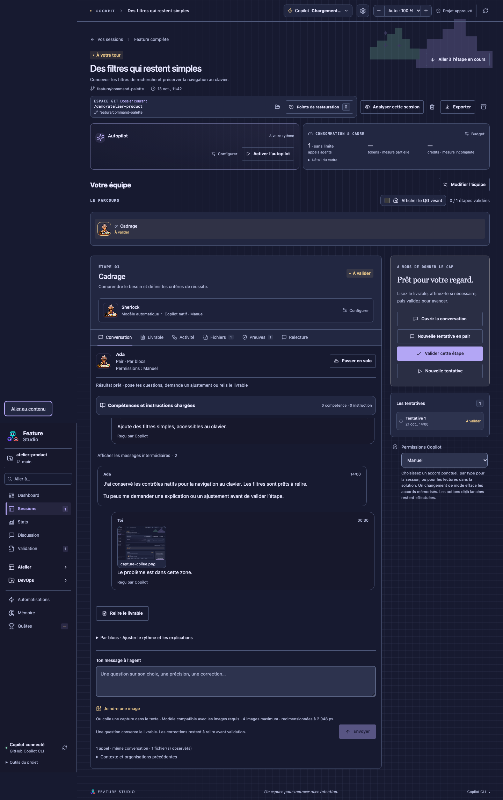
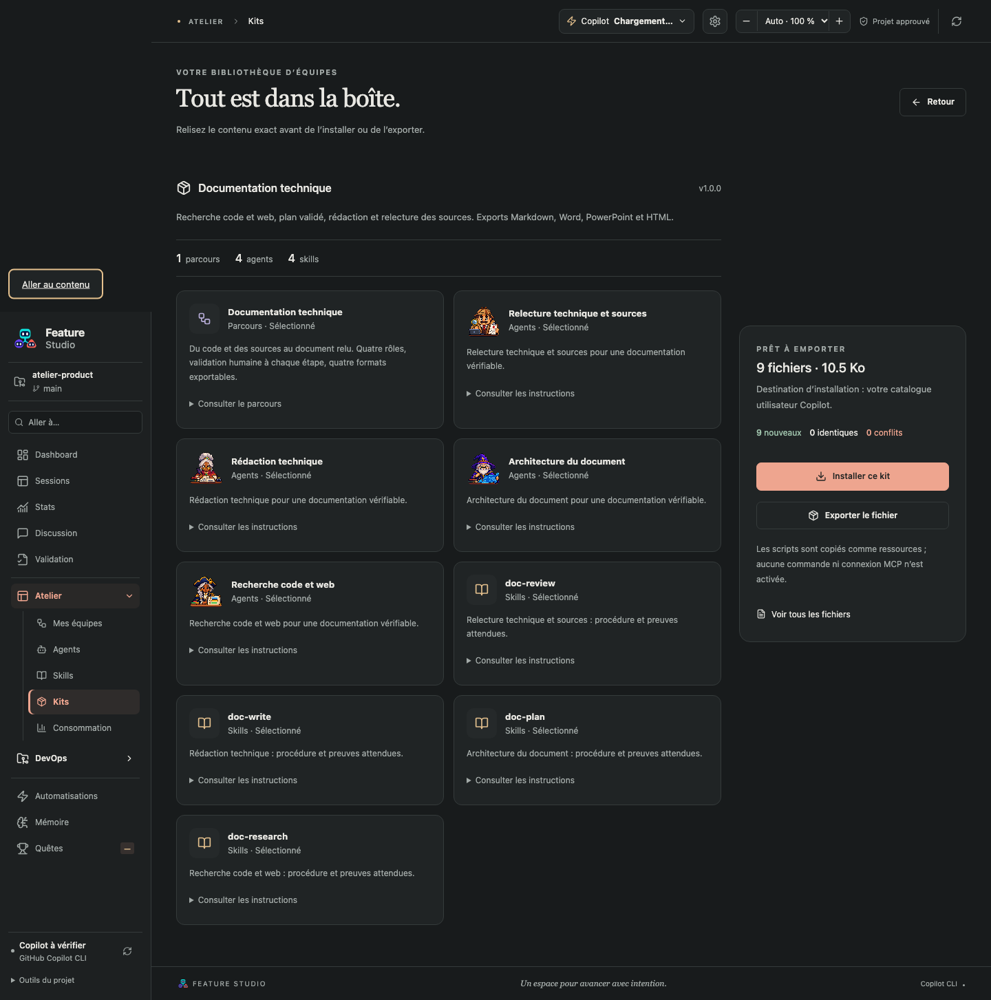

# Captures et documentation technique

## Montrer un problème à l’agent

Dans le formulaire de nouvelle session, dans la conversation d’une étape ou dans une discussion, clique sur **Joindre une image**, ou colle ta capture dans le champ de texte. Clique sur l’aperçu pour l’agrandir ; la croix retire une image avant envoi. Ajoute une explication de la zone concernée et du comportement attendu. Un chat accepte également une image seule.

PNG, JPEG et WebP sont acceptés. L’interface prépare les images à 2 048 pixels sur le côté le plus long, sans agrandissement, avec un maximum de 2 Mio par image préparée et quatre images par envoi. Une discussion indépendante réexpédie son historique à chaque réponse : elle accepte donc quatre images au total, puis propose d’ouvrir une autre discussion. Les captures restent consultables après réouverture.

Les images du besoin font partie du contexte sélectionnable avant lancement. Décocher leur section empêche leur transmission pour ce lancement. Les images d’un nouveau message suivent l’état de livraison du message. Le modèle choisi doit annoncer sa capacité visuelle et accepter les formats et tailles ; sinon l’envoi est refusé avec un diagnostic. En choix automatique, KerAI sélectionne un modèle visuel disponible si des images sont présentes. L’analyse et son coût restent ceux du fournisseur du modèle.

Les pixels sont enregistrés dans la session et transmis comme pièces jointes, séparément du texte. La préparation enlève les métadonnées de l’image via son rendu en pixels. Vérifie ce qui est visible avant envoi : les secrets dessinés dans une capture ne peuvent pas être masqués automatiquement par le filtre de texte.

## Choisir le kit Documentation technique

Le kit apparaît dans la bibliothèque et l’équipe dans les parcours disponibles. L’installation reste explicite et préserve les fichiers personnels existants. Décris ce qu’il faut documenter, le public, les projets à examiner, la profondeur attendue et le ou les formats souhaités.

| Intervention | Livrable | Accès |
| --- | --- | --- |
| Recherche code et web | Faits, références et questions | Lecture du code et pages web |
| Architecture du document | Plan, public et critères de qualité | Lecture |
| Rédaction technique | Document complet sourcé | Lecture |
| Relecture technique et sources | Document corrigé et annexe de vérification | Lecture du code et pages web |

Quatre rôles permettent une recherche et une relecture distinctes sans multiplier inutilement les passages. Tu peux modifier l’équipe. Le lancement et la validation de chaque étape restent humains, y compris lorsque l’autopilot est actif. Les profils de documentation n’ont ni outil d’écriture, ni terminal, ni sous-agents, ni serveur MCP. Les permissions natives continuent de s’appliquer.

Le chercheur et le relecteur utilisent `web_fetch` pour consulter les pages et des recherches publiques, selon leur disponibilité. Les consignes imposent des requêtes génériques sans code privé ni secret, la lecture des sources, la mention des versions et dates, et l’identification des recherches impossibles ou partielles. Aucun test n’est lancé dans ce kit ; il ne doit donc jamais présenter une simple inspection comme un résultat de test.

## Emporter les documents

Dans **Livrable**, choisis **Markdown**, **Word**, **PowerPoint** ou **HTML**, puis **Télécharger**. L’export porte sur la tentative et la révision affichées. Un brouillon non enregistré doit être enregistré ou abandonné ; un livrable en cours de production ne s’exporte pas. Le dialogue de VS Code laisse choisir le fichier de destination. Télécharger ne valide pas l’étape et ne publie rien.

Le Markdown est la version exacte du texte conservé. Word traduit les titres, paragraphes, listes, tableaux et liens. PowerPoint produit des sections et des pages de continuation ; les tableaux deviennent du texte. Prévois une idée par section et des puces courtes pour une présentation lisible. HTML est un document autonome sans script et sans chargement d’image externe. Les blocs Mermaid restent du code, et les images Markdown deviennent des références textuelles.

Limites d’export : 2 Mo de texte et 200 diapositives. La relecture humaine du fichier reste utile avant diffusion, surtout pour les contenus longs ou spécialisés. Les quatre fichiers sont produits localement, sans nouvel appel au modèle.

Le [dossier de preuves](DOSSIER-PREUVES.md) permet de vérifier les sources derrière les conclusions avant de les reprendre dans la documentation.
