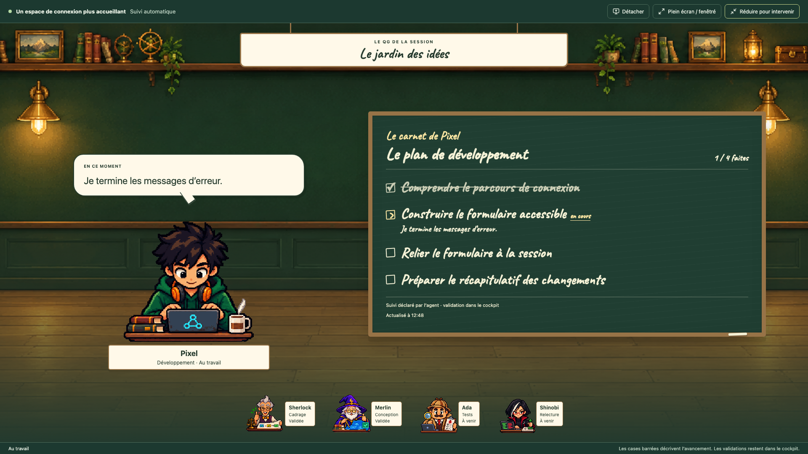
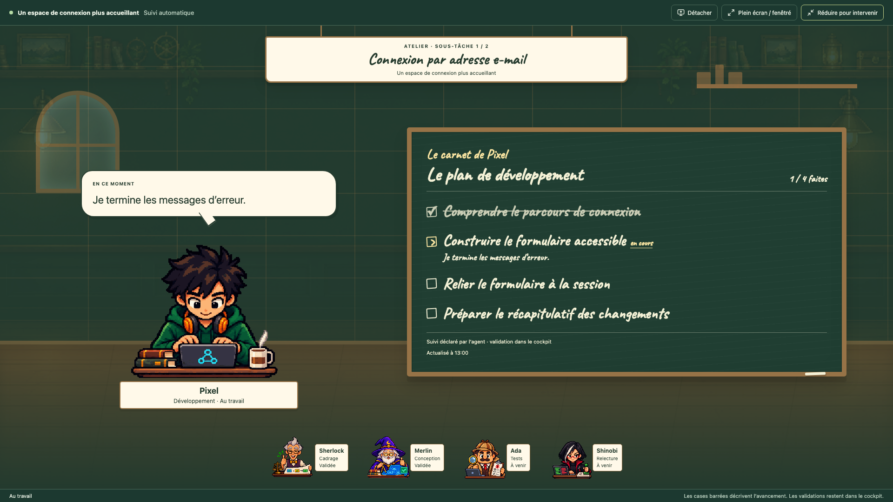
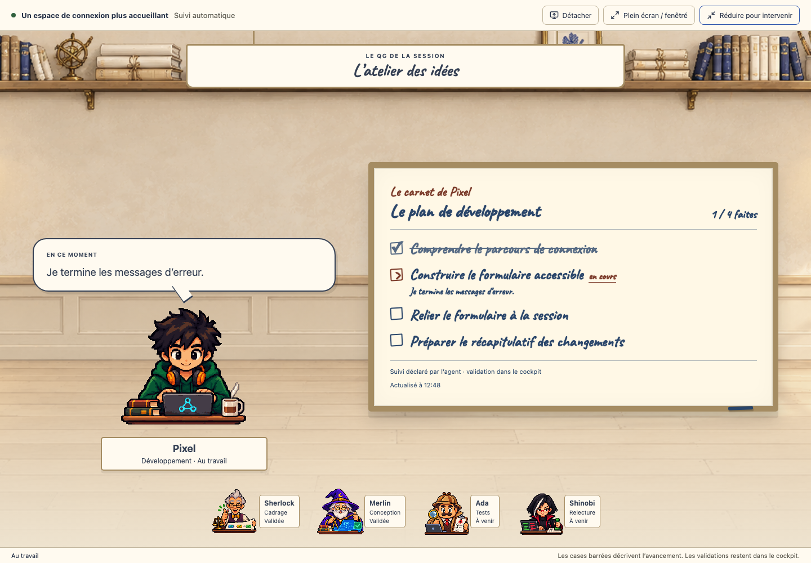

# Le QG grand écran

Dans une session, active **Afficher le QG vivant**, puis **Agrandir le QG**. La scène suit le travail courant, y compris le mode automatique. **Détacher** déplace le cockpit dans une fenêtre indépendante que tu peux placer sur un écran secondaire ; **Plein écran / fenêtré** bascule l’affichage de cette fenêtre.

## Les agents racontent leur travail

La bulle au-dessus de l’agent présente ses messages publics utiles. Les longs messages défilent par pages ; les réflexions internes et les sorties techniques ne deviennent pas des dialogues. Les avions en papier accompagnent un nouveau passage de contexte, sans rejouer les anciennes transmissions à la réouverture.

Une sous-tâche ouvre son propre atelier : la pancarte indique son numéro, le nombre de sous-tâches et son titre. La scène suit les sous-tâches imbriquées et revient au travail actif lorsqu’elles se terminent.

## Le tableau d’avancement

L’agent dispose d’un outil pour noter ses étapes et les mettre à jour pendant son travail. Le développeur peut suivre les étapes du plan ; le testeur peut suivre les fonctionnalités à vérifier. Sans plan, une seule ligne décrit la tâche courante. Les étapes réalisées sont cochées et barrées ; les notes et les blocages restent lisibles.

Le plan initial est conservé lorsqu’une ligne change ou qu’une étape est ajoutée. Chaque tentative garde son tableau dans la session. Les anciennes tentatives affichent leur plan disponible ou leur mission en attendant des notes. Les listes longues sont paginées, avec pause et navigation manuelle.

L’écriture est embarquée dans l’extension. Craie claire sur tableau sombre ou encre sur tableau clair : le décor et les couleurs suivent Jardin, Papier, Guilde, Halloween, Noob, Matrix, Dragon Ball et la palette native de VS Code. La réduction des mouvements et les couleurs forcées sont prises en charge.

## Intervenir

Une question, une permission ou une validation en attente est signalée dans la scène. Clique sur **Réduire pour intervenir**, ou utilise Échap, pour retrouver l’étape affichée et répondre dans le cockpit. Les brouillons restent conservés.

Une case barrée est une déclaration de l’agent. Elle ne valide pas du code, ne prouve pas un résultat de test et ne remplace aucun accord humain.

Les captures de ce guide utilisent des données de démonstration.
