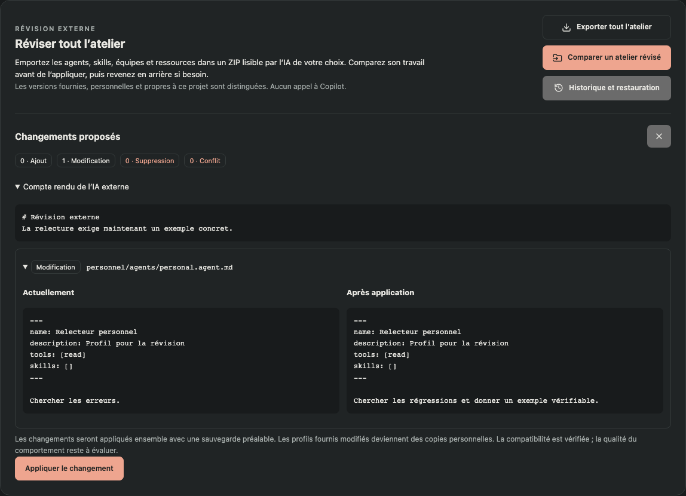

# Réviser tout l’atelier avec une IA externe

Dans **Atelier → Kits → Réviser tout l’atelier**, trois actions permettent d’exporter les définitions, de comparer leur révision et de restaurer un import. Aucune de ces opérations n’appelle Copilot ni ne lance les scripts des skills.

## Exporter et faire réviser

1. Cliquer **Exporter tout l’atelier** et enregistrer le ZIP.
2. Vérifier les instructions et ressources avant de les transmettre à l’IA choisie. Elles peuvent contenir des informations internes, même si l’application n’exporte pas ses secrets stockés.
3. Fournir l’archive à cette IA et lui demander de suivre **LIRE-MOI.md**. Les fichiers sont directement lisibles : Markdown, YAML, scripts et autres ressources conservent leurs octets, à l’exception des parcours dont les associations MCP locales sont retirées de la copie exportée.
4. Récupérer le ZIP révisé, avec les mêmes dossiers et `atelier.json`. L’IA documente ses raisons et ses propositions de vérification dans **REVISION.md**.

L’archive contient les trois portées, y compris les variantes masquées par une portée plus prioritaire :

| Dossier | Contenu | Effet d’une révision |
| --- | --- | --- |
| `fourni/` | Les agents, skills, équipes et ressources des cinq kits livrés avec KerAI | Création d’une personnalisation dans le catalogue personnel ; les fichiers de l’extension restent intacts. |
| `personnel/` | Agents, dossiers complets des skills, parcours et ressources partagées du compte | Mise à jour de la même portée personnelle. |
| `projet/` | Agents et skills de `.github`, parcours de `.feature-studio/workflows`, ressources partagées de `.github/feature-studio` | Mise à jour dans le projet qui a produit l’export. |

L’inventaire énumère tous les fichiers. La priorité reste **projet > personnel > fourni**. Si un profil fourni possède déjà une personnalisation personnelle, c’est cette dernière qu’il faut réviser. Les ressources relatives nécessaires à une copie sont ajoutées à l’aperçu si elles manquent à sa destination.

Les sources du projet hors de ces dossiers, les sessions, les conversations, les réglages de machine, les connexions MCP et les hooks actifs ne sont pas inclus. Les anciens kits `.fskit.json` restent disponibles séparément ; cet export n’est pas une sauvegarde de toute l’application ni de tous les projets enregistrés.

Les exports gardent une référence locale privée. **La réimportation de révision doit utiliser le même compte et le même projet**, y compris après un redémarrage. Pour transférer des profils sur une autre machine, utiliser les kits portables existants. Ne pas supprimer les références locales entre l’export et la réimportation.

## Comparer et appliquer

**Comparer un atelier révisé** lit le ZIP sans modifier le catalogue. L’écran présente les ajouts, modifications, suppressions, conflits, le contenu actuel et le contenu proposé, ainsi que le compte rendu externe. Les ressources binaires affichent leurs tailles.

La comparaison utilise trois états : l’export initial, l’archive révisée et les fichiers locaux actuels. Une modification locale d’un fichier que la révision veut remplacer bloque l’application. Les modifications locales sur les fichiers non révisés sont conservées. L’application revérifie l’état après l’aperçu : il faut refaire la comparaison si le catalogue a changé.

Les identifiants, profils, dépendances, parcours sans cycle et références locales sont contrôlés. Un fichier omis n’est jamais une suppression implicite : pour le supprimer, il faut aussi ajouter son chemin à `deleted` dans `atelier.json`. Les fichiers fournis ne sont pas supprimables. Retirer une personnalisation peut révéler la version fournie ; supprimer un skill exige de traiter aussi ses ressources et ses utilisateurs.

**Appliquer les changements** applique l’ensemble présenté après sauvegarde des fichiers concernés. Les connexions MCP locales des étapes qui conservent leur identifiant sont rétablies depuis la version locale ; elles ne sont pas communiquées à l’IA externe. L’application ne remplace pas les étapes ou historiques des sessions. Les appels déjà actifs doivent être arrêtés avant l’opération ; les prochains appels pourront utiliser les nouveaux profils du catalogue.

Une validation structurelle réussie ne garantit pas une meilleure qualité. Comparer les profils sur quelques missions représentatives avant de généraliser leur utilisation.

## Revenir en arrière

Dans **Historique et restauration**, choisir **Comparer avant restauration** puis **Restaurer cet état**. Les fichiers remplacés ou supprimés retrouvent leur contenu précédent et les fichiers ajoutés par cet import sont retirés. Les autres fichiers restent en place. Une modification ultérieure d’un fichier concerné bloque son remplacement ; la restauration ne l’écrase pas.

Les sauvegardes et références d’export résident sous `feature-studio/workshop/<identité du projet>/` dans le catalogue personnel. Elles restent accessibles après redémarrage. Une erreur pendant l’application déclenche une remise en état des écritures déjà effectuées, en préservant les changements concurrents. Un import interrompu dispose d’un journal persistant et apparaît dans l’historique pour restauration.

Les ressources restent passives. Les chemins sortants, collisions, liens symboliques et quelques formats connus de secrets sont refusés. Cette détection de secrets n’est pas exhaustive. Limites : 2 048 fichiers, 4 Mio par fichier, 32 Mio décompressés et ZIP de 40 Mio ; compte rendu limité à 100 000 caractères. L’archive peut être contenue dans un unique dossier parent.
