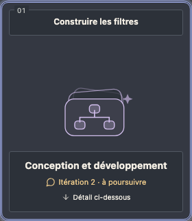

# Sous-plans et sous-équipes

Une carte **Sous-plan** confie le découpage d’une mission à un orchestrateur. Chaque tâche du découpage devient une **itération** qui exécute toute la sous-équipe choisie. Les sous-équipes peuvent contenir d’autres sous-plans, sans limite de profondeur imposée par l’interface.

## Composer la carte

Dans **Parcours**, ajoute un sous-plan à une équipe enregistrée. Dans une feature, utilise **Composer mon équipe** ou **Modifier l’équipe**. La carte a une illustration de sous-équipe distincte des portraits d’agents et reprend le thème courant, y compris dans le QG vivant.

Les réglages réunissent son nom, sa mission, un seul sélecteur d’orchestrateur et l’organisation par défaut. Le chat de l’orchestrateur utilise ce mode de découpage ; il n’affiche pas le réglage de rythme des agents exécutants :

- **Découpage accompagné** : discute le plan dans le chat, demande des ajustements, puis valide explicitement le découpage avant le démarrage de la première tâche.
- **Découpage automatique** : l’orchestrateur propose un découpage et lance la première sous-équipe dès que ce découpage est valide.

Le profil **Orchestrateur** est fourni. Son nom et son avatar restent dans les réglages et la conversation ; ils ne remplacent pas le visuel de la carte. Il utilise les outils natifs de lecture, sans développer à la place de sa sous-équipe.

**Choisir une équipe** ouvre le compositeur habituel. Tu peux sélectionner une équipe enregistrée, ajouter des agents et configurer d’autres sous-plans. La structure est une copie locale modifiable. Les profils sources des agents sont actualisés au lancement, sauf le modèle et la réflexion conservés sur chaque carte. Le modèle du budget, s’il est explicitement choisi, garde sa priorité.

Une carte vide peut être enregistrée. Elle affiche un avertissement et empêche le lancement, même si l’oubli se trouve plusieurs niveaux plus bas.

## Exécuter et valider

Une seule tâche progresse à la fois dans le même projet. Pour un parcours sous-plan → développement → tests, place ces trois interventions dans la sous-équipe. Chaque étape attend ta validation ; l’étape Tests ne démarre pas avant validation de celle de développement. Les contrôles et permissions Copilot restent indépendants du découpage automatique ou accompagné.

Clique sur la carte Sous-plan pour afficher son chat et le panneau des sous-tâches sans quitter l’équipe courante. Clique sur une tâche dans ce panneau pour entrer dans sa sous-équipe. Le bandeau indique le chemin, le numéro et l’état de l’itération. La liste **Changer d’itération** permet de consulter les précédentes ; **Niveau précédent**, **Équipe de base** et **Revenir à l’itération active** permettent de retrouver le travail en cours. **Chat de l’orchestrateur** revient à la conversation qui pilote ce niveau. Naviguer ne lance ni ne valide rien.

Chaque itération conserve ses tentatives, chats, fichiers observés, points de restauration et validations. Après les étapes, **Valider cette tâche** ouvre la tâche suivante. Après toutes les tâches et revérifications nécessaires, **Valider l’ensemble des sous-tâches** clôt la carte parente. La validation finale de la feature reste distincte.

Pour une correction avant validation de la tâche, utilise les actions de correction existantes : retour au développement, relecture humaine, puis nouveaux tests. Le cycle reste dans la même itération.

## Ajouter une tâche ou réviser un résultat

Tant que la carte n’est pas validée, son chat reste ouvert. Demande par exemple : « Ajoute la gestion du clavier » ou « Corrige l’itération 2 puis revérifie les filtres combinés ». L’orchestrateur explique le nouveau découpage ; en mode accompagné, tu le valides avant toute nouvelle exécution.

Une tâche jamais démarrée peut être ajustée ou retirée. La tâche déjà commencée conserve son identité, sa mission et sa priorité sur les tâches suivantes. Une tâche déjà validée reste consultable : sa correction crée une nouvelle itération liée à l’ancienne. Les résultats validés qui la suivent sont signalés **À revérifier**. Une tâche de vérification liée, exécutée et validée, lève ce signal. Une simple explication ou une déclaration de l’orchestrateur ne valide pas les résultats.

Depuis un historique, rejoins le chat de l’orchestrateur pour discuter une révision. Les anciennes exécutions restent inchangées.

## Modifier les équipes en cours

Tu peux ouvrir le compositeur à chaque niveau, y compris à la racine. Pendant un appel actif, le changement est enregistré en attente et appliqué à la fin de l’appel. Les cartes utilisées ne peuvent pas être supprimées ni transformées en un autre intervenant ; ajoute une nouvelle carte pour les remplacer dans la suite du travail.

Une insertion avant une carte déjà utilisée attend un retour par les boutons de correction. Une insertion après le point courant sera jouée normalement. Les réglages d’un sous-plan s’appliquent aux futures itérations encore intactes ; une itération commencée ou dont tu as déjà personnalisé l’équipe garde sa composition. Les historiques validés restent consultables et se corrigent par une nouvelle itération.

## Pause, réouverture et budget

La pause de l’orchestrateur suspend la progression de ses descendants et interrompt leur appel actif en conservant le travail partiel. La reprise est explicite. Fermer puis rouvrir le cockpit ne redémarre aucun agent.

Les appels et crédits des descendants comptent dans le budget de l’équipe de base. Ils sont aussi inclus dans les statistiques. Les sous-équipes travaillent dans le même dossier ou worktree que leur équipe de base ; elles ne créent pas une branche par tâche. Archiver ou supprimer une session se fait depuis son équipe de base et concerne tout son historique.

[Conversation de l’étape](MODE-PAIR.md) · [Outils natifs et permissions](COPILOT-NATIF.md) · [Validation et limites](VALIDATION.md)

## Lisibilité et accès rapide (v1.26.0)

**Aller à l’étape en cours** rejoint directement le détail actif. Sélectionner une carte y place aussi le focus clavier. Dans une sous-équipe, la mission de la tâche est affichée en premier ; **Contexte transmis à la sous-équipe** permet de relire le brief complet.

L’itération active est mise en avant et le compteur distingue les tâches validées de celles à revérifier. À partir de sept itérations, recherche une tâche par son nom, son numéro ou sa mission, avec ou sans accents ; les filtres isolent le travail restant, les revérifications ou l’historique. Les tâches retirées restent consultables.

Dans le compositeur, le bouton de la carte ouvre directement sa sous-équipe. Valider ce panneau met à jour le brouillon de la carte ; il faut ensuite enregistrer l’équipe parente. Échap ferme seulement le panneau au premier plan et rend le focus à son bouton d’ouverture.
