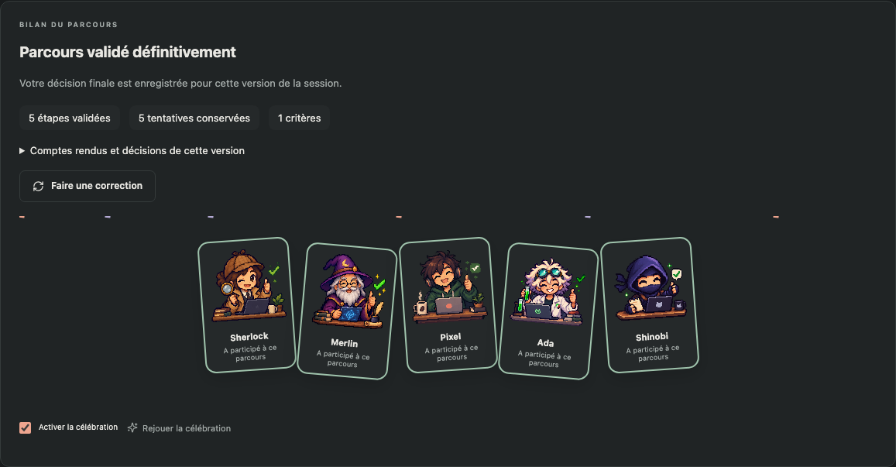

# Validation et limites

## Images, documentation et dossier de preuves — v1.28.0

- TypeScript, compilation et **814 tests métier réussis, 7 tests optionnels ignorés**. Les tests ciblés supplémentaires vérifient les images exclues du contexte, les sources inventées refusées, la persistance des conclusions et les empreintes modifiées. Les limites de taille et de pagination des exports sont contrôlées.
- **273 scénarios Chromium vérifiés** : 272 lors de la dernière passe complète, puis le dernier scénario relancé avec un sélecteur précis après ajout du dossier de preuves. La création avec capture, le collage, le retrait, l’envoi dans les deux conversations, le rechargement, les quatre formats et le dossier à 390 px sont couverts. Les captures documentées utilisent des données de démonstration.
- Quatre scénarios réussis avec le vrai CLI **1.0.102 / SDK 1.0.20** : catalogue DevOps, permissions natives, compétences/instructions ciblées et images/outils de preuves. Le scénario images/outils de preuves réussit aussi sur **1.0.103**. Le fournisseur local déterministe constate les pixels exacts transmis au modèle, les outils de lecture/web exposés, l’absence d’outils d’écriture/terminal dans les profils documentation et l’exécution des outils de conclusions. Ce n’est pas une évaluation de compréhension d’image ou de rédaction avec inférence réelle.
- Un exemple de documentation a été exporté dans les quatre formats. Les archives DOCX/PPTX et leurs liens sont vérifiés ; le rendu Word (1 page) et PowerPoint (6 diapositives) a été ouvert par LibreOffice et inspecté visuellement. Le HTML a été rendu dans Chromium. La mise en page PowerPoint reste sobre et dépend de la concision du plan ; les tableaux y sont textuels.
- `npm audit --omit=dev` : aucune vulnérabilité signalée lors du contrôle. Le paquet est contrôlé par le vérificateur d’archive, puis chargé dans un vrai VS Code avec un profil isolé. La CI Linux/Windows et le téléchargement du paquet publié restent des preuves séparées, rattachées au commit dans la [release v1.28.0](https://github.com/MattDevBzh/KerAI/releases/tag/v1.28.0).
- La recette avec le compte connecté reste limitée par le catalogue de modèles vide observé lors de la préparation de la v1.27.0. Aucun succès d’analyse visuelle réelle ni de campagne documentaire autonome n’est revendiqué. Les sources web dépendent du réseau et des sites ; le dossier conserve des observations datées, pas une certification de fraîcheur ou de conformité.

## Compétences natives et instructions ciblées — v1.27.0

- Vérification TypeScript, compilation et **803 tests métier réussis, 6 tests optionnels ignorés**. **267 scénarios Chromium réussis**, dont les chargements réellement confirmés, leur contenu et leur affichage compact. Les captures du panneau utilisent des données de démonstration.
- Un scénario traverse le véritable adaptateur et Copilot CLI **1.0.102 et 1.0.103**, avec un fournisseur de réponses local déterministe : compétence ordinaire chargée à la demande, compétence explicite préchargée, lecture d’une instruction ciblée, refus du shell et conservation des preuves après relecture du stockage. Ce scénario ne constitue pas une évaluation de la qualité d’un modèle réel.
- La recette avec inférence réelle n’a pas pu démarrer : le compte est authentifié mais le catalogue de modèles retourné par ces runtimes est vide. Aucun succès d’inférence n’est revendiqué pour cette version.
- Les validations humaines et les catalogues personnels sont conservés. Le paquet, le smoke VS Code, la CI Linux/Windows et le téléchargement publié sont des contrôles séparés ; la [release](https://github.com/MattDevBzh/KerAI/releases/tag/v1.27.0) référence le commit et la CI de livraison.

## Lisibilité des sessions et sous-équipes — v1.26.0, 22 octobre 2026

- Après intégration de la version 1.25.2 : **800 tests métier réussis, 5 tests optionnels ignorés**, vérification TypeScript et compilation. Les tests métier ont été exécutés séparément de Chromium pour éviter la concurrence sur les tests d’archives qui écrivent plusieurs milliers d’événements.
- **266 scénarios Chromium réussis**, dont les parcours de Mes équipes, les sous-plans imbriqués, la navigation au clavier, le retour vers l’étape active, la mission et son contexte dépliable, l’historique filtrable et les résultats à revérifier. Le glisser-déposer, les panneaux imbriqués à 390 px et au zoom 200 %, les thèmes, le contraste élevé et les mouvements réduits sont couverts.
- Les demandes humaines partagent leur brouillon entre la popin et le chat ; les tests vérifient la réduction, les demandes successives et l’absence de double réponse. Les permissions mémorisées sont limitées à la session et à leur portée, puis effacées lors d’un changement de mode. Les validations humaines, dont le code avant les tests, restent requises.
- **Deux contrôles réussis avec le vrai Copilot CLI 1.0.102 / SDK 1.0.20**, sans inférence : catalogue natif, outils exécutés, permissions, refus et reprise. Les variantes `rg` et `apply_patch` restent couvertes par les tests du catalogue. Cette passe n’ajoute pas de campagne avec un modèle réel ; la recette agentique de la v1.24.0 reste documentée ci-dessous.
- Les [captures de navigation](screenshots/subplan-ergonomics/navigation.png), d’[historique](screenshots/subplan-ergonomics/historique.png) et de [composition compacte](screenshots/subplan-ergonomics/composition-390.png) proviennent de l’interface avec des données de démonstration. Les cartes Sous-plan gardent leur illustration dédiée, sans portrait d’orchestrateur.
- La livraison exige séparément le contrôle du VSIX, son chargement dans VS Code, la CI Linux/Windows du commit livré et la vérification du paquet téléchargé. La [release v1.26.0](https://github.com/MattDevBzh/KerAI/releases/tag/v1.26.0) associe le commit exact, sa CI et les empreintes du paquet publié.

## Sous-plans et sous-équipes — v1.24.0, 22 octobre 2026

- Validation locale : **735 tests métier réussis, 5 tests optionnels ignorés**, vérification TypeScript et compilation. **254 scénarios Chromium réussis**. Les scénarios couvrent l’imbrication, les historiques, les révisions avec revérification des résultats suivants, les changements de composition pendant un appel, la reprise après interruption, les worktrees et la suppression complète de l’arbre.
- Le scénario avec **Copilot CLI 1.0.102 / SDK 1.0.20 et gpt-6-luna** a réalisé une tâche avec deux agents : l’orchestrateur a fourni le découpage, le développeur a modifié le fichier avec l’outil natif `apply_patch`, le testeur a exécuté une commande native avec code de retour 0. Le scénario a contrôlé l’absence d’appel du testeur avant validation du code, puis les validations de la tâche et de la carte parente, et la relecture de leur état persisté. Les validations humaines sont envoyées explicitement par le scénario de recette. **3 appels** pour ce scénario réussi ; [preuve synthétique](subplan-runtime-proof.json).
- Les premiers essais ont révélé l’absence de `apply_patch` dans le catalogue proposé aux modèles qui l’utilisent, puis la présence d’anciens profils utilisateur dans la recette. Le catalogue a été complété, le profil Tests fourni adapté au mode natif, et la recette utilise désormais un catalogue de profils isolé. Les profils personnels existants ne sont pas écrasés : une ancienne consigne interdisant le terminal reste à mettre à jour dans Agents si tu veux utiliser les tests natifs avec ce profil.
- Un contrôle sans inférence utilise le vrai CLI pour exécuter le patch natif et vérifier son refus en lecture seule. Les interruptions, révisions multiples et niveaux imbriqués sont vérifiés par les tests déterministes avec agents simulés ; ils ne sont pas présentés comme une campagne multi-modèles réelle.
- La carte et les écrans ont été vérifiés en thèmes clairs, sombres et événementiels, ainsi qu’en petite largeur. Les [captures du sous-plan](screenshots/carte-sous-plan.png) et de [navigation](screenshots/sous-equipe.png) utilisent des données de démonstration. Le paquet, son chargement dans VS Code, la CI Linux/Windows du commit et l’archive téléchargée restent des vérifications séparées avant livraison.

## Conversation native intégrée — v1.23.0, 21 octobre 2026

- Le vrai CLI 1.0.102 avec SDK 1.0.20 reprend une même session en passant du catalogue de lecture au catalogue de travail, puis à la lecture. Le test automatisé sans inférence vérifie les outils réellement exposés dans les deux sens.
- La recette avec modèle réel a lu le fichier, effectué le travail autorisé, reçu une intervention pendant le shell, confirmé son application dans la réponse finale puis expliqué le résultat sans changer le fichier. Les trois tours partagent la même session native. Modèle observé : gpt-6-luna ; usage total du scénario réussi : 49 893 tokens entrants, 1 100 sortants, 204 055 000 nano-AIU. [Preuve synthétique](conversation-runtime-proof.json).
- Le premier essai a refusé un modèle explicitement demandé absent du catalogue avant tout prompt. Un essai suivant avait réalisé le travail mais une assertion de recette imposait à tort un saut de ligne final ; la recette réussie contrôle le contenu demandé et l’absence de changement pendant l’explication.
- Les scénarios de service et d’interface vérifient solo/pair, organisation acceptée, préférences, messages pendant le travail, envois incertains sans renvoi automatique, arrêt confirmé, questions sur le livrable, correction, verrouillage après validation et stockage version 9.
- Les captures de conversation sont des fixtures visuelles. Les preuves locales, le chargement du VSIX, la CI Linux/Windows du commit et le paquet téléchargé sont contrôlés séparément lors de la publication.

## Copilot natif — v1.22.0, 21 octobre 2026

- SDK 1.0.20 et CLI 1.0.102 : recette locale macOS avec outils réellement exécutés, réponses humaines, refus, changement de mode, reprise et arrêt d’un processus enfant. Une fixture complémentaire vérifie une règle gérée de refus de commande, y compris en mode tout autoriser.
- Un appel modèle borné gpt-6-luna a modifié le fichier de recette et exécuté une commande avec code de retour structuré 0. Usage observé : 34 561 tokens d’entrée, 573 de sortie, 145 973 500 nano-AIU. [Preuve synthétique](native-runtime-proof.json).
- Manuel et tout autoriser sont disponibles sur ce runtime. Assisté est refusé et désactivé dans l’interface. CLI 1.0.63 : les APIs natives requises manquent, le lancement est refusé avant prompt.
- Les suites automatisées couvrent permissions, refus, annulation, persistance version 8, événements natifs, fichiers observés sans attribution de propriété et interface. Les jobs Linux/Windows utilisent un CLI 1.0.102 épinglé et n’envoient aucun prompt payant.
- La procédure de publication contrôle séparément le paquet, son chargement dans VS Code, la CI du commit et l’archive téléchargée. Un succès local n’atteste pas à lui seul ces étapes.
- Les outils web, sous-agents, plugins, hooks et skills natifs, la conversation native continue et le compagnon latéral restent hors de cette version. [Périmètre et limites](COPILOT-NATIF.md).

## Intégration des travaux locaux — v1.14.0

- Inventaire des deux dossiers de travail, des branches locales et distantes et des stashes : les anciennes branches étaient déjà incluses dans la v1.13 (`a75f2914c8cbb00f5b0913570ebc4329fc9eb0ce`). Les nouveautés visuelles et correctifs non commités du dossier principal ont été enregistrés, puis fusionnés avec cette base. Aucun stash ne contenait un autre lot.
- Les lots récupérés couvrent le QG et ses décors, les six récompenses et leurs préférences, Dragon Ball et ses vingt costumes, les thèmes explicites sous Bearded et l’approbation native du projet. Les sources, tests, visuels, prompts et anciennes propositions graphiques sont versionnés. Les deux captures différentes du second dossier sont conservées dans `design/proposals/2026-10-18-v1.13/`.
- Les anciens paquets et téléchargements locaux sont conservés octet pour octet : 24 fichiers dans le dossier principal, 132 dans le second dossier. Les nouveaux paquets sont ignorés par Git et distribués dans les releases GitHub ; les anciens paquets déjà suivis restent dans l’historique et leur `releases/SHA256SUMS` est conservé.
- Le QG prend en charge l’état `skipped`, l’attente d’un choix facultatif et le bilan avec interventions passées. Le scénario d’intégration vérifie le choix, le poste, les compteurs, la validation finale disponible et le retour à la bande classique. Une intervention passée ne devient ni une tentative ni une réussite.
- La célébration Eiffel ne réapparaît plus à la réouverture d’une session terminée quand le mouvement réduit est actif. Le scénario vérifie l’ouverture et le rechargement sans commande métier.
- Le vérificateur `scripts/verify-vsix.py` contrôle les versions, le manifeste, les quatre commandes de fonctionnalité dans les bundles hôte et interface, les préférences déclarées, les notes de version et tous les visuels publics octet pour octet. Avec `--match-build`, il compare aussi chaque fichier compilé. Les jobs de validation et de publication l’exécutent avant le smoke du paquet ; Windows couvre aussi les nouveaux tests de récompenses, Dragon Ball et QG.
- Validation locale : `npm run check` réussi avec **657 tests métier réussis, 4 ignorés**, vérification TypeScript, format et compilation. La campagne complète Chromium a réussi **212 scénarios**. Les captures du QG avec passage facultatif, du chaton, de Matrix et des dashboards figurent dans `design/proposals/2026-10-19-v1.14/`.
- Paquet local contrôlé : **40 351 762 octets**, SHA-256 `1f9bd49d83774adc2f55295232cfcd0df0e78d0098962784e90c98263332f10b`. Les **138 fichiers compilés** et **131 assets publics** correspondent aux sources. Deux archives volontairement incomplètes (une planche Dragon Ball absente, puis sa commande absente du bundle interface) ont été refusées par le vérificateur.
- Le **VSIX local exact, extrait**, a passé le smoke natif dans VS Code Insiders sur macOS (sortie 0) : activation et cockpit, préférences/thèmes/secrets/récompenses, QG, parcours facultatifs, conservation des données et contrôles Git existants. Le projet et le profil sont isolés et aucun prompt Copilot payant n’est envoyé. Ce compte rendu a été complété après construction du paquet local.
- La publication attend les jobs Linux et Windows du commit livré, puis reconstruit et contrôle le VSIX, le charge dans VS Code et vérifie les empreintes après téléchargement. Le paquet distribué possède son propre `SHA256SUMS` ; la [release v1.14.0](https://github.com/MattDevBzh/KerAI/releases/tag/v1.14.0) porte le commit et le lien de CI exacts.
- Les contrôles locaux, la CI et le paquet publié restent des preuves distinctes. Les comptes rendus datés du 17 et du 18 octobre décrivent les recettes historiques ; ils sont conservés pour la traçabilité.

## Interventions facultatives — v1.13.0

- `npm run check` réussi sur macOS : format, TypeScript, **638 tests métier réussis**, 4 ignorés, puis compilation. Les contrôles complets sont exécutés séparément des scénarios navigateur ; les tests d’archives écrivent et relisent réellement plus de 3 000 événements.
- **178 scénarios Chromium réussis**. Les nouveaux cas couvrent la participation dans la composition, le choix facultatif du pilote, la décision différée et la réouverture, les doubles clics, le refus puis la nouvelle décision, le passage manuel, le bilan honnête et l’accès depuis le centre de validation. Le test de mise à jour du Métro cible désormais l’identité de la session, indépendamment de son rang dans la liste.
- Les tests du service attendent les demandes humaines jusqu’à 10 secondes, avec échec immédiat si l’exécution se termine avant la demande ; la préparation Git sous Windows peut dépasser le délai implicite de 1 seconde des assertions. Ils utilisent un agent simulé et de vrais dossiers/dépôts : pause sans appel, notification unique, reprise après choix, checkpoint conservé, refus des anciennes notifications et réponses concurrentes, absence de confiance, retour à l’état précédent si la sauvegarde échoue et redémarrage sans lancement implicite.
- Les tests du moteur couvrent les dépendances après passage, l’interdiction de passer une intervention déjà tentée, les critères encore bloquants, la réactivation, les invalidations après correction/restauration et la conservation de l’historique. Ils vérifient aussi le contexte transmis aux agents suivants, les copies d’équipes et l’aller-retour des kits avec participation facultative.
- Le smoke dans un vrai hôte VS Code Insiders sur macOS vérifie la création d’une équipe facultative depuis une proposition, le passage par le protocole hôte, l’absence de tentative ou de prompt payant et la conservation du choix après fermeture/réouverture. Les critères non vérifiés continuent à bloquer la fin de session.
- Le stockage v6 conserve le parcours et les décisions, migre les index v5 et les formats antérieurs, et refuse les états incohérents. Les interventions des anciennes sessions restent obligatoires par défaut.
- La CI Linux et Windows du commit livré est une vérification distincte des tests locaux. La publication attend ces jobs, contrôle les versions du VSIX, charge son contenu extrait dans VS Code et vérifie les empreintes après téléchargement. La [release v1.13.0](https://github.com/MattDevBzh/KerAI/releases/tag/v1.13.0) donne le commit et la CI correspondants ; son `SHA256SUMS` porte sur le paquet réellement publié.
- Les tests n’envoient aucun prompt Copilot payant. Ils prouvent les transitions, la persistance et l’intégration UI/hôte, pas la qualité d’une réponse produite par un modèle réel pour une US donnée.

## Thèmes masqués par Bearded et enregistrement des réglages — correctif local, 17 octobre 2026

- Diagnostic dans le cockpit installé : projet déjà approuvé, thème enregistré, mais message de priorité au contraste élevé. Le manifeste local de Bearded Theme Milkshake Vanilla Banana déclare `uiTheme: hc-black`, ce qui forçait le thème effectif à `auto`.
- Les thèmes explicitement choisis dans Feature Studio conservent désormais leur palette, leurs portraits et leurs décors sous les classes VS Code `vscode-high-contrast` et `vscode-high-contrast-light`. **Suivre VS Code** garde la palette native. Les couleurs forcées du système restent prioritaires avec une explication visible.
- Le choix du thème annonce son enregistrement automatique. Le bouton **Enregistrer les réglages du projet** explique pourquoi il reste grisé après un simple changement d’apparence. L’état de confiance remplace le texte d’approbation inconditionnel ; l’écran natif est accessible sans approbation implicite ni perte du brouillon.
- `npm run check` réussi : format, TypeScript, **637 tests métier réussis**, 4 ignorés, compilation. `npm run test:ui` réussi : **206 scénarios**. Les nouvelles vérifications couvrent les refus et l’accès à l’écran d’approbation, les brouillons conservés, Dragon Ball et Halloween sous la classification Bearded, les vingt costumes, le QG, le suivi automatique et les couleurs forcées.
- Captures vérifiées : `design/proposals/2026-10-17-theme-fix/dragonball-bearded-reglages.png` et `qg-dragonball.png`. Les captures documentaires régénérées par la recette ont été remises à leur état antérieur.
- Paquet `releases/local/feature-studio-1.12.0-themes-fix-local.vsix` : 40 334 153 octets, SHA-256 `1a535b127b5f00de944539d4b93a045080397f47ca79d6272e579f7bd6d7aa24`. Archive intègre, bundles extension/webview et neuf fichiers de décors/planches comparés octet par octet aux sources.
- Le contenu extrait de ce VSIX exact a passé le test natif dans VS Code Insiders sur macOS (`PASS`, sortie 0), incluant l’ouverture réelle de l’écran de confiance sans changement de confiance ni initialisation métier. Profil et projet isolés ; aucune installation dans le profil habituel ni appel IA payant.
- Correctif local non publié. Ce compte rendu a été complété après la construction du paquet ; aucune nouvelle CI Linux ou Windows n’est attestée.

## Dragon Ball, thème secret — évolution locale, 17 octobre 2026

- Format, TypeScript et compilation réussis ; **636 tests métier réussis**, 4 ignorés. Après le dernier ajustement de cadrage des portraits, TypeScript et les **79 tests ciblés** du protocole, des thèmes et des avatars ont également réussi.
- **203 scénarios Chromium réussis sur la campagne complète**, dont sept pour le secret : séquence exacte, erreurs, pause, touches maintenues, champs de saisie, navigation, persistance, refus/expiration, réponse étrangère, vingt portraits, trois poses, image absente, contraste élevé, animations réduites, petits écrans et Tour de contrôle détachée. La campagne précédente avait signalé trois appels de lecture superflus au démarrage ; ils ont été supprimés avant cette campagne réussie.
- Le déblocage est mémorisé dans le profil personnel VS Code ; un choix de thème direct reste refusé tant que le secret n’est pas acquis. Un échec de sauvegarde conserve le thème confirmé. Le code ne lance aucun agent, ne modifie pas les profils et n’accorde aucun trophée. Les six récompenses et leur jauge restent indépendantes.
- Cinq fichiers image_gen : un décor et quatre planches transparentes couvrant vingt agents × trois poses distinctes. Les fichiers restent intacts ; le cadrage SVG suit leurs gouttières transparentes et masque les cellules voisines. Les portraits habituels et Halloween restent inchangés. Prompts et fichiers dans `design/dragonball/PROMPTS.md`.
- Captures de l’interface réelle avec données de recette dans `design/proposals/2026-10-17-dragonball/` : Dashboard 1440/390 px, révélation, vingt costumes et QG.
- Paquet `releases/local/feature-studio-1.12.0-dragonball-local.vsix` construit (38,46 Mio), archive intègre, cinq décors, deux récompenses et quatre planches Dragon Ball vérifiés octet par octet. Les 60 fichiers des avatars habituels et les 60 fichiers Halloween sont identiques aux sources. SHA-256 : `17d4152c5b2a5fe0cb260529e4e46adea28d4cec3fa9d85047ee0bbe42492971`, conservé aussi dans son fichier `.sha256`.
- Le contenu extrait de ce **VSIX exact** a passé `npm run test:extension` dans VS Code Insiders sur macOS : thème secret refusé avant découverte, code accepté, préférence globale enregistrée, choix ultérieurs et contrôles existants réussis. Projet et profil isolés, aucun prompt Copilot payant, aucune installation dans le profil habituel. Ce compte rendu a été complété après construction du paquet.
- Évolution locale non publiée ; aucune nouvelle CI Linux ou Windows n’est attestée par ce lot.

## Six récompenses de trophées — évolution locale, 17 octobre 2026

- `npm run check` réussi : format, TypeScript, **632 tests métier réussis**, 4 ignorés, puis compilation.
- **195 scénarios d’interface vérifiés** : la campagne Chromium complète a réussi 194 cas et révélé une course dans le test de rechargement, qui coupait sa simulation avant l’accusé de sauvegarde. Après ajout de l’attente explicite, les neuf scénarios des récompenses ont réussi. Les autres cas n’ont pas été modifiés.
- Seuils 5/20/40/70/110/200, un seul cadeau futur visible, jauge par intervalle, anciens trophées pris en compte, activation facultative, titres exclusifs, conservation des choix, erreurs et expiration vérifiés. Les contrôles hôte refusent les récompenses verrouillées, les messages forgés et un registre illisible ; les écritures concurrentes préservent les autres choix.
- Recette des thèmes Noob et Matrix à 1440 et 390 px, du chaton dans le QG, de la célébration Eiffel, du contraste élevé et des animations réduites. Captures dans `design/proposals/2026-10-17-recompenses/` ; données de recette, sans ajout de trophées au profil habituel.
- Deux images issues de l’outil intégré image_gen, avec prompts dans `design/rewards/PROMPTS.md`. La tour Eiffel est un décor et les feux d’artifice sont animés dans l’interface ; le chaton utilise six poses d’une planche transparente. Les vingt avatars restent inchangés.
- Paquet `releases/local/feature-studio-1.12.0-rewards-local.vsix` construit (26,44 Mio), archive intègre, deux images de récompenses et quatre décors identiques aux sources, 60 fichiers des vingt avatars vérifiés octet par octet. SHA-256 : `a4643631e4a8787070aaed2e81caee6d014971b4acf88eb613727c7c854d7b3f`, également conservé dans son fichier `.sha256`.
- Le contenu extrait de ce **VSIX exact** a passé `npm run test:extension` dans VS Code Insiders sur macOS : activation et ouverture du cockpit, protocole et préférences, refus des récompenses verrouillées, conservation des données métier et contrôles existants. Profil, projet et stockage isolés ; aucun prompt Copilot payant et aucune installation dans le profil habituel.
- Évolution locale non publiée ; aucune nouvelle CI Linux ou Windows n’est attestée par ce lot. Ce compte rendu de recette a été complété après construction du paquet.

## QG par thème — évolution locale, 17 octobre 2026

- Format, TypeScript et compilation vérifiés ; **21 scénarios Chromium réussis** : les 10 scénarios du QG et les 11 scénarios des thèmes existants, dont les petits écrans, la réduction des animations et les contrastes élevés.
- Recette visuelle complémentaire des sept thèmes et du mode automatique sous VS Code clair et sombre : **9 captures** dans `design/proposals/2026-10-17-qg-vivant/themes/`. Les changements de thème conservent la sélection et le brouillon du compte rendu ; les deux contrastes élevés masquent les décors et costumes, puis le retour au thème Halloween les restaure. Aucune erreur de page ou commande d’exécution observée pendant cette recette.
- Quatre décors partagés, dont trois nouvelles variantes issues d’image_gen ; les images des avatars restent inchangées. Les filtres et calques d’éclairage affectent uniquement le décor. Prompts et chemins des images dans `design/qg/THEMES.md`.
- Paquet `releases/local/feature-studio-1.12.0-qg-themes-local.vsix` construit (23,04 Mo), archive vérifiée, quatre décors présents et 60 fichiers des vingt avatars identiques aux sources. SHA-256 : `1d08cfe59379538ee20b9ba545fbaefca3c1f9b8b74debbb8786cf6a338d9458`, conservé aussi dans le fichier `.sha256` associé.
- Le contenu extrait de ce paquet exact a passé `npm run test:extension` dans VS Code Insiders sur macOS avec profil et projet isolés. Aucun prompt Copilot payant ni installation dans le profil habituel.
- Évolution locale non publiée ; aucune nouvelle CI Linux ou Windows n’est attestée par ce lot.

## QG de session — évolution locale, 17 octobre 2026

- `npm run check` réussi : format, TypeScript, **624 tests métier réussis**, 4 ignorés, puis compilation.
- **40 scénarios Chromium ciblés réussis**, dont 10 pour le QG : remplacement de la bande, sélection du détail, persistance entre sessions et rechargements, refus et expiration de sauvegarde, conservation du brouillon, états réels et questions humaines, vingt avatars et interventions répétées, profils absents, équipe vide, thèmes, largeurs de 1440/1100/390 px, clavier, contraste élevé et animations réduites. Les 30 autres couvrent la collaboration, les validations, la composition, les thèmes et la navigation existants.
- La préférence est validée à la frontière hôte et écrite uniquement dans le profil personnel, avec accusé de réception et traitement ordonné des écritures. Le contrôle conserve l’état des sessions et ne lance aucun agent.
- Le décor `webview/public/qg/atelier.png` est partagé par tous les postes ; les vingt avatars, leurs GIF et leurs costumes existants restent inchangés. Captures de l’interface réelle sous Chromium avec données de recette : `design/proposals/2026-10-17-qg-vivant/03-qg-session.png` et `04-qg-papier.png`.
- Paquet local `releases/local/feature-studio-1.12.0-qg-local.vsix` construit et contrôlé : archive intègre, préférence personnelle désactivée par défaut, décor présent et 60 fichiers des vingt avatars identiques aux sources. SHA-256 : `f55631ae6a9f7a9114fdeccbe54e589a67a680083fcd4732ed38baf847abf144` (également dans le fichier `.sha256` associé).
- Le contenu extrait de ce paquet exact a passé `npm run test:extension` dans VS Code Insiders sur macOS, avec profil et projet isolés, y compris la persistance de la préférence et la conservation de l’état métier. Aucun prompt Copilot payant ni installation dans le profil habituel.
- Cette évolution est locale et non publiée. Les validations distantes de la release v1.12.0 ci-dessous ne portent pas sur ces changements.

## Dashboard, navigation et tickets — v1.12.0

- `npm run check` réussi : format, TypeScript, **619 tests métier réussis**, 4 ignorés, puis compilation. Le parallélisme respecte les capacités du poste, avec un plafond de quatre processus pour les tests qui sollicitent fortement Git et les archives. Les deux suites d’intégration des worktrees disposent de 60 secondes par scénario sous Windows ; elles vérifient les chemins décodés et les permissions réellement disponibles sur la plateforme, avec les mêmes contrôles de conservation des fichiers et des index.
- **174 scénarios Chromium réussis**, dont la navigation regroupée, les filtres et détails des tickets, la préparation d’une session, le dashboard Métro et la Tour de contrôle. Les modules couvrent la duplication, les filtres, les tailles, le déplacement, la persistance, les mises à jour des sessions et les largeurs de 1440, 1100, 820 et 390 px. Les anciennes préférences de navigation sont migrées vers Sessions.
- Dans un vrai hôte VS Code Insiders sur macOS, le smoke couvre l’ouverture de la fenêtre auxiliaire, le refus des commandes d’exécution depuis cette vue de suivi, la fermeture du cockpit pendant le suivi, son retour à la bonne session et la conservation de la disposition après fermeture et réouverture.
- Les tests du contrôleur vérifient une actualisation partagée entre les fenêtres, l’absence de requêtes concurrentes, l’arrêt des lectures lorsque les vues sont masquées, les filtres indépendants, les erreurs avec conservation de la date des dernières données et le refus des sauvegardes obsolètes.
- Les recherches Azure utilisent une API simulée. Les droits du compte réel, ses données et ses éventuels champs personnalisés restent à vérifier dans le cockpit. La création depuis un ticket utilise de vrais dépôts Git locaux avec un agent simulé : contexte conservé, référence de départ vérifiée, dossier source préservé, reprises sans doublon et aucun lancement implicite. Aucun prompt Copilot payant n’est envoyé par cette recette.
- La publication attend les validations Linux et Windows du commit de `main`, reconstruit le VSIX, contrôle son manifeste et son contenu, puis charge le paquet extrait dans VS Code. Les assets sont téléchargés de nouveau et leurs empreintes vérifiées avant publication. Le commit et la CI exacts figurent dans les [notes de release v1.12.0](https://github.com/MattDevBzh/KerAI/releases/tag/v1.12.0) ; le `SHA256SUMS` de la release concerne le paquet effectivement livré.

## Préparation et publication de la version 1.11.0

- Sources fonctionnelles : `53efa24c0d55468a0454ef4e9e5306ad3d87df06`, dont la [CI Linux et Windows a réussi](https://github.com/MattDevBzh/KerAI/actions/runs/39031277359). Le passage à 1.11.0 modifie la version du paquet et la documentation ; les sources et les versions des dépendances restent identiques.
- Recette locale préalable de la version 1.11.0 : `npm run check` réussi (**592 tests métier réussis**, 4 ignorés), paquet construit et inspecté, puis contenu extrait de ce VSIX chargé avec succès dans VS Code Insiders sur macOS. Les **154 scénarios Chromium** de la fusion couvrent les mêmes sources fonctionnelles.
- La publication reconstruit le VSIX en CI après les validations Linux et Windows du commit candidat, vérifie son manifeste et son contenu, puis charge le paquet extrait dans un vrai hôte VS Code. Les assets sont téléchargés à nouveau et leurs empreintes sont contrôlées avant de rendre la release visible. Le commit et le run exacts figurent dans les [notes de release v1.11.0](https://github.com/MattDevBzh/KerAI/releases/tag/v1.11.0) ; son `SHA256SUMS` concerne le paquet publié, distinct de la construction locale préalable.

## Fusion du zoom et de la détection automatique avec main

- Intégration de `codex/display-zoom` (`10e0662307bd839e530fd7740876cc1320166014`) avec `main` (`40a639c77f337f890f9329011321c4b680b06748`). L'ouverture dans la fenêtre courante, la connexion au démarrage, les améliorations ergonomiques et le compteur de crédits sont conservés.
- `npm run check` réussi : format, TypeScript, **592 tests métier réussis**, 4 ignorés, puis compilation. La résolution des chemins utilise les conventions de la plateforme demandée ; le scénario de pagination de plus de 1 500 fichiers garde ses assertions avec un délai adapté aux agents Windows.
- **154 scénarios Chromium réussis**, dont les scénarios de zoom et de détection du CLI. La navigation compacte, les dialogues et les détails des crédits sont vérifiés ensemble à 200 %, ainsi que le retour à la navigation de bureau après redimensionnement.
- `npm run test:extension` réussi dans VS Code Insiders sur macOS avec projet et profil isolés. Aucun prompt Copilot payant.
- Cette recette porte sur les sources fusionnées. Les résultats de CI du commit final restent consultables sur GitHub ; le VSIX et les notes de la release v1.10.0 déjà publiée ne sont pas remplacés.

## Connexion automatique et ergonomie — v1.10.0

- `npm run check` réussi : format, TypeScript, **567 tests métier réussis**, 4 ignorés, puis compilation.
- **141 scénarios Chromium réussis**. Les trois nouveaux scénarios de connexion couvrent le démarrage sans clic, l'interface utilisable pendant la vérification, l'absence de nouvelle vérification à chaque navigation, l'approbation tardive du projet, le changement de projet non vérifié, le diagnostic d'échec et le réessai manuel. Les 138 scénarios précédents, dont les 8 d'ergonomie, restent verts.
- Le smoke dans VS Code Insiders utilise un chemin de CLI volontairement absent dans son profil isolé : le cockpit doit lancer le diagnostic automatiquement, afficher son échec et rester utilisable, puis recommencer après fermeture et réouverture. Le diagnostic réussi, les modèles et l'absence de création de session ou de prompt sont couverts par le transport injecté des tests d'adaptateur ; aucun compte personnel n'est utilisé dans cette recette.
- Les 44 corrections ergonomiques et leurs captures sont détaillées dans l'[audit de 68 évolutions](ERGONOMIE.md).
- Le processus de publication attend les validations Linux et Windows du même commit, vérifie le contenu du VSIX, charge le paquet extrait dans VS Code, puis télécharge à nouveau ses assets et contrôle leurs empreintes avant publication. Le commit et le run exacts figurent dans les [notes de release v1.10.0](https://github.com/MattDevBzh/KerAI/releases/tag/v1.10.0).
- La validation du compte Copilot personnel et l'installation dans le profil habituel restent distinctes de ces tests. Une première authentification GitHub peut être nécessaire si aucun compte n'est enregistré sur le poste.

## Ergonomie — corrections locales après v1.9.0

- [Audit de 68 évolutions](ERGONOMIE.md), classées de 1 à 10 : les 44 de priorité 1 à 5 sont corrigées ; les 24 suivantes restent proposées.
- `npm run check` réussi : format, TypeScript, **567 tests métier réussis**, 4 ignorés, puis compilation. La campagne complète finale a été exécutée séparément des tests d'interface après un délai dépassé sur les archives lors du premier passage simultané.
- **138 scénarios Chromium réussis**, dont 8 nouveaux scénarios d'ergonomie : seize écrans à 390 px, menu accessible, focus et défilement, filtres et tri, catalogues, sauvegarde visible, dialogues et discussions. Les sept thèmes, le contraste élevé et les mouvements réduits restent couverts.
- Revue visuelle locale des vues bureau et compactes. Les captures d'accueil, du catalogue et des écrans documentés sont conservées dans `docs/images/`.
- `npm run test:extension` réussi dans VS Code Insiders sur macOS, depuis le build courant avec profil et projet isolés. Aucun prompt Copilot payant.
- Ces résultats concernent les sources locales. Aucun nouveau VSIX ni installation dans le profil habituel, aucune CI distante ou publication ne sont attestés par ce lot. Les preuves historiques de v1.9.0 ci-dessous restent distinctes.

## Zoom et détection automatique — recette de la branche avant fusion

- Base `main` : `481651b45ff64097fa30db0a2271ce72661c64ea`. Intégration du zoom avec les discussions depuis un compte rendu et les propositions de features de la v1.9.0.
- TypeScript vérifié ; 89 tests ciblés réussis, 3 tests Windows ignorés sur cet hôte Linux. Couverture du PATH Windows, npm/MSI/WinGet, chemins avec espaces, anciens et nouveaux lanceurs VS Code, paramètres personnels et affichage du chemin en cas d’échec du CLI ou de l’authentification. Tests de transport sans prompt réel.
- 14 scénarios Chromium réussis : réglages CLI et chemin Windows à 390 px, zoom automatique de 1440 à 3840 px, zoom fixe à 200 %, persistance, erreur d’enregistrement, composition d’équipe, discussions liées aux rapports et propositions ajustables.
- Le lancement réel sur Windows, l’authentification du compte et la compatibilité du CLI installé restent à vérifier avec **Vérifier la connexion**. Aucun prompt Copilot payant envoyé pendant cette recette.

## Discussions et sessions reliées — v1.9.0

- `npm run check` réussi : format, TypeScript, **567 tests métier réussis**, 4 ignorés, puis compilation.
- **130 scénarios Chromium réussis**, dont cinq nouveaux parcours couvrant le compte rendu vers le chat, le retour direct à l’éditeur, les brouillons protégés, le rapport devenu plus récent et la proposition de feature ajustable. Les anciens fixtures de création ont été adaptés à l’accusé de réception du nouvel enregistrement ; le second passage complet est vert.
- Le contexte hôte est testé avec un prompt archivé découpé en plusieurs fragments, les lectures d’outils, les réponses humaines, une reprise de session, les anciennes archives et la limitation explicite des traces. Le profil figé reste utilisable après suppression du profil courant et rechargement.
- La préparation de feature est testée avec les décisions de la conversation, la persistance du brouillon, le refus d’agents inventés et de propositions illisibles, et la déduplication des requêtes. La création conserve les ajustements, les critères en attente, l’équipe ordonnée et le lien d’origine, sans lancer d’agent.
- Les interfaces ont été examinées sur bureau et à 800 px ; le test compact vérifie que la zone de saisie et le bouton d’envoi restent dans le viewport. Le formulaire conserve les ajustements après une erreur ou sa fermeture.
- VSIX 1.9.0 local vérifié (intégrité ZIP, version et point d’entrée), extrait puis chargé dans VS Code Insiders sur macOS. Le smoke vérifie notamment une création avec équipe et critères, une requête répétée sans doublon, aucun lancement implicite et la conservation après fermeture/réouverture.
- Les tests utilisent un runtime simulé : aucun prompt Copilot payant n’est envoyé. Le comportement rédactionnel d’un modèle réel reste à apprécier sur un échange utilisateur.
- Les nouveaux tests de discussions et d’archives sont inclus dans le job Windows. Les validations Linux/Windows du commit exact et le smoke du paquet construit en CI précèdent la publication ; les checksums de la release concernent le VSIX effectivement livré.

## Quêtes et trophées — v1.8.0

- `npm run check` réussi : format, TypeScript, 556 tests métier réussis, 4 ignorés, puis build. Le test supplémentaire de rechargement du profil d’exécution dans le Store réel a été rejoué dans les 11 tests de quêtes, tous réussis.
- 125 scénarios Chromium réussis. Le carnet et les récompenses ont été inspectés sur bureau et à 390 px ; clavier, filtrage, progression, erreur de stockage, réapparition des missions, contraste élevé et réduction des mouvements sont couverts.
- Catalogue de 100 quêtes validé : 80 en séries, 20 uniques, identifiants distincts et récompenses de 1 à 10. Les preuves hôte couvrent notamment les six agents distincts, les échecs, les validations humaines, les réponses héritées, les profils personnels et les checkpoints manuels.
- Le journal atomique est testé avec rechargement, appels répétés, deux instances concurrentes, plafonnement du stockage et données illisibles conservées. Une sauvegarde échouée ne publie aucune preuve ; une modification en mémoire pendant une écriture n’altère pas le snapshot durable observé.
- Smoke réussi dans VS Code Insiders sur macOS : premières quêtes de feature et d’équipe, budget, agents, parcours non recompté après réenregistrement, refus d’un faux lancement, fermeture et réouverture avec total inchangé. Aucun prompt Copilot payant.
- Les tests de quêtes sont ajoutés à la CI Windows. La publication requiert les jobs Linux et Windows, puis un smoke du VSIX extrait. Les checksums de la release vérifient le paquet réellement publié.

La v1.7.0 a été publiée depuis `5eeb363d91cac68b4e96f8e766b7d84eaf645c9e` après [CI réussie](https://github.com/MattDevBzh/KerAI/actions/runs/38820001893). Son VSIX et son icône ont été téléchargés depuis la release et leurs SHA-256 vérifiés.

## Sept ambiances et Halloween — v1.7.0

- `npm run check` réussi : format, TypeScript, 545 tests réussis et 4 ignorés, puis build. Deux délais dépassés lors d’un premier passage simultané avec Chromium ont disparu lors de la relance complète sans concurrence.
- 119 scénarios Chromium réussis. Sept palettes vérifiées sous les thèmes natifs clair et sombre, contrastes de texte et contrôles, clavier, persistance et vues de 1440 et 390 px.
- Vingt costumes : transparence, dimensions, quatre images animées distinctes et boucle ; changement de thème, contraste élevé et repli sur le portrait original testés. Planches et rendus bureau inspectés visuellement.
- VSIX 1.7.0 local vérifié : ZIP intègre, version exacte et 60 assets saisonniers inclus. Smoke réussi du paquet extrait dans VS Code Insiders sur macOS, sans prompt Copilot payant.
- La CI Linux et Windows et le smoke du paquet construit en CI précèdent la publication. La release contient le commit exact, le VSIX et son SHA256SUMS.

## Observateur intégré à la v1.5.0 et animation de scan

- Base intégrée : `origin/main` à `514ebc3`, avec discussions, fenêtre dédiée, sessions multi-projets, composition d’équipes et avatars.
- `npm run check` réussi : format, TypeScript, **523 tests métier réussis**, 4 ignorés (3 propres à Windows et 1 catalogue CLI exécuté séparément en CI), puis compilation.
- **116 scénarios Chromium réussis**, dont 6 pour l’Observateur. Après ajustement des couleurs du scan, les 6 scénarios concernés ont été rejoués avec succès. Captures de bureau et écran 390 px examinées ; progression réelle, synthèse, arrêt, états terminaux et réduction des mouvements vérifiés.
- Tests de migration du stockage v4 de la v1.5.0 vers v5 : racines des projets, équipe, révision et paramètres conservés après rechargement. Commande Observateur transférée à la fenêtre dédiée avant accès au stockage.
- VSIX 1.6.0 construit, intégrité ZIP et version vérifiées, code extrait identique au build ; smoke de ce paquet réussi dans VS Code Insiders sur macOS. Le smoke inclut l’activation, les thèmes, les outils, la persistance, les checkpoints et la préparation locale de l’Observateur.
- Aucun prompt Copilot payant. Les analyses et leurs coûts restent simulés dans cette recette ; les échanges avec le compte réel ne sont pas couverts.

La CI Linux et Windows contrôle le commit poussé avant publication automatique. Son résultat et son commit exact sont liés dans les [notes de release v1.6.0](https://github.com/MattDevBzh/KerAI/releases/tag/v1.6.0). Les validations historiques ci-dessous restent datées et distinctes.

## Discussions et navigation de v1.5.0

Les tests de Discussion couvrent les instructions et skills, l’ordre des échanges après rechargement, les choix de modèle et de raisonnement, les avatars figés par réponse, les requêtes répétées, la fermeture et la réouverture du panneau pendant plusieurs réponses, l’arrêt avec conservation du texte partiel et des mesures, les erreurs du runtime, la récupération d’une réponse interrompue et la conservation d’un historique illisible. La consommation utilise le même calcul des mesures que les parcours, sans inventer de validations pour les conversations.

Les tests de registre vérifient la suppression du catalogue dans plusieurs projets, la conservation des définitions et la recréation explicite. Le marqueur des agents est conservé dans les profils et lors de l’import/export des kits. Les tests d’interface couvrent l’ordre des menus, les sélecteurs de projet, les brouillons de réglages, les agents prioritaires, les accusés de réception tardifs après changement de conversation, l’historique, le clavier, les bulles et les avatars. Les cinq palettes et une fenêtre compacte en contraste élevé sont vérifiées.

Le catalogue vide d’outils de Discussion est vérifié sur le CLI **1.0.96** avant tout prompt. La CI Linux et Windows exécute ce contrôle et les tests de persistance des discussions. L’envoi réel sur le compte Copilot de l’utilisateur reste une recette distincte ; aucun prompt payant n’est envoyé par ces tests.

La publication de **v1.5.0** reste conditionnée aux validations du commit livré et aux contrôles du VSIX extrait. Le run exact est ajouté aux [notes de release](https://github.com/MattDevBzh/KerAI/releases/tag/v1.5.0). Les sections suivantes conservent les preuves et limites des versions précédentes.

## Identité visuelle de v1.4.1

Le logo « L’équipe » est partagé par la fiche de l’extension, le lanceur, l’onglet et le cockpit. Une adaptation SVG monochrome sert à la barre d’activité. L’ICO Windows contient les tailles 16, 24, 32, 48, 64, 128 et 256 px, issues du même rendu source approuvé.

Le test de conservation de l’icône vérifie la suppression du fichier source, le remplacement de la copie stable et la préservation de l’ancienne icône si l’actualisation échoue. Il est exécuté sous Linux et Windows. Le smoke du contenu du VSIX contrôle la présence du PNG, du SVG et de l’ICO à sept tailles. Le SHA-256 couvre le VSIX et l’ICO, téléchargés de nouveau avant publication. Le run exact figure dans les [notes de release](https://github.com/MattDevBzh/KerAI/releases/tag/v1.4.1).

Le raccourci utilise la copie de l’ICO dans les données du cockpit, sans dépendre du dossier de l’extension. Le clic natif et le rafraîchissement du cache d’icônes Windows restent à vérifier sur le poste utilisateur ; l’icône native du processus VS Code reste gérée par VS Code.

## Publication de v1.4.0

La version des sources et du lockfile est **1.4.0**. La CI de publication attend les validations Linux et Windows du même commit de `main` : format, TypeScript, tests métier, scénarios Chromium, catalogue CLI et hôte VS Code selon les jobs définis dans [ci.yml](../.github/workflows/ci.yml).

Le job de publication reconstruit le VSIX depuis ce commit, contrôle l’intégrité ZIP et les versions de `extension/package.json` et `extension.vsixmanifest`, puis exécute le smoke VS Code sur le contenu extrait. Après téléversement, le fichier est téléchargé de la release brouillon et vérifié contre `SHA256SUMS` avant publication. Les paquets sont attachés aux releases GitHub ; les binaires présents dans le dépôt restent historiques.

Les résultats effectifs sont consultables dans la [CI](https://github.com/MattDevBzh/KerAI/actions/workflows/ci.yml) et le lien vers le run du commit livré est ajouté aux [notes de release](https://github.com/MattDevBzh/KerAI/releases/tag/v1.4.0). Les contrôles ciblés des nouveaux avatars sont détaillés en fin de document. Les comptes rendus ci-dessous conservent leur version et leur plateforme d’origine.

La CI Windows couvre les tests prévus par le job `windows-cli` ; elle ne simule pas le clic sur le raccourci du Bureau. Le lancement natif et les échanges avec ton compte Copilot/Azure DevOps restent à vérifier sur ton poste. Aucun prompt Copilot payant n’est envoyé par cette chaîne.

## Historique local de l’Observateur (branche avant intégration)

## Vérifications locales de v1.2.1

- Format, TypeScript, tests et builds réussis : **446 tests métier**, 4 ignorés selon les mêmes conditions que v1.2.0.
- **26 tests de l’Observateur et du stockage**, dont 7 régressions nouvelles : reprise après une coupure UTF-8, avertissement conservé après redémarrage, sauvegarde du fragment avant réécriture et reprise après interruption du nettoyage, refus des lignes terminées corrompues, conservation d’un dernier événement sans saut de ligne, exports avec plusieurs modèles et modèle demandé.
- Les **4 scénarios Chromium de l’Observateur** passent avec le rappel de plusieurs modèles dans le cockpit.
- Le **VSIX final extrait** passe le smoke dans un vrai hôte VS Code Insiders, avec un profil temporaire et sans prompt payant.

Ces paquets de travail utilisaient des numéros locaux 1.2.0/1.2.1 avant la fusion ; ils sont conservés dans l’historique Git et remplacés par la livraison intégrée 1.6.0 pour éviter la confusion avec les versions publiées de ces mêmes numéros. Aucun appel Copilot payant ni publication n’a été exécuté ; les mesures de revue dans les tests restent simulées.

## Vérifications locales de v1.2.0

- Format, TypeScript, tests et builds réussis : **439 tests métier**, 4 ignorés (3 propres à Windows et le contrôle explicite du catalogue CLI 1.0.96 réservé à la CI).
- **91 scénarios Chromium** réussis, dont 4 nouveaux scénarios de rapport, aperçu, budget, source, export, suppression et petit écran. Le rendu du rapport a été inspecté sur desktop et à 390 px ; le débordement des boutons de session a été corrigé.
- **19 tests spécifiques** de l’Observateur et du stockage : couverture de toutes les phases, snapshot immuable, empreintes et références inventées, annulation et coûts conservés, limites de budget, valeurs inconnues, plus de 3 000 événements, messages longs UTF-8, secrets masqués, refus de liens, migration v4 → v5, suppression d’un journal tronqué, nettoyage après crash, checkpoints et médias orphelins, préservation des objets partagés.
- Smoke réussi dans un vrai hôte **VS Code Insiders**, profil temporaire : activation/CSP, commande et profil Observateur, préparation locale d’un dossier et consultation du stockage sans modèle, persistance v5, contrôles Git/checkpoints et parcours existants.

La relecture statique ciblée d’Astra high a identifié deux défauts après crash : un manifeste de checkpoint écrit avant sa référence persistée pouvait survivre à la suppression, et le filtrage des liens DevOps au redémarrage restait uniquement en mémoire. Ils ont été corrigés, avec trois tests de régression incluant la collecte des médias qualité orphelins. Une seconde relecture du correctif n’a identifié aucun autre défaut concret dans ce périmètre. Ce verdict reste distinct des tests exécutés.

Les tests d’analyse utilisent un adaptateur Copilot simulé et de vrais fichiers temporaires. Ils vérifient les contrats, la comptabilité et les contrôles d’accès ; ils ne constituent pas une mesure de qualité sur un compte Copilot réel. Aucun prompt payant ni opération distante Azure DevOps n’a été exécuté. Les crédits des fixtures ne sont pas une facture réelle. Le contrôle natif de suppression est couvert par le protocole et l’UI simulée ; sa confirmation reste une interaction humaine.

Le paquet de travail 1.2.0 de cette branche n’a pas été publié ; la livraison intégrée porte le numéro 1.6.0. Le nouveau stockage v5 refuse les anciens binaires ; les données antérieures connues sont migrées, les traces déjà perdues restent explicitement manquantes.

## Vérifications locales de v1.1.1

La relecture statique indépendante d’Astra medium a identifié trois défauts dans la v1.1.0 : anciennes empreintes d’écriture utilisées comme état courant, redirection du pilote hors de la correction sélectionnée et réinjection de remarques décochées. Sol 6.1 high a corrigé ces chemins, puis Astra a validé le correctif sans nouveau défaut substantiel dans ce périmètre. Son verdict est une revue de code, distincte des tests exécutés.

- Format et TypeScript réussis ; **419 tests métier** réussis, 4 ignorés dans cette suite locale pour les raisons détaillées ci-dessous.
- **87 scénarios d’interface** réussis.
- **7 nouveaux cas de régression** réussis : 4 parcours indépendants avec de vrais outils hôtes/fichiers et 3 contrôles des écritures historiques, de leur ordre et de la portée de validation.
- Le contenu extrait du VSIX a passé le smoke dans un vrai hôte VS Code Insiders. Deux premiers lancements se sont terminés avec le code 1 sans diagnostic d’assertion ; le lancement instrumenté a réussi. La cause de ces deux échecs initiaux n’est pas établie. Le test peut conserver son résultat ou son erreur dans le fichier choisi par `FEATURE_STUDIO_SMOKE_DIAGNOSTICS`.

Le parcours réel des outils de fichiers vérifie qu’un développeur peut écrire un test, que le testeur peut le compléter, exécuter une assertion Node, puis valider et terminer la session. Les modifications extérieures restent refusées. Le même scénario est vérifié sur une session ancienne dépourvue de table d’empreintes courantes et avec un parcours dont l’ordre de stockage diffère de l’ordre d’exécution. Les preuves de tests hôtes restent contrôlées contre leurs fichiers et les preuves DevOps contre leur commit.

Le pilote suspend une correction qui demanderait de rejouer une étape conservée. Le contexte conserve uniquement les remarques sélectionnées figées et les nouvelles remarques pertinentes de l’étape ; décocher une remarque bloquante ne résout pas le blocage global. Les snapshots et preuves historiques restent conservés.

Le paquet livré est `releases/feature-studio-1.1.1.vsix`. Les versions précédentes et leurs empreintes restent dans l’historique.

## Vérifications locales de v1.1.0

Cette version ajoute l’édition des comptes rendus et du besoin, les corrections ciblées, la décision finale humaine, le roast par agent et la célébration d’équipe. Le développement et les validations indépendantes ont été répartis entre trois agents Sol 6.1 avec effort high, puis intégrés et vérifiés sur macOS avec Node 24.1.0.

| Périmètre                   | Résultat observé                                                                                                                                                                       |
| --------------------------- | -------------------------------------------------------------------------------------------------------------------------------------------------------------------------------------- |
| Format, TypeScript et build | `npm run check` réussi                                                                                                                                                                 |
| Métier et intégration       | **412 tests Vitest réussis**, 4 ignorés : 3 propres à Windows et le contrôle explicite du catalogue CLI 1.0.96 exécuté en CI                                                           |
| Interface Chromium          | **87 scénarios Playwright réussis**, dont 10 nouveaux scénarios de correction, édition, roast et décision finale                                                                       |
| Validation indépendante     | 9 tests d’intégration et 3 scénarios UI indépendants : branches conservées, ancien contexte écarté, versions éditées, reprise et preuves physiques à la finalisation                   |
| Vrai hôte VS Code Insiders  | Smoke réussi dans un profil temporaire : activation/CSP, profils roast personnel/projet, refus d’une décision finale prématurée, catalogue, Git, points de restauration et persistance |
| Rendu                       | Équipe en poses de validation inspectée ; éditeur et contexte de correction contrôlés sur petit écran ; mouvement réduit et préférence d’animation vérifiés                            |

Les tests de service utilisent un adaptateur Copilot simulé et de vrais fichiers temporaires, les messages d’interface sont contrôlés avec un pont hôte simulé. Aucun prompt Copilot payant ni opération Azure DevOps réelle n’est exécuté. La qualité du roast interprété par un modèle et le parcours sur un compte réel restent à éprouver pendant l’utilisation.

Les contre-exemples ont corrigé la reprise depuis un rapport devenu obsolète après édition du besoin, l’entraînement d’une branche indépendante, la réinjection d’anciens rapports décochés ou réponses, la poursuite après une validation intermédiaire et la fermeture d’un cycle terminé. Le contrôle final refuse également une preuve dont les fichiers ont été modifiés en dehors du cockpit.

Le schéma de stockage **4** conserve les versions et les cycles ; les versions 0 à 3 migrent. Les anciennes sessions terminées sans décision finale humaine explicite attendent cette décision. Les anciens binaires refusent ce schéma et ne peuvent pas réécrire silencieusement les nouveaux historiques. Le VSIX est conservé dans `releases/feature-studio-1.1.0.vsix` avec son empreinte dans `releases/SHA256SUMS`.

La CI du commit poussé est une preuve distincte de cette recette locale ; son résultat est consultable dans [GitHub Actions](https://github.com/MattDevBzh/KerAI/actions/workflows/ci.yml).

## Vérifications locales de v1.0.0

Cette version réunit le kit DevOps, ses six avatars et l’écran de composition/import/export des kits. Recette exécutée sur macOS, Node 24.1.0 et VS Code Insiders 1.141.0.

| Périmètre                   | Résultat observé                                                                                                                                                     |
| --------------------------- | -------------------------------------------------------------------------------------------------------------------------------------------------------------------- |
| Format, TypeScript et build | `npm run check` réussi                                                                                                                                               |
| Métier et intégration       | **374 tests Vitest réussis**, 3 spécifiques à Windows ignorés sur macOS                                                                                              |
| Interface Chromium          | **76 scénarios Playwright réussis**, dont les trois parcours de la bibliothèque de kits et les deux du kit DevOps                                                    |
| Vrai hôte VS Code Insiders  | Smoke réussi : activation, CSP, catalogue DevOps, six identités d’avatars et leurs 18 fichiers, installation utilisateur, profils, persistance, Git et restaurations |
| Rendu                       | Bibliothèque et composition inspectées à 1440 px ; import avec conflit contrôlé à 390 px sans débordement                                                            |
| Avatars DevOps              | Six sprites source inspectés, exports PNG 192×192 et GIF de travail à quatre images vérifiés                                                                         |
| Ressources de skills        | Huit skills DevOps validées ; licence Microsoft et provenance vérifiées et embarquées                                                                                |

La première CI Windows a révélé un défaut de comparaison entre chemins avec `/` et `\` : l’installation des ressources associées ne préservait pas l’exclusion du profil en cours d’édition, provoquant un refus de sauvegarde. La comparaison est normalisée et un test de non-régression vérifie les deux séparateurs. Les assertions des rapports d’installation utilisent les chemins natifs de chaque plateforme.

Les nouveaux tests utilisent le vrai `KitService` avec des répertoires temporaires : sélection transitive, ressources partagées personnalisées, export de fichier et réimport, installation puis relecture du registre, conflits apparus après aperçu, révisions multiples, kit sauvegardé invalide, checksum erroné, dépendance ou référence locale absente, collision fichier/dossier, chemins interdits et liens symboliques. Les boîtes de dialogue natives de choix de fichiers sont remplacées par un pont dans les scénarios Chromium ; leurs opérations de fichiers et leur validation métier sont réelles. Le smoke VS Code couvre l’activation et le catalogue, sans pilote UI des boîtes natives.

Les lectures Azure DevOps restent testées avec des fixtures HTTP : **aucun test sur un compte Azure DevOps réel ni prompt Copilot payant n’a été lancé pour cette recette**. L’isolation effective du test hors production exige la préparation humaine et les preuves du projet concerné. Voir [les limites du validateur](DEVOPS-KIT.md#ce-que-le-verdict-couvre).

La CI configure Node 22 sous Linux et Windows, vérifie les empreintes des VSIX livrés, puis exécute les suites prévues dans `.github/workflows/ci.yml`. Son résultat distant est consultable dans [GitHub Actions](https://github.com/MattDevBzh/KerAI/actions/workflows/ci.yml) ; les résultats locaux ci-dessus ne s’y substituent pas. La release v1.0.0 fournit le VSIX et son empreinte de téléchargement.

Les validations des versions antérieures restent ci-dessous comme historique.

## Vérifications locales de v0.5.1

Le kit comprend désormais huit skills. `devops-azure-preflight` adapte `azure-validate` 1.2.3 de Microsoft aux étapes de plan, relecture, guide et validation, avec sources figées et licence MIT embarquée.

| Périmètre du complément                 | Résultat observé                                                                                                                                                                                 |
| --------------------------------------- | ------------------------------------------------------------------------------------------------------------------------------------------------------------------------------------------------ |
| TypeScript                              | `npm run typecheck` réussi                                                                                                                                                                       |
| Registre, migration, contexte et DevOps | **50 tests Vitest ciblés réussis** ; injection unique de la nouvelle skill dans le contexte des quatre étapes, avant et après installation utilisateur ; copie de sa licence et de sa provenance |
| Interface du parcours DevOps            | **2 scénarios Playwright réussis** : duplication et lancement manuel avec contrat de preuve                                                                                                      |
| Skills                                  | **8 skills validées** avec `quick_validate.py`                                                                                                                                                   |

La recette complète de la v0.5.0 figure ci-dessous ; le complément porte sur les ressources du kit et leurs associations. Aucune commande IaC n’a été exécutée pour cette adaptation, et son interprétation par un modèle sur un projet Azure réel reste à éprouver. Les profils utilisateur existants restent prioritaires : les associations à ajouter sont expliquées dans [Kit DevOps](DEVOPS-KIT.md).

## Vérifications locales de v0.5.0

Le kit DevOps apporte six agents, sept skills, un parcours et un script autonome partageant le collecteur en lecture seule avec l’extension. Le test hors production est mis en place et exécuté manuellement, puis sa vérification exige des références humaines et des preuves hôte.

| Périmètre                   | Résultat observé                                                                                                                                     |
| --------------------------- | ---------------------------------------------------------------------------------------------------------------------------------------------------- |
| Format, TypeScript et build | `npm run check` réussi                                                                                                                               |
| Métier et intégration       | **363 tests Vitest réussis**, 3 ignorés sur cette plateforme ; dont 18 nouveaux scénarios DevOps                                                     |
| Interface                   | **73 scénarios Playwright réussis**, dont les nouveaux parcours de duplication et de lancement DevOps ; formulaire contrôlé à 390 px                 |
| Skills et script            | Sept skills validées avec `quick_validate.py` ; copie utilisateur du script réellement exécutée avec `--help`, conflits personnels conservés         |
| Vrai hôte VS Code Insiders  | Smoke réussi, avec présence des six étapes DevOps et du validateur dans le catalogue ; installation utilisateur et parcours hôtes existants vérifiés |

Les fixtures HTTP vérifient les routes GET, le périmètre du dépôt, l’absence des valeurs de variables et des URL de téléchargement, la pagination, les données tronquées et les erreurs de droits. Les cas négatifs couvrent mauvais pipeline/SHA/branche, stage ignoré ou échoué malgré un build vert, reprise de stage échouée, absence d’artefact ou de tests, résultats partiels et incohérence des fichiers locaux. Les tests d’intégration couvrent la persistance, le rattachement de la preuve à la tentative, le contrat de relecture, l’arrêt du pilote et l’invalidation de l’aperçu.

Les réponses Azure DevOps sont des fixtures : **aucun compte Azure DevOps réel ni prompt Copilot payant n’a été utilisé pour cette recette**. Les droits réels du PAT et l’interprétation du guide par un modèle restent à éprouver sur ton projet. Cette validation locale ne constitue ni une exécution CI ni une publication distante. Les limites du contrôle d’isolation et des données collectées sont détaillées dans [Kit DevOps](DEVOPS-KIT.md).

Les anciennes sessions restent lisibles. Les nouveaux champs du parcours et des preuves nécessitent la v0.5.0 pour rouvrir les sessions DevOps ; les anciens binaires ne connaissent pas ce contrat.

## Vérifications locales de v0.4.4

La version 0.4.4 remplace l’avatar frontal par un geek de trois quarts devant un ultrabook. L’illustration en couleur apparaît dans un petit volet local ; sa déclinaison SVG monochrome reste dans la barre d’activité.

| Périmètre                   | Résultat observé                                                                                                                                                                                                                                        |
| --------------------------- | ------------------------------------------------------------------------------------------------------------------------------------------------------------------------------------------------------------------------------------------------------- |
| Format, TypeScript et build | `npm run check` réussi                                                                                                                                                                                                                                  |
| Métier et intégration       | **345 tests Vitest réussis**, 3 tests spécifiques Windows ignorés sur macOS                                                                                                                                                                             |
| Volet d’accueil             | **16 cas Chromium réussis** sur le HTML réel du provider, avec pont VS Code simulé : 200/320 px, clair/sombre et classes de contraste élevé, avec/sans projet ; image locale chargée sous CSP, absence de débordement, focus et activation clavier/clic |
| Vrai hôte VS Code Insiders  | Vue ouverte, image et script réellement chargés sous CSP nonce, état métier et DevOps non initialisés avant l’ouverture du cockpit ; double ouverture dédupliquée et parcours hôtes existants vérifiés                                                  |
| Assets                      | Illustration PNG transparente inspectée dans le volet ; icône SVG de trois quarts inspectée à 24, 48 et 192 px sur fonds clair et sombre                                                                                                                |

Le pont du volet accepte seulement `ready` et `open`, sans commande, URL ni arguments injectables. Le choix entre ouverture du cockpit et ouverture d’un dossier dépend du workspace courant côté hôte. Les tests couvrent les changements de dossier, la fermeture et la résolution répétée d’une vue, ainsi que l’inactivité des anciens callbacks après remplacement ou destruction. Les ressources sont limitées au dossier local `resources`, avec scripts/styles autorisés uniquement par nonce et connexions réseau interdites.

La source imagegen, son prompt et la provenance de l’adaptation SVG sont conservés dans `design/cockpit-avatar` et `design/cockpit-icon.md`. Le PNG livré est un export de 448 px avec transparence conservée. Aucun prompt Copilot payant ni appel au compte Azure DevOps réel n’a été effectué pendant la recette ; l’illustration a été créée séparément avec imagegen. Cette validation est locale, sans nouvelle CI ni essai Windows. Les fichiers du cockpit React et ses dépendances n’ont pas changé ; sa dernière campagne complète reste celle de v0.4.2.

## Vérifications locales de v0.4.3

La version 0.4.3 ajoute le raccourci **Feature Studio** à la barre d’activité, son icône de geek au portable en pixel art et le volet natif **Cockpit**. La recette locale du 13 octobre 2026 donne les résultats suivants :

| Périmètre                   | Résultat observé                                                                                                                                           |
| --------------------------- | ---------------------------------------------------------------------------------------------------------------------------------------------------------- |
| Format, TypeScript et build | `npm run check` réussi                                                                                                                                     |
| Métier et intégration       | **341 tests Vitest réussis**, 3 tests spécifiques Windows ignorés sur macOS                                                                                |
| Vrai hôte VS Code Insiders  | Activation par `featureStudio.launcher.focus`, vue native visible, magasin et DevOps non initialisés, cockpit non ouvert à la simple consultation du volet |
| Ouverture du cockpit        | Deux commandes simultanées créent un seul onglet ; une ouverture ultérieure réutilise cet onglet ; les parcours hôtes existants restent vérifiés           |
| Icône                       | SVG original sur grille 24 × 24, transparent et monochrome ; rendus inspectés sur fonds clair et sombre à 24, 48 et 192 px                                 |

Le smoke vérifie les contributions et la ressource réellement chargées par l’extension, ainsi que les deux accueils déclarés : **Ouvrir le cockpit** avec un dossier et **Ouvrir un dossier** sans projet. L’affichage réel du volet a été vérifié avec un projet par le test d’hôte. Le Mac s’étant verrouillé avant la recette manuelle, le clic physique dans la barre d’activité et l’accueil sans dossier n’ont pas été inspectés manuellement. Les fichiers React/CSS n’ont pas changé ; la campagne Playwright de v0.4.2 ci-dessous reste la dernière recette du cockpit web.

Aucun prompt Copilot payant ni appel au compte Azure DevOps réel n’a été effectué. Cette recette locale ne confirme aucune nouvelle exécution CI, aucun essai Windows ni publication distante. Les dépendances n’ont pas changé.

## Vérifications locales de v0.4.2

La version 0.4.2 ajoute les thèmes clairs **Aube, Brume et Sauge**, les thèmes sombres **Minuit et Forêt** et le choix **Suivre VS Code** dans les Réglages. La recette locale du 13 octobre 2026 donne les résultats suivants :

| Périmètre                   | Résultat observé                                                                                                                                                                                                  |
| --------------------------- | ----------------------------------------------------------------------------------------------------------------------------------------------------------------------------------------------------------------- |
| Format, TypeScript et build | `npm run format:check`, `npm run typecheck` et `npm run build` réussis                                                                                                                                            |
| Métier et intégration       | **341 tests Vitest réussis**, 3 tests spécifiques Windows ignorés sur macOS                                                                                                                                       |
| Interface                   | **71 scénarios Playwright réussis**, dont 8 consacrés aux thèmes                                                                                                                                                  |
| Rendu visuel                | Cinq palettes capturées en Réglages et sur le dashboard à 1440 et 390 px ; contrôle visuel et absence de débordement                                                                                              |
| Accessibilité               | Navigation clavier avec sauvegarde différée et focus conservé ; contrastes des paires de texte vérifiées ≥ 4,5:1 et bordures de contrôles ≥ 3:1 ; modes contraste élevé clair/sombre et couleurs forcées couverts |
| Vrai hôte VS Code Insiders  | Six choix enregistrés dans un profil utilisateur isolé, ordre des écritures, modification externe et réouverture vérifiés ; index Git et état des sessions conservés                                              |

Les tests d’interface utilisent les couleurs natives de VS Code dans les deux sens : thème personnel clair avec éditeur sombre, et thème personnel sombre avec éditeur clair. Le contraste élevé garde la priorité sans effacer la préférence. Les erreurs de sauvegarde conservent le choix précédent ; la préférence reste indépendante des brouillons et des agents en cours. Le protocole accepte uniquement les six identifiants et l’écriture cible les réglages personnels, sans fichier de configuration dans le projet. La démonstration ne conserve le choix que pendant sa session.

Les contrôles de contraste portent sur les éléments et paires vérifiés, sans constituer une certification d’accessibilité exhaustive. Aucun prompt Copilot payant ni appel au compte Azure DevOps réel n’a été effectué. Cette recette locale ne confirme aucune nouvelle exécution CI, aucun essai Windows ni publication distante. Les dépendances n’ont pas changé. Les résultats des versions précédentes restent historiques.

## Vérifications locales de v0.4.1

La version 0.4.1 ajoute les sous-menus permanents **PR** et **Tickets** à Azure DevOps, leurs tableaux dédiés et les métadonnées facultatives récupérées dans les appels existants. La recette locale du 13 octobre 2026 donne les résultats suivants :

| Périmètre                   | Résultat observé                                                                                                                                                                     |
| --------------------------- | ------------------------------------------------------------------------------------------------------------------------------------------------------------------------------------ |
| Format, TypeScript et build | `npm run check` réussi                                                                                                                                                               |
| Métier et intégration       | **336 tests Vitest réussis**, 3 tests spécifiques Windows ignorés sur macOS                                                                                                          |
| Interface                   | **63 scénarios Playwright réussis** lors de la campagne complète, dont 8 nouveaux scénarios dédiés aux dashboards ; les 5 anciens parcours Azure DevOps restent inchangés            |
| Rendu visuel                | PR et Tickets inspectés dans Chromium à 1440 et 390 px ; thèmes clair et contrastés, mouvement réduit, absence de débordement et navigation clavier à 800×600 couverts par les tests |
| Vrai hôte VS Code Insiders  | Activation React sous CSP, configuration Azure DevOps hors ligne et réouverture, inspection Git, profils, reporter et protections des worktrees vérifiés sur les sources compilées   |

Les scénarios couvrent la navigation persistante, les brouillons conservés, la recherche et le tri, les liens vers les features, les commentaires chargés à la demande, les métadonnées inconnues et les listes partielles. Les compteurs distinguent un tableau non chargé d’un tableau vide. Un filtre dont l’état disparaît après actualisation reste explicite. Les transitions de configuration, de déconnexion et de remplacement de jeton effacent les données de l’ancien compte ; une actualisation ordinaire échouée conserve le dernier tableau reçu.

Les fixtures Azure DevOps sont déterministes : aucun compte réel n’a été contacté et aucun prompt Copilot payant n’a été envoyé pour cette recette. Elle ne confirme ni les droits du PAT, ni les politiques de fusion, ni une publication distante. Les dépendances n’ont pas changé. Les preuves v0.4.0 ci-dessous restent historiques.

## Vérifications locales de v0.4.0

La recette a été exécutée sur macOS le 13 octobre 2026. Les résultats ci-dessous concernent le lot 0.4.0 ; les preuves historiques v0.3 restent séparées.

| Périmètre                     | Résultat observé                                                                                                                                                                                                                                 |
| ----------------------------- | ------------------------------------------------------------------------------------------------------------------------------------------------------------------------------------------------------------------------------------------------ |
| Format, TypeScript et build   | `npm run check` réussi ; vérification de format et reconstruction après les dernières corrections d’interface                                                                                                                                    |
| Métier et intégration         | **312 tests Vitest réussis**, 3 tests spécifiques Windows ignorés sur macOS                                                                                                                                                                      |
| Interface                     | **55 scénarios Playwright vérifiés** : 54 lors de la campagne complète, puis le scénario de navigation à 800×600 après correction de son assertion ; recette visuelle des trois nouveaux menus à 1440, 800 et 390 px                             |
| Vrai hôte VS Code Insiders    | Activation React sous CSP, configuration ADO hors ligne conservée après réouverture, inspection Git et index humain intact, priorité personnel/projet et copies conservées, installation explicite du reporter, worktrees et restauration ciblée |
| Recette Playwright du produit | Parcours réel Chromium avec formulaire local, capture et trace ZIP ; collecte hôte liée aux critères et refus des rapports inconnus, périmés, incomplets ou du mauvais type                                                                      |
| Dépendances de production     | `npm audit --omit=dev --audit-level=low` : aucune vulnérabilité signalée à la date du contrôle                                                                                                                                                   |

Les tests portent notamment sur les alias physiques de chemins (y compris Unicode sur le disque macOS), les réponses liées à leur question exacte, les critères devenus obsolètes, les diffs depuis un sous-dossier Git, la pagination/exclusion, les scopes de profils, les mesures et les preuves qualité. Les tests Azure DevOps utilisent une API simulée et les tests de livraison des dépôts Git temporaires ; ils ne confirment ni droits PAT ni push/PR sur le compte réel. Aucun prompt payant n’a été envoyé. L’organisation et le projet restent à configurer depuis le menu. Aucune nouvelle exécution CI ou Windows ni publication distante n’est attestée par cette recette locale.

Le package local cible `releases/feature-studio-0.4.0.vsix`. Son empreinte est enregistrée dans `releases/SHA256SUMS` ; la recette de livraison inclut l’inspection de ses ressources et le chargement de son contenu extrait dans le vrai hôte VS Code.

La recette qualité cible d’abord les applications web locales disposant de Playwright. L’installation explicite du reporter, une commande approuvée et les dépendances/navigateurs préparés par l’utilisateur sont nécessaires. Les contre-exemples possèdent une étape indépendante dans `quality-feature`. Une preuve hôte vérifie l’exécution et les rapports fournis ; elle ne garantit pas la qualité de toute application. [Reporter et limites](../defaults/quality/README.md).

Les opérations de Livraison ne font aucun appel modèle. Chaque commit, push et création de PR demande sa propre confirmation hôte après aperçu. Les tests déterministes ne constituent pas une autorisation ni une preuve de publication. [Contrat Git et ADO](devops-delivery.md).

## Vérifications historiques de v0.3

| Périmètre                        | Preuve observée                                                                                                                                                                                                                               |
| -------------------------------- | --------------------------------------------------------------------------------------------------------------------------------------------------------------------------------------------------------------------------------------------- |
| TypeScript, format et builds     | `npm run check` : hôte esbuild et webview Vite produits                                                                                                                                                                                       |
| Métier et intégration            | **158 tests Vitest** : vrais dépôts/worktrees, protection de l’index source, restauration et exclusions, migration v3, contexte/fingerprint, pilote, budgets, preuves, mémoire, politique MCP et persistance                                  |
| Interface                        | **35 tests Playwright** : création isolée, points/diffs/restauration, cycle réel des états hôtes de comparaison, sélection/confirmation, clavier/mobile, parcours MCP, pilote, validation, mémoire et workflows                               |
| Vrai hôte VS Code                | Activation React sous CSP, contexte/MCP/SecretStorage, worktree depuis HEAD, source/index intacts, diff snapshot, refus de buffer non enregistré, restauration ciblée puis récupération, refus d’empreinte obsolète, fermeture/réouverture v3 |
| CLI installé                     | Diagnostic réel depuis l’hôte : version 1.0.63, protocole 3, authentification et modèles, sans prompt                                                                                                                                         |
| MCP, CLI installé (recette v0.2) | Découverte et catalogue exact sur 1.0.63 ; l’adaptateur refuse les runs MCP avant prompt faute d’attestation de politique. Voir [mcp-smoke.json](mcp-smoke.json)                                                                              |
| MCP, runtime SDK (recette v0.2)  | **7 scénarios natifs** de permissions sur le wrapper runtime 1.0.96 : lectures automatiques/humaines, écritures autorisées/refusées, opération sans annotation ; zéro appel modèle. Voir [mcp-smoke-bundled.json](mcp-smoke-bundled.json)     |
| Package                          | VSIX versionné dans `releases/`, empreinte SHA-256 et tests d’hôte sur son contenu extrait                                                                                                                                                    |
| Dépendances                      | `npm audit` : **aucune vulnérabilité signalée** à la date du contrôle                                                                                                                                                                         |

Le cycle à cinq étapes est testé avec un adaptateur déterministe et les **vrais outils fichiers/runner local**, dont un test Node réellement exécuté. Le pilote s’arrête au checkpoint, repart après approbation humaine et exige une preuve hôte réussie pour valider automatiquement Tests. Les tests couvrent aussi l’arrêt à une question, l’annulation, les budgets, les remarques bloquantes, la mémoire invalidée par replay et les preuves devenues obsolètes. Tests et écritures hôtes partagent une file pour empêcher leur chevauchement.

Les tests Git utilisent des dépôts temporaires réels. Ils vérifient le checkout de HEAD sans recopier les changements stagés/non stagés/non suivis, l’index source inchangé, les hooks et filtres Git neutralisés, l’environnement Git indépendant et les chemins UTF-8 exacts. Les outils, hooks et tests sont exécutés dans le worktree de la feature ; les preuves sont revérifiées à cette même racine. Les points avant/après couvrent aussi les tentatives échouées et annulées.

La restauration couvre ajouts, modifications, suppressions, binaires et permissions, les fichiers précédemment exclus/ignorés, les limites de taille, la persistance du point de récupération avant écriture, un échec de cette persistance et une édition humaine injectée après la synchronisation du temporaire. Une restauration invalide les validations et permet un nouvel essai sans attribuer à l’agent une modification humaine ultérieure. Les tests de concurrence modélisent le verrou de la fenêtre source pendant toute sa vie et celui du worktree pendant son utilisation.

Les aperçus compilent réellement les prompts à partir du contexte manuel, des agents/skills, des derniers livrables valides et de la mémoire choisie. Les parcours UI utilisent un bridge de test ; le vrai hôte VS Code vérifie séparément la validation des messages et la persistance. Aucune réponse d’agent simulée n’est présentée comme un run Copilot en production.

**Aucun prompt Copilot supplémentaire n’a été envoyé pour développer ou valider cette itération.** Les sous-agents de développement ont servi à répartir le travail de construction ; le produit n’ajoute pas de modèle orchestrateur ni de résumeur de mémoire. Une session démarrée par l’utilisateur consomme normalement son quota Copilot.

La recette IA réelle historique de v0.1 reste dans [live-smoke.json](live-smoke.json) : un seul prompt en lecture seule, lecture d’un marqueur inconnu par outil hôte, résultat exact, événements et usage mesurés. La reprise sans nouveau prompt a retrouvé l’échange et le résultat de lecture. Cela ne prouve ni l’accès Azure DevOps, ni la qualité d’une feature arbitraire développée entièrement par IA, ni un coût futur.

Versions locales : macOS arm64, Copilot CLI **1.0.63**, SDK **1.0.20**, VS Code Insiders **1.141.0**. Les restrictions sont vérifiées par capacités/catalogue, pas seulement par numéro de version. La CI [GitHub Actions](https://github.com/MattDevBzh/KerAI/actions) reprend format, TypeScript, tests métier, UI, vrai hôte VS Code Linux sous affichage virtuel et packaging sur chaque push. Le résultat d’un run est distinct d’une validation locale.

Le VSIX livré est vérifié par `releases/SHA256SUMS`. Le stockage des artefacts GitHub Actions ayant atteint son quota sur la première livraison, leur copie supplémentaire reste optionnelle (`FEATURE_STUDIO_UPLOAD_ARTIFACTS=true`). Les tests et le packaging sont toujours obligatoires.

## Limites à connaître

- Feature Studio ouvre un onglet indépendant du Chat Copilot natif. Un cockpit par racine et une tentative à la fois dans ce cockpit sont autorisés. Les nouvelles sessions peuvent créer leur worktree ; les anciennes restent dans le dossier courant. La création exige la racine Git et un commit HEAD. Seul le contenu commité est copié : dépendances, LFS/smudge et modifications locales demandent une préparation explicite.
- Les points capturent des fichiers, sans commit Git, staging ou index. Limites : 4 MiB par fichier, 64 MiB de contenus et 10 000 entrées par point. Les ignorés non suivis, secrets usuels, configurations et liens sont exclus. La restauration est ciblée et peut être partielle en cas d’échec tardif ; son point de récupération reste disponible. Les buffers non enregistrés sont vérifiés uniquement dans la fenêtre courante. Les modifications sur disque sont recontrôlées, sans sandbox système. [Contrat détaillé](WORKSPACES.md).
- Le MCP de l’organisation Azure DevOps de Matt n’a pas été connecté : son authentification et ses droits restent à tester par l’utilisateur. Le preset, la découverte locale, le catalogue et les contrôles de permissions sont distingués dans [MCP.md](MCP.md).
- Le CLI 1.0.63 ne fournit pas `session.managedSettings.get` : les sessions MCP sont bloquées avant prompt et nécessitent une mise à jour manuelle du CLI. La découverte et les sessions sans MCP restent compatibles. Les invocations natives ont été validées séparément sur le wrapper runtime SDK 1.0.96, qui n’est pas livré dans le VSIX ; elles ne constituent pas un test de la distribution CLI classique de même version ni un appel MCP piloté par un modèle. OAuth distant MCP n’est pas implémenté dans le cockpit.
- Les budgets contrôlent **la prochaine tentative**. Un run actif peut dépasser le seuil de tokens/nano-AIU. Une mesure partielle reste signalée comme incomplète et bloque les nouveaux appels si ce plafond est requis. Les nano-AIU ne sont pas des euros, et aucun plafond de facture n’est garanti.
- La mémoire est locale et injectée seulement sur choix explicite. Elle peut ajouter des tokens au prompt quand elle est sélectionnée. Son enregistrement, sa sélection et son aperçu n’appellent aucun modèle. L’aperçu ne comptabilise pas les instructions internes, outils et historique de reprise ajoutés par le SDK.
- Le pilote ne repart pas tout seul après une question, un redémarrage ou une erreur. Une tentative échouée/interrompue se reprend manuellement. Les corrections sont désactivées par défaut et leurs cycles se configurent explicitement.
- Une preuve de test porte sur la commande exécutée et les fichiers connus du host : fichiers lus pendant la tentative et fichiers modifiés par la feature. Ce n’est pas une empreinte exhaustive et immuable de tout le dépôt. Le diff de fichiers affiche **HEAD ↔ dossier de la feature** ; le panneau des points compare aussi **point ↔ dossier actuel** et **point ↔ point**. Les critères et commentaires restent des validations humaines ; les constats du modèle ne prouvent pas l’exécution d’un test.
- Les agents n’ont aucun shell générique, commande Git d’écriture ou outil de publication fourni par l’hôte. Ils peuvent créer/modifier des fichiers et utiliser les tests/MCP explicitement autorisés. Les scripts, hooks et serveurs MCP approuvés sont des processus/services ordinaires, sans sandbox système ; leurs effets dépassent potentiellement les outils fichiers hôtes.
- Les écritures préexistantes, suppressions humaines, chemins sensibles et liens sont protégés. Le contrôle par empreinte détecte les modifications concurrentes ordinaires ; il ne protège pas contre tout programme local malveillant. Les outils de lecture paginée et de remplacement exact sont bornés à 4 MiB par fichier UTF-8 ; le remplacement intégral reste borné à 256 Ko et les binaires ne sont pas éditables par ces outils ; les points de restauration ont leur propre limite de 4 MiB et peuvent conserver des binaires. Liste, recherche, journaux et sorties sont bornés.
- L’arrêt conserve les changements déjà effectués. Le CLI 1.0.63 ne supporte pas `session.detach` ; le nettoyage se termine avec `forceStop` si nécessaire. Son transcript peut manquer le dernier message assistant : Feature Studio conserve le livrable dans son état et le réinjecte lors d’une reprise.
- Les modèles et niveaux de raisonnement sont ceux annoncés par le compte. La machine testée expose `auto` ; aucune liste fictive ni réduction de prix supposée n’est ajoutée. Les noms économie/équilibré/qualité sont des profils à configurer.
- Windows n’a pas été testé. Les tests/hooks emploient des exécutables natifs, pas les lanceurs `.cmd` avec le runner sans shell. Les connexions MCP dépendent aussi de leur serveur et de sa disponibilité sur la plateforme.
- Les modifications directes des agents/skills/workflows sont rechargées avec **Actualiser**. Un workflow existant conserve sa définition copiée. Le stockage migre v0/v1/v2 vers v3, préserve les versions inconnues/corrompues et ne propose pas de migration inverse, synchronisation multi-machine ou import d’un export Markdown. La v0.2 refuse les données v3. Archiver ne supprime ni worktree ni points sur disque ; leur nettoyage automatique n’est pas implémenté.

Les captures du README portent un bandeau **démonstration**. Les huit avatars pixel art et leurs GIF sont les mêmes assets que dans le VSIX ; leur provenance et leur reconstruction restent dans `design/avatars`.

## 1.4.0 — avatars de métiers, 15 octobre 2026

- Vingt personnages distincts, pixel art de face, avec repos, travail animé (quatre images, boucle de 320 ms par image) et réussite : 60 assets distribués. Le repos du mage conserve le visuel approuvé.
- TypeScript, construction webview/extension et packaging VSIX réussis.
- 67 tests Vitest ciblés réussis : catalogue et transparence des PNG/GIF, quatre images de travail distinctes, profils anciens/nouveaux, registre et kits. Le contrôle a conduit à supprimer le bruit d’arrondi alpha de 1/255 dans l’export PNG ; les couleurs visibles restent intactes.
- 9 scénarios Playwright réussis : 20 choix chargés, libellés mobiles, sauvegarde du profil, anciens identifiants, trois états et réduction des mouvements, kits, glisser-déposer et célébrations.
- Galerie contrôlée dans Chromium : 20 images chargées, animation GIF visible sur des captures successives, poses de réussite, fonds clair/sombre et réduction des mouvements.
- Le VSIX contient exactement les 60 assets attendus. Les profils et kits historiques conservent leurs identifiants, résolus par le catalogue commun à l’affichage ; aucune migration automatique de fichiers personnels.
- Contrôles effectués sous Linux ; l’hôte VS Code natif Windows n’a pas été relancé pour cette modification graphique. Aucun prompt Copilot payant ni appel Azure DevOps.
