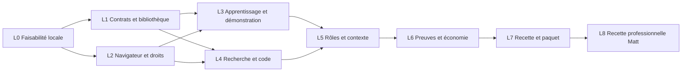

# Plan d’implémentation de la navigation documentée

Le plan livre la feature complète dans KerAI, avec son IHM et ses trois modes d’apprentissage. Il commence par les inconnues techniques qui pourraient remettre en cause l’architecture. Les agents, skills et scripts sont des éléments de livraison ; le fonctionnement dépend également de services hôtes, de données persistées et d’un processus navigateur.

## 1. Ordre et dépendances

L1 et L2 peuvent être réalisés en parallèle après stabilisation des contrats. L3 et L4 partagent le worker et ses types : attribuer un responsable unique à ces interfaces pour éviter les divergences. L’IHM est développée dans chaque lot, avec ses messages hôtes et sa persistance ; elle n’est pas laissée à la fin du chantier.

## 2. Lots de réalisation

### L0 Éprouver les choix sans Copilot

**But :** vérifier que l’observation externe, la démonstration et l’inspection sont réalisables sans ajouter quoi que ce soit à l’application cible.

- Créer une application synthétique dans les fixtures KerAI : authentification de test, deux états pour la même URL, onglets, dialogue, formulaire, chargement asynchrone, routes et sources disponibles ou absentes selon le cas.
- Éprouver un navigateur visible piloté par un worker Playwright, une démonstration enregistrée depuis une commande KerAI et un rejeu depuis un nouveau contexte.
- Éprouver pause/retrait de l'enregistreur, saisie suivie d'un clic immédiat, nouvelle frame, rechargement et fermeture avant acquittement ; toute perte doit être signalée. Tester une intervention humaine pendant une commande sans promettre son annulation rétroactive.
- Vérifier un relais humain/agent simulé avec arrêt confirmé, aucun overlay dans la cible et aucune modification des fichiers de l’application par l’outillage.
- Comparer des retours ciblés à des snapshots complets : volume transmis et temps local, sans annoncer un gain fournisseur.
- Tester l’inspection CSS/source et le packaging du worker extrait d’une archive sur les plateformes visées. Épingler le runtime retenu.

**Livrables IHM :** panneau expérimental de préparation et de contrôle de démonstration, diagnostic des prérequis. Ces éléments doivent servir de base aux composants définitifs.

**Sortie :** enregistrement/rejeu réel, limites supportées documentées, transport retenu, preuve que la V1 n’exige aucune instrumentation permanente de la cible. Si cette condition échoue, revoir la conception avant d’étendre les agents. Ce jalon reste une preuve technique locale.

### L1 Définir les contrats et la bibliothèque

- Ajouter les types navigation, états, révisions, contributions, binding et contexte figé ; valider les formats et leurs limites.
- Implémenter `NavigationStore`, transactions, concurrence, objets immuables, index reconstruisible, archivage et récupération.
- Ajouter la migration de sessions et les références de parcours ; préserver les données historiques.
- Implémenter la recherche locale initiale et l’édition humaine explicite, utilisables sans Copilot.

**Livrables IHM :** Applications, bibliothèque, recherche, fiche, paramètres, variantes, statuts et historique. Les corrections sont sauvegardées et rechargées réellement.

**Sortie :** AC-01, AC-09, AC-14 et partie stockage de AC-15/16 ; conflit de révision et crash pendant sauvegarde traités sans perte de l’original.

### L2 Piloter le navigateur avec des droits adaptés

- Implémenter profil d’application, association des dépôts, origine locale, préparation du navigateur et binding de serveur/worktree.
- Ajouter worker, IPC, sessions, baux, annulation, rôle déclaré, connexion manuelle et contrôle des domaines.
- Séparer droits code/navigateur/bibliothèque dans l’hôte et le catalogue. Ajouter le Navigateur avec catalogue fermé sans edit ni terminal.
- Fournir rejeu déclaratif, inspection et collecte des événements ; aucun appel IA interne pour un parcours connu.

**Livrables IHM :** préparation de l’application, connexion, état du navigateur, acteur actif, Arrêter et Reprendre la main ; messages actionnables en cas de prérequis absent.

**Sortie :** AC-02, AC-07, AC-13, AC-15 ; outils éditoriaux refusés aux rôles non propriétaires ; commandes d’un bail périmé refusées. Navigateur absent ou non installé ne provoque aucune installation silencieuse.

### L3 Livrer les trois modes d’apprentissage

- Description : contexte borné, recherche préalable, questions précises, limites de tentatives et sauvegarde de proposition.
- Import : format KerAI et sous-ensemble Chrome Recorder, aperçu, paramètres, incompatibilités et validation avant exécution.
- Démonstration : écouteurs temporaires sans modification de l’IHM cible, captures d’états, pause pendant connexion, consolidation des saisies, revue puis rejeu.
- Toutes les entrées utilisent les mêmes définitions, service de stockage, contrôles de droit et moteur.

**Livrables IHM :** Décrire, Importer, Montrer ; progression de l’import, liste des actions, valeurs à paramétrer, limites, Terminer/Annuler et statut après rejeu. Aucune étape manuelle omise silencieusement.

**Sortie :** AC-03 à AC-06 et AC-16. Sans Copilot, import et démonstration jusqu’au rejeu fonctionnent ; le parcours naturel est éprouvé par adaptateur simulé et sera validé avec un modèle réel en L8. Une édition explicite par Matt ne se fait pas passer pour une production du Navigateur.

### L4 Localiser le code avec peu de contexte

- Produire des inspections DOM/styles/réseau/sources ciblées, filtrées et paginées.
- Résoudre les pistes vers les projets et worktrees sélectionnés ; traiter source maps présentes/absentes et version d’application inconnue.
- Ajouter l’index d’ancres dérivé des livrables techniques et observations ; conserver provenance, hash, niveau candidat/corroboré et invalidation ciblée.
- Introduire recherche progressive et budgets ; permettre l’élargissement justifié vers des composants partagés et contrats serveur.

**Livrables IHM :** panneau « Écran et code » avec élément observé, fichiers candidats, raisons, fraîcheur, liens ouvrant les fichiers de la bonne racine et action pour charger davantage.

**Sortie :** AC-11, AC-13 et AC-14 ; faux candidat et source map incompatible détectés. Le test de localisation utilise des projets synthétiques aux noms volontairement ambigus ; l’absence de source map n’impose pas d’ajout à la cible.

### L5 Raccorder les rôles et les workflows

- Installer le profil Navigateur et les skills proposées sans écraser les profils personnels.
- Adapter Architecte (`fs-plan`), Dev, Testeur et recette visuelle ; présenter les différences du catalogue avant adoption.
- Ajouter recherche/sélection de parcours à la préparation, empreinte incluant révisions et binding, reprise figée et contribution au Navigateur.
- Préparer l’intervention du Navigateur à la demande, avec orchestration par `StudioService`, sans chemin d’exécution dans `DiscussionService` et sans sous-agent natif obligatoire.
- Le consommateur suspend sa tentative sur une demande de contexte manquant ; le service conserve son état et propose une intervention Navigateur selon le workflow autorisé. Si la réponse change le contexte figé, créer une nouvelle tentative liée et une nouvelle session runtime, sans réutiliser l'ancien `resumeSessionId`. Une reprise à contexte inchangé suit le mécanisme existant. Ne pas garder deux acteurs concurrents dans le même navigateur ou contourner un verrou workspace.

**Livrables IHM :** sélection des parcours dans le lancement, aperçu du contexte et de sa taille, état « Contexte à compléter », liste des contributions, acceptation d’une nouvelle révision. Les décisions humaines du workflow restent visibles.

**Sortie :** AC-08, AC-09, AC-11 et AC-12 avec adaptateurs locaux. Le workflow existant sans navigation reste fonctionnel ; les anciens kits ne gagnent pas de droits implicitement.

### L6 Intégrer preuves et mesure économique

- Collecter les captures et manifestes hôtes ; intégrer observations navigateur et comparaison avant/après au dossier de preuves.
- Ajouter métriques de phases, usages fournisseur optionnels, cache quand reçu, temps actif/attente et volumes locaux.
- Dédupliquer les événements sans doubler les snapshots existants ; préserver inconnus, interruptions et échecs.
- Ajouter journal de campagne et export agrégé privé ; intégrer la politique de conservation et les références de révision.

**Livrables IHM :** comparaison d’états, preuves liées aux critères, source/binding affichés, coûts d’apprentissage/exploitation/entretien et couverture des mesures.

**Sortie :** AC-12, AC-18 et tests d’agrégation. Une simulation ne fait apparaître aucun gain présenté comme mesuré sur Copilot. Une preuve d’exécution ne valide pas automatiquement un critère humain.

### L7 Vérifier et fournir le candidat complet

- Exécuter la recette fonctionnelle des trois entrées, de tous les rôles, des annulations, reprises et erreurs avec vrais navigateurs locaux et transport modèle simulé.
- Vérifier les thèmes, clavier, focus, fenêtres étroites et persistance après réouverture ; fournir les captures IHM de KerAI à Matt pour validation visuelle.
- Construire et extraire le VSIX, vérifier le worker/runtime réellement distribués, puis lancer une instance VS Code isolée sur les plateformes prévues.
- Fournir guide de démarrage, exemple portable synthétique, limites, procédure de désactivation et recette professionnelle pas à pas.

**Livrables IHM :** parcours complet sans écrans factices, diagnostics lisibles et état exact de validation. La démonstration intégrée est présente.

**Sortie :** critères locaux AC-01 à AC-18 satisfaits dans leur périmètre. Le paquet est un candidat à la recette Copilot ; aucune publication ou installation sur le PC professionnel n’est impliquée par sa construction.

### L8 Recette professionnelle par Matt

Matt installe le candidat selon ses règles professionnelles, choisit une application locale et un corpus autorisé, puis suit le [protocole d’évaluation](PROTOCOLE-EVALUATION.md). Cette étape confirme ou réfute compatibilité réelle, qualité des parcours et économies. Elle ne nécessite pas de transférer le code ou les données professionnels vers le PC personnel.

**Sortie :** décisions séparées sur compatibilité Copilot, utilité métier, économie et ouverture à d’autres environnements. Les correctifs issus de cette recette entraînent une nouvelle révision identifiée et une vérification ciblée. Aucune économie n’est annoncée avant ses mesures.

## 3. Carte des changements

| Nature              | Emplacements proposés ou existants                                                                                                                             | Contenu                                                                               |
| ------------------- | -------------------------------------------------------------------------------------------------------------------------------------------------------------- | ------------------------------------------------------------------------------------- |
| Types et validation | Nouveaux `src/shared/navigation.ts`, `src/core/navigationSchemas.ts`, adaptations `types.ts`, `store.ts` et `host/messages.ts`                                 | Contrats stricts, migration et messages                                               |
| Hôte                | Nouveaux `NavigationService`, `NavigationStore`, `NavigationTools`, `NavigationSearch`, `NavigationContext`                                                    | Propriété, transactions, recherche, contexte et orchestration                         |
| Navigateur          | Nouveaux `BrowserSessionManager`, `NavigationRecorder`, `ChromeRecorderImport`, `NavigationReplay`, worker dédié                                               | Contrôle, démonstration, conversion et exécution                                      |
| Analyse             | Nouveaux `BrowserInspection`, `CodeAnchorIndex` ; intégration `WorkspaceExplorer`                                                                              | Inspections et indices techniques ciblés                                              |
| Adapter             | `CopilotCliAdapter.ts`, `NativeCopilot.ts`, contrats de callbacks                                                                                              | Catalogue exact, capacités et comptabilité                                            |
| Preuves             | `shared/proofs.ts`, `QualityRunner.ts`, `ProofTools.ts` et contrats associés                                                                                   | Observations navigateur, pièces et fraîcheur                                          |
| IHM                 | Nouveaux composants Applications, parcours, démonstration, inspection et comparaison ; `Navigation.tsx`, `ExecutionUI.tsx`, `StudioUI.tsx`, `ProofDossier.tsx` | Vues utilisables, messages, reprise et validation                                     |
| Agents et skills    | `defaults/agents`, skills du kit et workflows concernés                                                                                                        | Nouveau propriétaire et méthodes des consommateurs                                    |
| Scripts             | `scripts/build.mjs`, contrôles d’archive, préparation navigateur et recette                                                                                    | Worker distribuable, version épinglée, aucun script installé dans l’application cible |
| Tests               | Tests de contrats, stockage, runtime simulé, fixtures applicatives et parcours UI/navigateur                                                                   | Preuves locales sans compte fournisseur                                               |
| Documentation       | Guide Applications, fiche compatibilité et protocole                                                                                                           | Usage réel, limites, erreurs et entretien                                             |

Les noms des nouveaux modules sont une proposition d’organisation. Garder les responsabilités séparées sans concentrer tout le moteur dans `StudioService` ou l’IHM dans un seul composant.

## 4. Risques et décisions de passage

| Risque                                                                    | Décision de passage                                                                                        |
| ------------------------------------------------------------------------- | ---------------------------------------------------------------------------------------------------------- |
| Démonstration nécessitant des API privées ou une modification de la cible | Stop L0 ; choisir une autre réalisation publique ou rendre la limite explicite avant développement complet |
| Droits en lecture seule permettant encore un edit/terminal non prévu      | Stop L2/L5 ; corriger le catalogue effectivement offert                                                    |
| Ancres fiables seulement sur une démo préinstrumentée                     | Stop L4 ; vérifier le mode sans source map ni attribut ajouté                                              |
| VSIX incapable de démarrer le worker sur le poste visé                    | Stop L7 ; pas de déclaration de feature distribuable                                                       |
| Parcours qui s’adaptent silencieusement pour faire passer les tests       | Stop recette ; séparer version du parcours et critères                                                     |
| Gains obtenus seulement en excluant apprentissage, entretien ou échecs    | Conclusion économique invalide ; reprendre la mesure                                                       |
| Copilot absent du PC personnel                                            | Continuer L0–L7 ; conserver L8 comme validation réelle à réaliser par Matt                                 |

Les inconnues principales sont l’enregistreur sans modification de cible, les droits réellement disponibles dans le runtime et la qualité du lien écran–code. Une estimation calendaire ferme avant L0 serait peu fiable. L1 à L7 constituent un chantier produit substantiel, pas une simple livraison de profils d’agents.
