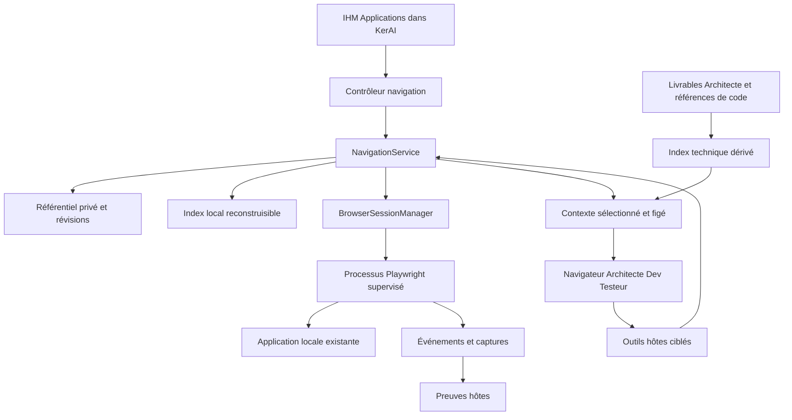

# Spécifications techniques de la navigation documentée

Cette proposition s’appuie sur KerAI 1.28.0, commit `7ba422c8de2c6640c220b2f0632c07da9d7576c8`, inspecté le 23 octobre 2026. Elle ajoute des services hôtes et un processus navigateur à l’architecture existante. Les noms de modules proposés ne désignent pas des composants déjà livrés.

## 1. État existant et points d’intégration

| Existant vérifié                                                                                                                                        | Réutilisation ou adaptation                                                                                         |
| ------------------------------------------------------------------------------------------------------------------------------------------------------- | ------------------------------------------------------------------------------------------------------------------- |
| [`StudioService`](../../../src/host/StudioService.ts), `prepareInput`, `executeRun`                                                                     | Préparation, empreinte, contexte figé, interruptions, questions et preuves                                          |
| [`promptSections`, `previewContext`](../../../src/core/context.ts)                                                                                      | Ajouter des blocs de navigation ciblés et leurs révisions à l’empreinte ; conserver le compilateur sans appel IA    |
| [`MemoryEntry`](../../../src/shared/evolutions.ts)                                                                                                      | Ne pas y placer toute la bibliothèque : `agentIds` filtre les lecteurs, il n’assure pas une propriété éditoriale    |
| [`Store`](../../../src/core/store.ts)                                                                                                                   | Schéma courant **10**, sessions immuables hashées ; migration nécessaire pour les nouveaux champs persistés         |
| [`ProjectCatalog.storage`](../../../src/host/ProjectCatalog.ts)                                                                                         | Racine privée par projet, hors dépôt ; catalogue de projets version 1                                               |
| [`CopilotCliAdapter`](../../../src/host/CopilotCliAdapter.ts)                                                                                           | Enregistrement et vérification du catalogue effectif, callbacks, usages, reprise et confinement des nouveaux outils |
| [`NativeCopilot`](../../../src/host/NativeCopilot.ts), [`McpRuntime`](../../../src/host/McpRuntime.ts)                                                  | Droits natifs et contrôle des outils ; séparer les capacités code, navigateur et bibliothèque                       |
| [`WorkspaceExplorer`](../../../src/host/WorkspaceExplorer.ts)                                                                                           | Recherche locale bornée et paginée pour trouver et vérifier le code candidat                                        |
| [`QualityRunner`](../../../src/host/QualityRunner.ts), [`proofDossier`](../../../src/shared/proofs.ts)                                                  | Principes de collecte réelle, empreintes, médias privés et distinction observation/affirmation/validation           |
| [`Images`](../../../src/host/Images.ts)                                                                                                                 | Transmission visuelle à la demande, après vérification de la capacité du modèle                                     |
| [`SessionArchive`](../../../src/host/SessionArchive.ts)                                                                                                 | Journaux bornés, provenance et traces d’interruption                                                                |
| [`Usage`](../../../src/shared/types.ts), [`budgets`](../../../src/core/budgets.ts)                                                                      | Déduplication, champs inconnus, contrôle avant nouvel appel ; ajouter attribution et métriques complémentaires      |
| [`ExecutionUI`](../../../webview/ExecutionUI.tsx), [`Navigation`](../../../webview/Navigation.tsx), [`ProofDossier`](../../../webview/ProofDossier.tsx) | Préparation, nouvelle entrée Applications, contexte, preuves et comparaison                                         |

Deux obstacles doivent être corrigés explicitement. En natif, `nativeReadOnly` ou le droit `documentation` retire actuellement tous les MCP ; à l’inverse, `step.policy: read-only` ne réduit pas à lui seul le catalogue natif normal, qui comprend écriture et terminal. Le filtre des outils métier dans `CopilotCliAdapter` doit aussi reconnaître les nouvelles capacités. Une simple modification des prompts ne suffit donc pas.

## 2. Architecture proposée

**T-01 — Autorité de l’hôte.** Le Navigateur est le propriétaire éditorial ; `NavigationService` est le seul chemin d’écriture applicatif du référentiel. Les autres rôles soumettent des contributions. L’identité et les capacités viennent de la tentative résolue par l’hôte, jamais d’un `agentId` déclaré dans les arguments d’un outil.



**T-02 — Playwright derrière des outils ciblés.** Choix proposé : bibliothèque Playwright dans un processus supervisé, avec commandes déclaratives et retours bornés. Les appels de rejeu s’exécutent sans modèle. L’inspection approfondie Chromium utilise des commandes DevTools encapsulées lorsque nécessaire. Aucun endpoint générique d’exécution JavaScript n’est exposé au modèle ou à un JSON importé.

Un MCP Playwright brut n’est pas le contrat central retenu : il ne fournit pas la propriété éditoriale, le format des parcours, la collecte métier ni les limites de contexte propres à KerAI. La documentation officielle distingue elle-même les compromis de coût entre MCP riche et commandes ciblées ; ce constat motive un prototype comparatif, il ne prouve aucun gain pour KerAI. [Playwright MCP](https://github.com/microsoft/playwright-mcp#playwright-mcp-vs-playwright-cli).

L0 comparera le worker et une invocation CLI structurée pour vérifier coût d’intégration, packaging et qualité des sorties. Une substitution de transport reste possible derrière le même contrat ; elle ne change ni les droits, ni les données, ni les exigences IHM. Aucun second pilote MCP ne doit contrôler simultanément le contexte géré.

**T-03 — Aucune instrumentation permanente de la cible.** Le worker observe le navigateur existant. L’enregistreur utilise des écouteurs temporaires installés dans les pages du contexte, sans élément DOM, style, barre ou surcouche ajouté à l’application. Ses commandes sont affichées exclusivement dans KerAI. Aucun fichier du projet cible n’est écrit pour installer l’outillage. Des restrictions empêchant cette observation produisent une incompatibilité explicite ; aucun contournement des politiques du poste n’est prévu.

## 3. Modèle de données

Les définitions sont déclaratives, validées par Zod et versionnées. Les identifiants sont opaques ; une URL n’est jamais une clé primaire.

| Entité                    | Champs et responsabilités principales                                                                                                                                     |
| ------------------------- | ------------------------------------------------------------------------------------------------------------------------------------------------------------------------- |
| `ApplicationProfile`      | `id`, nom, `projectIds`, origine locale, procédure de démarrage facultative approuvée, référence d’authentification, politique d’interaction, Navigateur désigné, limites |
| `ExecutionBinding`        | `appId`, projets, chemins canoniques d’exécution, worktree, commit et état dirty, origine/port, instance serveur, build connu ou inconnu, degré de vérification et motif  |
| `ScreenState`             | Identité fonctionnelle, chemin indicatif, rôle/prérequis, conditions observables, paramètres d’affichage ; aucune image comme unique vérification                         |
| `NavigationRecipe`        | Identité stable, intention, états initial/cible, tags, paramètres, références de variantes et révision courante                                                           |
| `RecipeRevision`          | Numéro, hash, parent, étapes, contraintes, provenance description/import/démonstration, auteur résolu par l’hôte, références des observations et décisions                |
| `NavigationStep`          | Action autorisée, cible sémantique, frame/tab contrôlés, valeur ou paramètre, postconditions, délai maximum, classe d’effet métier                                        |
| `NavigationContribution`  | Parcours/révision concernés, observation, proposition, source de tentative, pièces associées, état de traitement ; aucune mutation de recette                             |
| `NavigationRun`           | Révision exacte, intention atteindre/reproduire, binding, contexte navigateur, paramètres filtrés, événements, résultats des conditions, preuves, état final              |
| `NavigationContextPacket` | Références immuables sélectionnées, extraits, indices techniques, fraîcheur, binding attendu, budget et omissions ; hash incorporé au lancement                           |
| `CodeAnchor`              | Référence à un livrable technique, observation écran/réseau/source, projet, chemin relatif, symbole/plage, hash du fichier lu, niveau candidat/corroboré et motifs        |
| `BrowserLease`            | Contexte, acteur humain/tentative, génération, expiration, commande en cours et état d’arrêt                                                                              |
| `NavigationMetric`        | Événements locaux d’action et volumes ; références des consommations fournisseur, phase, identités de déduplication et couverture                                         |

**T-04 — Séparer définition et exécution.** Un succès est inscrit dans un `NavigationRun`, jamais déduit du texte de la recette. Les statuts de publication, preuve et fraîcheur sont trois axes séparés. La fraîcheur peut être calculée pour un binding précis sans réécriture par un agent du texte canonique.

Appliquer la transition de F-08 dans le service : brouillon à la création ; disponibilité après validation structurelle, résolution des prérequis et rejeu réussi de cette définition avec conditions d’arrivée vérifiées. Un rejeu de brouillon n’est autorisé qu’en mode de vérification explicite par le propriétaire ou l’humain. `commit` accepte une capacité d’auteur Navigateur dans sa mission déjà autorisée, ou une commande UI humaine dédiée ; il ne demande pas au modèle de déclarer son identité. Conserver auteur, autorisation, diff et identifiant du rejeu. Une création humaine sans Copilot est un chemin complet, pas une attribution simulée au Navigateur.

Les références du paquet participent à l’empreinte de `previewContext`. Tout changement incompatible de révision, paramètres, binding ou droits crée une nouvelle tentative liée à la précédente et une nouvelle session runtime, sans réutiliser son `resumeSessionId`. Les fichiers modifiés et les preuves antérieures sont conservés. Un contexte inchangé peut suivre la reprise habituelle ; le renouvellement d’un bail ne suffit pas à autoriser un changement de contexte.

**T-05 — Variantes et paramètres.** Les valeurs métier réutilisables sont des paramètres typés. Les différences d’état ou de chemin significatives créent des variantes explicites. La V1 stocke une révision résolue autonome par variante, avec son lien de filiation ; aucun héritage récursif ou graphe arbitraire de scripts à déboguer. Les fragments communs éventuels sont copiés avec provenance, sans mise à jour implicite des consommateurs.

Les secrets sont des références hôtes, jamais des valeurs sérialisées dans la recette. Les identifiants de données peuvent être privés ou remplacés par des valeurs synthétiques à l’export. Une ancienne révision reste accessible tant qu’une session ou une preuve la référence.

## 4. Stockage et migrations

**T-06 — Référentiel distinct de la mémoire générale.** Sous la racine privée du projet principal fournie par `ProjectCatalog.storage`, créer un espace `navigation/` :

```text
navigation/
  catalog.json                  # format navigationVersion: 1, applications et têtes
  revisions/<sha256>.json        # contenus immuables
  contributions/<id>.json
  runs/<id>/manifest.json
  runs/<id>/events.jsonl
  objects/<sha256>               # captures et artefacts autorisés
  indexes/                      # recherche et ancres dérivées, reconstruisibles
  pending/                      # transactions incomplètes et récupération
```

Écritures ordonnées, verrou interprocessus, fichiers temporaires puis renommage atomique, contrôle `expectedRevision` et reprise après crash. Un commit de révision publie l’objet avant de changer la tête du catalogue. Les événements incomplets sont marqués comme tels. Les index peuvent être reconstruits sans IA à partir des définitions valides. Les pièces ne sont collectées qu’après vérification de toutes les références conservées.

Les profils de navigateur sont dans un espace privé séparé, jamais dans les exports, les objets de preuve ou le dépôt. Les clés simples utilisent les mécanismes de secrets hôtes ; le profil navigateur reste une donnée sensible locale, protégée par les droits du compte, sans promesse de chiffrement applicatif universel.

Les sessions ne conservent que les références de révision, binding, contexte figé et preuves nécessaires. Une migration **10 → 11** est proposée si 10 est encore la version courante au début du développement. Elle est additive, préserve les sessions historiques et désactive les nouvelles capacités par défaut. Rebaser le numéro si une autre migration a précédé. Version inconnue ou données invalides : refus explicite et original conservé. Aucun rollback destructif.

## 5. Recherche et réduction du contexte

**T-07 — Retrieval local déterministe.** Indexer intentions, titres, états, tags, rôles, routes normalisées et références techniques corroborées. Classer par compatibilité application/rôle/état, correspondance lexicale et fraîcheur expliquée. Aucun embedding, crawl intégral ni appel de résumé obligatoire en V1. Un résultat ambigu reste ambigu.

La recherche s’effectue en niveaux :

1. Jusqu’à cinq résumés avec identifiants, prérequis, motifs de pertinence et statut.
2. Chargement du parcours retenu et des conditions d’arrivée ; les étapes de rejeu restent côté moteur si le modèle n’a pas besoin de toutes les lire.
3. Inspection d’une zone ou d’un élément, des quelques styles ou requêtes concernés.
4. Recherche ciblée dans les fichiers/symboles candidats avec `WorkspaceExplorer`, puis lecture exacte des portions et dépendances utiles.
5. Élargissement explicite en cas d’absence, contradiction ou impact partagé ; jamais de blocage artificiel empêchant une analyse correcte.

**T-08 — Budgets initiaux proposés.** Résultats de recherche : 6 000 caractères au total. Paquet de navigation sélectionné : 12 000 caractères. Une observation textuelle : 6 000 caractères, avec pagination et indication de troncature. Rejeu : 80 étapes maximum, 180 secondes au total, 15 secondes par attente ; exploration agent : 30 actions avant point de contrôle. Deux échecs sans progrès sur la même cible déclenchent une demande contextualisée.

Ces valeurs sont configurables et seront ajustées au pilote. Elles s’appliquent en plus de la limite globale de contexte existante, pas à sa place. Les 4 000 caractères de mémoire générale restent distincts. Les conversions caractères/tokens ne sont que des estimations ; aucun pourcentage d’économie n’en est déduit.

Les captures sont conservées hors prompt et jointes uniquement lorsque la question visuelle le demande, avec les contrôles `Images` existants. Les schémas d’outils, réinjections d’historique et retours navigateur entrent aussi dans la mesure fournisseur. Aucun « résumé automatique » gratuit supposé.

## 6. Outils hôtes et contrats d’accès

| Outil proposé                  | Entrée utile                                      | Résultat borné / effets                                                                                                        |
| ------------------------------ | ------------------------------------------------- | ------------------------------------------------------------------------------------------------------------------------------ |
| `studio_navigation_search`     | Application, intention, contraintes               | Candidats et motifs ; aucun navigateur ni modèle lancé                                                                         |
| `studio_navigation_context`    | Identifiant, révision, projection demandée        | Définition/extraits et fraîcheur ; pas de changement de tête                                                                   |
| `studio_navigation_replay`     | Révision, binding, paramètres, mode               | Exécution autorisée, état, références de preuves ; sans appel modèle interne                                                   |
| `studio_navigation_contribute` | Observation liée à une tentative                  | Contribution en attente, sans édition de recette                                                                               |
| `studio_navigation_propose`    | Définition candidate et provenance                | Brouillon validé ; réservé au Navigateur                                                                                       |
| `studio_navigation_commit`     | Brouillon, révision attendue                      | Nouvelle révision publiée par l’hôte ; réservé au Navigateur et aux commandes humaines explicites de création ou de correction |
| `studio_browser_inspect`       | Session, cible, catégorie DOM/style/réseau/source | Observation filtrée ; fonctions inspectées prédéfinies, pas de code libre                                                      |
| `studio_browser_act`           | Session et action déclarative                     | Action autorisée et postcondition, événement ; aucune écriture documentaire                                                    |
| `studio_browser_capture`       | Session, cible ou viewport                        | Preuve image hôte et métadonnées, pas une affirmation de réussite                                                              |

Les opérations UI d’import, d’enregistrement, de reprise de main et de suppression ont des messages hôtes dédiés ; elles n’exigent pas de modèle. L’import UI produit une proposition, pas une révision prétendument rédigée par le Navigateur.

**T-09 — Capacités orthogonales.** Définir `codeAccess`, `browserAccess` et `navigationAccess` sur le contexte hôte figé. Navigateur : aucun edit ni shell, exploration navigateur autorisée, auteur de parcours. Architecte : lecture code et inspection/interactions autorisées, lecteur/contributeur. Dev : droits code prévus par le workflow, navigateur autorisé, lecteur/contributeur. Testeur : chemins et exécutions de tests autorisés, navigateur, lecteur/contributeur. Une tentative sans attribution du rôle propriétaire ne peut appeler les outils éditoriaux, même avec un nom d’agent usurpé.

Adapter catalogue natif, `availableTools`, custom agent, hooks, callbacks et vérification de provenance. Les nouveaux outils hôtes ne sont pas réintroduits par un joker MCP. Conserver les garanties du mode Studio historique et les permissions natives sélectionnées ; une capacité indisponible bloque son activation avant le prompt, avec diagnostic.

Avant chaque action et chaque étape de rejeu, le handler hôte contrôle origine, bail, état attendu, paramètres et politique d’interaction, puis seulement transmet au worker. Les outils hôtes actuels utilisent `skipPermission` : ces contrôles ne peuvent pas dépendre implicitement d’un dialogue du runtime. La classe d’effet fournie par un modèle ou un import est une indication non fiable, jamais une permission. Une autorisation peut couvrir un parcours identifié et ses paramètres, sans confirmation répétée à chaque clic ; une action non couverte demande un accord précis ou est refusée suivant le profil. Le système ne prétend pas déduire tous les effets serveur d’un clic.

La propriété éditoriale est contrôlée par les API et le catalogue. Elle n’est pas une sandbox OS contre un processus arbitraire lancé sous le même compte. Un Dev disposant d’un terminal général peut dépasser les protections de chemins d’un simple service : cette limite doit rester explicite, sans présenter le stockage hors dépôt comme inviolable. Les altérations détectées sont refusées ou mises en quarantaine.

## 7. Sessions navigateur et liaison à l’application

**T-10 — Processus supervisé.** `BrowserSessionManager` pilote un worker séparé par protocole IPC typé : identifiant, génération du bail, commande autorisée, limites, événements et résultat. Pas de port de contrôle ouvert sans nécessité, pas de commande shell issue d’une page. Le worker ne reçoit pas de droit d’écriture sur le catalogue et ne publie pas de révision.

Un contexte possède un seul acteur actif. La machine d’état distingue `idle`, `agent`, `recording`, `human`, `stopping`, `interrupted`, `closed`. Toute action porte la génération du bail ; les commandes tardives d’un ancien propriétaire sont refusées. La reprise humaine attend l’accusé d’arrêt. Après crash, préserver le journal et réclamer une reprise explicite. Une recette repart dans un contexte défini et ne réutilise pas implicitement les modifications temporaires d’une session Dev.

Le bail exclut les commandes gérées concurrentes, pas les gestes physiques sur le navigateur visible. Une reprise de main stoppe l'émission de nouvelles commandes et attend ou annule de façon bornée celle en cours ; son résultat peut rester incertain. Une interaction externe détectée invalide l'observation courante et impose un nouveau contrôle avant poursuite. Aucun overlay bloquant ni interception de l'IHM cible ne sert à prétendre verrouiller l'utilisateur ; un effet déjà produit ne peut être révoqué par l'annulation.

**T-11 — Binding vérifiable sans modifier l’application.** L’origine locale et les racines de code sont déclarées dans le profil. Si KerAI lance le serveur par une commande approuvée, il conserve cwd canonique, PID, port et identité d’exécution. S’il attache un serveur existant, il vérifie les éléments accessibles et demande l’association des dépôts ; cette déclaration n’équivaut pas à une preuve du build servi. Exploiter un endpoint de version déjà présent ou des hashes de ressources si disponibles, sans en exiger l’ajout. Processus et port seuls ne prouvent pas que les bundles chargés correspondent au dernier code sauvegardé.

La V1 suppose navigateur, hôte et application sur le même poste. SSH/WSL/conteneurs et navigateur distant ne sont pas certifiés par cette hypothèse ; détecter ces situations et expliquer la limite. Les worktrees doivent conserver leur propre binding d’instance et de port.

Les origines applicatives autorisées sont explicitement déclarées, locales par défaut. Un fournisseur d’authentification externe est une exception de connexion manuelle avec capture suspendue. Les popups et frames restent attachées à une origine et une session vérifiées. Aucun profil personnel existant n’est importé par défaut.

## 8. Enregistreur intégré et import

**T-12 — Enregistrement sans modifier l’IHM cible.** Utiliser les API publiques de contexte pour installer temporairement les écouteurs et remonter les événements avec leur page/frame d’origine. `addInitScript` et `exposeBinding` fournissent ces primitives ; ils ne constituent pas à eux seuls un enregistreur complet. La réalisation et les limites doivent être validées en L0. [API BrowserContext](https://playwright.dev/docs/api/class-browsercontext).

Enregistrer les intentions : clic sur cible unique, remplissage consolidé à la fin de l’édition, choix, case à cocher, touche utile et défilement nécessaire. Ne pas conserver chaque frappe ni les mouvements de souris. Les champs de mot de passe et phases d’authentification sont exclus avant transfert des valeurs. Les autres valeurs potentiellement métier deviennent des paramètres ou demandent revue. Les sources URL, titres, journaux et captures suivent la même politique de données.

L'origine de chaque page/frame et la phase d'authentification sont contrôlées **avant lecture d'une valeur**, puis de nouveau avant transfert et à réception hôte. Sur popup, iframe ou redirection non autorisée, la capture reste désactivée ; une image contenant une zone non autorisée est refusée ou cette zone est occultée dans l'artefact sans modification de l'IHM cible. Aucun journal, brouillon ou prompt ne doit recevoir ces valeurs avant masquage.

L'enregistreur s'active pour une génération précise. Pause et arrêt désactivent d'abord la capture, retirent les écouteurs et vident les événements déjà autorisés selon numéros de séquence et acquittements. Les nouvelles pages/frames démarrent désactivées jusqu'au contrôle hôte. Ne pas supposer qu'un script de contexte peut être retiré intégralement sur toutes les versions : si son inactivité ne peut être garantie, fermer le contexte et repartir d'un contexte propre. Une perte avant acquittement est marquée comme interruption/incomplétude, jamais ignorée. Tester saisie suivie d'un clic immédiat, rechargement pendant émission et fermeture avant acquittement.

Les événements reçus de la page sont non fiables : vérifier session, frame, bail, schéma, taille, séquence et vraisemblance par observation worker. Une page ne peut publier un parcours ni certifier qu’une action humaine a eu lieu en appelant le binding. Les événements natifs et l’état observé servent à corroborer la proposition ; seul un rejeu indépendant établit sa reproductibilité.

Préférer les identifiants de test **existants**, puis noms accessibles, labels et rôle dans un conteneur identifié, enfin sélecteurs structurels vérifiés uniques. Aucun ajout d’attribut dans le code cible. Signaler les cibles fragiles, les ambiguïtés et les coordonnées non sémantiques. Les frames standard et l’ouverture d’un nouvel onglet doivent être testées ; les composants non observables deviennent des étapes manuelles identifiées.

**T-13 — Import fermé et explicable.** Parseur de JSON borné, validation de structure et version, projection vers les mêmes actions déclaratives. Support initial : navigation locale, viewport, clic, changement de valeur, touches usuelles, scroll et conditions élémentaires de présence/visibilité. Mapper les sélecteurs supportés et les paramètres ; montrer toute perte de sémantique. Ne jamais ignorer un type inconnu, `waitForExpression`, JavaScript incorporé, téléchargement ou opération système. Le format Recorder prévoit des expressions JavaScript : elles ne sont pas exécutées par cet importeur. [Référence Chrome Recorder](https://developer.chrome.com/docs/devtools/recorder/reference).

Valeurs proposées : fichier 2 Mio, 80 étapes, profondeur JSON 20, chaînes 4 000 caractères. Les bornes sont contrôlées avant allocation non maîtrisée. L’original filtré peut être conservé comme provenance ; le fichier brut sensible n’est pas copié automatiquement dans les archives. La documentation lisible est générée depuis la définition canonique, avec les notes explicitement saisies ; aucun deuxième Markdown divergent à maintenir.

## 9. Inspection et correspondances avec le code

**T-14 — Inspections bornées.** DOM/accessibilité limité à la cible et ses voisins ; dimensions et styles calculés sélectionnés ; règles CSS applicables ; console filtrée ; métadonnées de requêtes et initiateurs. Corps réseau, cookies, en-têtes d’authentification et grands bundles ne sont pas retournés par défaut. Les captures et réponses détaillées se demandent séparément. L’inspection approfondie via CDP impose Chromium, ce qui motive le périmètre navigateur initial. [Session CDP via Playwright](https://playwright.dev/docs/api/class-browsercontext#browser-context-new-cdp-session).

**T-15 — Localisation progressive.** Une observation de route, règle CSS, libellé ou endpoint devient une piste. L’Architecte confronte la piste au dépôt choisi et peut utiliser les source maps servies pour remonter aux fichiers originaux. Leur absence n’est pas une erreur de configuration imposant une modification du projet. [Source maps](https://developer.chrome.com/docs/devtools/javascript/source-maps).

Le résolveur vérifie le chemin relatif dans un dépôt autorisé, le fichier réellement lu, sa révision et la relation disponible avec le bundle. Une source map, son chemin et son `sourcesContent` sont des données non fiables, pas une permission d’accès à n’importe quel fichier. Le code backend est recherché à partir des contrats/API ; il n’est pas déclaré visible parce que le navigateur connaît l’endpoint.

Les `CodeAnchor` sont une projection des livrables et observations techniques référencés, reconstruite par l’hôte. L’Architecte demeure responsable du diagnostic ; le Navigateur n’est pas chargé d’interpréter le code. Cet index n’autorise pas l’Architecte à modifier un parcours. Les ancres candidates sont présentées comme telles ; une approbation humaine du plan ne remplace pas une preuve technique de correspondance.

**T-16 — Invalidation sélective.** Recalculer l’état des ancres lorsque leurs fichiers, bundles ou binding changent. Un simple numéro de commit nouveau ne détruit pas toutes les connaissances. Un changement dans une dépendance non connue laisse une incertitude : un contrôle d’arrivée et, pour la recette, un rejeu réel restent nécessaires. Ni TTL ni hash partiel ne garantissent l’ensemble de l’application.

## 10. Preuves, consommation et conservation

**T-17 — Reçus hôtes.** Chaque capture est collectée par le worker, puis importée par l’hôte avec contrôle de type, taille, chemin et SHA-256. Métadonnées : run, tentative, acteur, recette/révision, étape, état, horodatage, URL filtrée, viewport, navigateur, binding et version connue/inconnue. Un chemin écrit dans le texte d’un outil ne suffit pas. Adapter `ProofEntry` avec une provenance navigateur explicite et une pièce jointe résolue côté hôte.

Proposition de bornes initiales : 16 Mio par média et 64 Mio par exécution, alignées sur les principes de `QualityRunner` ; quota projet 512 Mio configurable. Signaler une collecte incomplète. Nettoyer les objets non référencés selon une politique visible ; ne jamais supprimer silencieusement une preuve encore attachée. L’authentification reste exclue de ce quota et de ces objets.

Les captures avant/après identifient la même recette, les paramètres, le viewport et les différences de build attendues. Un test réussi, une observation et l’acceptation humaine restent trois choses distinctes. Le panneau permet de voir une divergence sans demander au modèle une analyse d’image systématique.

**T-18 — Comptabilité complète.** Étendre les métriques avec phase apprentissage/recherche/analyse/développement/recette/entretien, tokens de cache et durée quand le runtime les fournit. Garder l’identité comptable de l’événement et les snapshots cumulés actuels. Le registre d’expérience est une projection des mêmes événements : ne pas l’ajouter une seconde fois aux totaux de session. Un appel mêlant plusieurs activités reste non ventilé ou partiel, jamais réparti par une estimation présentée comme exacte.

Mesurer séparément nombre d’actions, recherches, octets/extraits remis au modèle, captures jointes, durée active et attente humaine. Les appels du Navigateur, de réparation, d’annulation et de revue participent au total. Les garde-fous avant nouvel appel ne sont pas un plafond financier dur au milieu d’un appel. Les unités restent celles reçues du fournisseur. Voir le [protocole](PROTOCOLE-EVALUATION.md).

## 11. Catalogue, skills, scripts et packaging

**T-19 — Catalogue utilisateur conservé.** Fournir un profil `fs-navigator` proposé, attribuable comme auteur d’une application, sans écraser les personnalisations. Adapter les profils livrés `fs-plan`, `fs-dev`, `fs-tests` et `fs-visual-tests` avec un aperçu des changements. Les identités métier Architecte et Testeur ne nécessitent pas de dupliquer les agents existants. Un kit explicite rassemble les instructions et dépendances ; l’installation ne démarre ni navigateur ni appel fournisseur.

Skills proposées : `navigation-discovery`, `navigation-context`, `screen-code-analysis`, `navigation-verification`. Elles portent les méthodes, les règles de preuve et les formats de compte rendu. Le moteur de rejeu, l’enregistreur, les migrations et la mesure ne sont pas des skills. Les tâches Navigateur passent par le service d’exécution existant ; `DiscussionService` reste consultatif et ne devient pas une voie d’exécution parallèle.

**T-20 — Runtime distribuable.** Playwright Test est actuellement une dépendance de développement et le VSIX est produit avec `--no-dependencies`. Ajouter un runtime Playwright de version exacte, un worker construit séparément et les assets requis à l’archive ne se résume donc pas à ajouter un import. La version précise est sélectionnée et épinglée après L0 ; aucun `latest` au lancement.

Le navigateur est préparé sur action humaine explicite, dans un espace dédié à la version du runtime, ou un exécutable Chromium déjà autorisé est sélectionné et éprouvé. Aucun téléchargement silencieux, aucune installation dans l’application cible. Si le poste professionnel interdit le lancement ou le téléchargement, l’IHM expose ce prérequis sans contourner sa politique. Le packaging vérifie la présence réelle du worker, des modules et des fichiers de support après extraction du VSIX sur Windows/macOS.

## 12. Validation et limites

Les contrats sont testés avec un transport Copilot simulé et un vrai navigateur sur une application locale synthétique. Vérifier les migrations, droits, catalogues, demandes humaines, trois modes d’entrée, annulation, confidentialité des exports, rejeu et preuves. Un test de CLI utilisant un fournisseur local déterministe peut compléter cette preuve si disponible, mais il ne démontre pas le fonctionnement du compte Copilot professionnel.

La recette réelle de Matt vérifie catalogue effectivement offert, appels d’outils, permissions, sources utilisées, usages et résultats dans le VSIX installé. Tant qu’elle n’est pas réalisée, le statut demeure « Validé localement ; intégration Copilot à confirmer ». Aucune économie fournisseur n’est déduite des fixtures.
